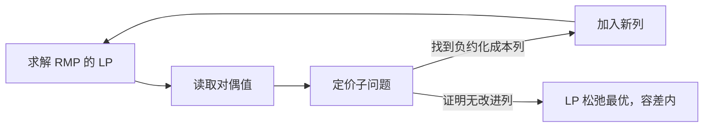

---
tags:
  - 建模
  - 写作规范
---

# 公式、伪代码与代码写作规范

一段模型说明应同时给出公式、变量、直觉和适用条件。算法先用伪代码说明流程，再用求解器代码展示接口；运行结果另按[实验规范](./实验规范.md)记录。

## 公式：以 VRPTW 时间传递为例

只考虑客户间的弧 $(i,j)$，令服务开始时间满足 $e_i\le b_i\le l_i$。选用弧时需要满足

$$
b_j \ge b_i+s_i+t_{ij}-M_{ij}(1-x_{ij}),
\qquad M_{ij}=\max\{0,l_i+s_i+t_{ij}-e_j\}.
$$

| 符号 | 含义 |
| --- | --- |
| $b_i$ | 客户 $i$ 的服务开始时间 |
| $[e_i,l_i]$ | 客户 $i$ 的服务开始时间窗 |
| $s_i$ | 在客户 $i$ 的服务时长 |
| $t_{ij}$ | 从客户 $i$ 到 $j$ 的行驶时间，与行驶成本分别定义 |
| $x_{ij}\in\{0,1\}$ | 是否使用弧 $(i,j)$ |
| $M_{ij}$ | 根据时间界计算的弧相关松弛常数 |

当 $x_{ij}=1$ 时，$j$ 的服务只能在 $i$ 服务结束并行驶到 $j$ 之后开始。允许早到等待；当 $x_{ij}=0$ 时，上述 $M_{ij}$ 使约束不额外限制时间窗内的 $b_i,b_j$。

??? note "为什么这个 M 足够？"
    在时间窗内，右侧未松弛部分的最大值为 $l_i+s_i+t_{ij}$，而 $b_j$ 最小为 $e_j$。因此选取 $M_{ij}\ge l_i+s_i+t_{ij}-e_j$ 即可；与 0 取最大值避免不必要的负常数。

    若 $e_i+s_i+t_{ij}>l_j$，可以预先删除该客户弧。仓库的出发和返回节点、车辆下标及完整覆盖约束应另行处理；这一个不等式不构成完整 VRPTW 模型。

完整建模见[VRPTW 数学模型](../路径规划/VRPTW/模型建立.md)。公式用 `$...$` 或独立的 `$$...$$`，宽公式可横向滚动，详细推导可放入折叠块。

## 伪代码：明确输出与终止含义

下面以最小化问题的列生成为例，假定初始 RMP 可行、主问题对偶项完整、定价能给出最优性证书。实际代码需要显式处理不可行、超时和数值容差。

```text title="列生成：求完整主问题的 LP 松弛"
输入：一组初始可行列、定价模型、容差 epsilon
重复：
    求解 RMP 的 LP；若未达最优，返回求解状态
    读取对偶值，构造约化成本定价问题
    求解定价问题
    若证明所有未加入列的约化成本 >= -epsilon：
        返回当前 LP 解及定价证书
    若找到约化成本 < -epsilon 的列：
        将该列加入 RMP，继续
    否则：返回“定价未完成”，不能宣称 LP 已最优
```



列生成结束只说明 LP 松弛的求解状态。整数解与最优性证明见[列生成原理](../求解方法/列生成与DW分解.md)和[分支定价](../求解算法/BranchAndPrice.md)。

## 代码：多标签、重点行与注释

以下仅对照一条约束的写法。两个代码页都假设已经创建对应的 `model` 对象，以及取值为 0 到 10 的整数变量 `x,y`；它们不是可独立运行的完整程序。

=== "Gurobi"

    ```python title="约束接口示例" linenums="1" hl_lines="2"
    # x, y: 已创建的整数变量，0 <= x, y <= 10
    model.addConstr(x + y <= 10, name="capacity")  # (1)!
    ```

    1. 为约束命名，便于在日志和模型导出文件中定位。

=== "OR-Tools CP-SAT"

    ```python title="约束接口示例" linenums="1" hl_lines="2"
    # x, y: 已创建的整数变量，0 <= x, y <= 10
    model.add(x + y <= 10)  # (1)!
    ```

    1. 此处比较同一整数约束的表达；不表示两个求解器的其他接口或能力相同。

=== "数学模型"

    $$x+y\le10,\qquad x,y\in\{0,1,\ldots,10\}.$$

代码块提供复制和行选择；使用 `title` 说明文件或用途，`hl_lines` 标记关键行，`# (1)!` 配合编号列表说明代码。完整程序还应记录依赖、运行命令、输入和预期输出。

## 写作自检

- 变量的域、下标集合和单位是否明确？公式依赖的假设是否写出？
- 算法返回的是可行解、下界、LP 最优值，还是已证明的整数最优解？
- 代码是否为可运行程序？若只是片段，是否列出前置对象与变量类型？
- 实验是否附代码版本、数据、种子、预算和原始日志？

展示语法参照 [Material 数学公式](https://squidfunk.github.io/mkdocs-material/reference/math/)、[代码块](https://squidfunk.github.io/mkdocs-material/reference/code-blocks/)和[内容标签页](https://squidfunk.github.io/mkdocs-material/reference/content-tabs/)。
