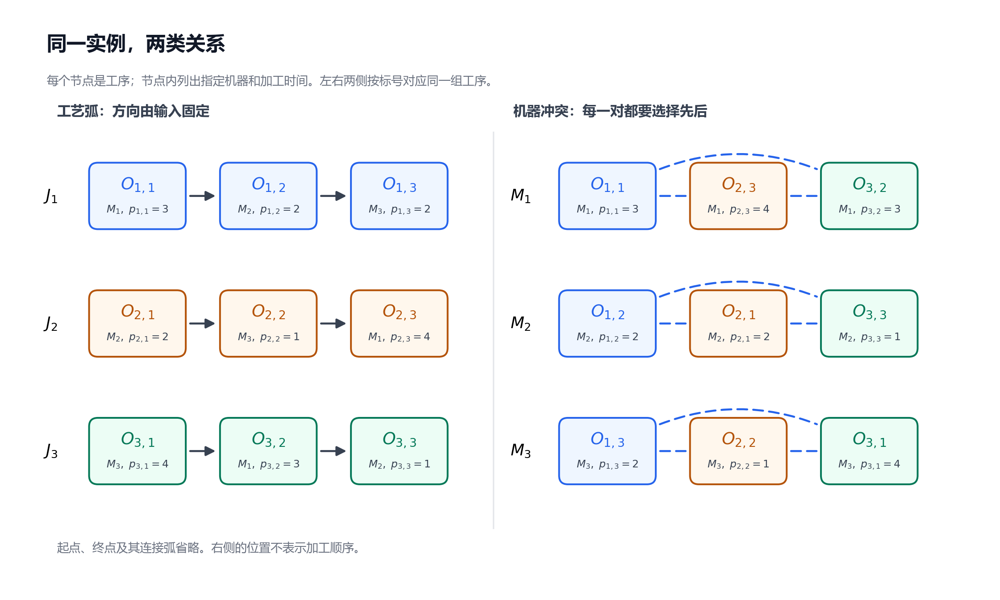
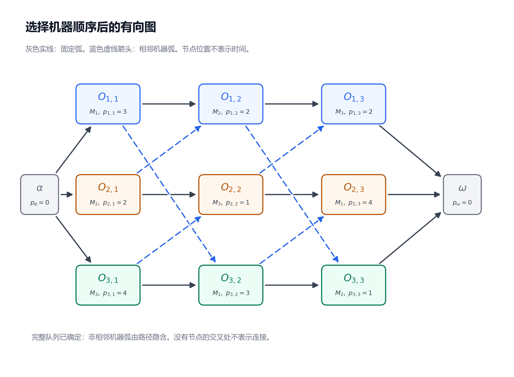
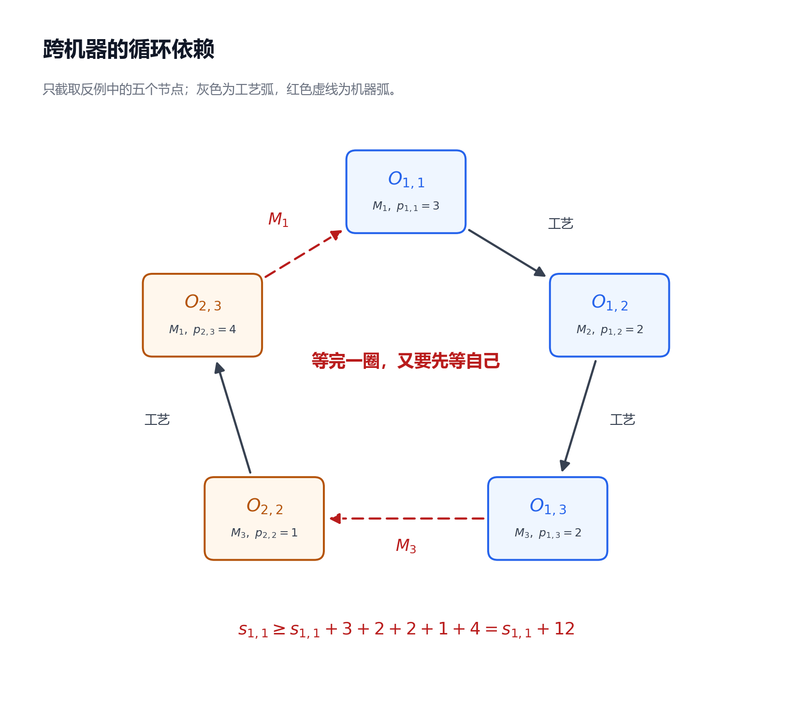

---
tags:
  - JSP
  - 图算法
---

# 第 2 节：机器顺序与析取图

状态：第一版，待 review。 
本节目标：能把 JSSP 实例转换成析取图，从排程中读出机器顺序，并用有向环解释某组机器顺序为什么不可行。

前置：[第 1 节：JSSP 的问题定义与手算排程](./01_JSSP的问题定义与手算排程.md)。本节沿用其中的基础模型：加工时间为正，所有 job 在时间 0 可投入，工序不可抢占，机器始终可用，工序间允许等待。

## 2.1 从上一节留下的问题说起

上一节找到一个 $C_{\max}=11$ 的可行排程。它在机器上形成的顺序是：

$$
\begin{aligned}
M_1&:\quad O_{1,1}\longrightarrow O_{3,2}\longrightarrow O_{2,3},\\
M_2&:\quad O_{2,1}\longrightarrow O_{1,2}\longrightarrow O_{3,3},\\
M_3&:\quad O_{3,1}\longrightarrow O_{2,2}\longrightarrow O_{1,3}.
\end{aligned}
$$

现在暂时擦掉甘特图里的具体开始时间，只保留这些顺序。我们要回答两个问题：这些顺序是否相互兼容？如果换一组顺序，还能不能安排出合法的开始时间？

难点在于机器之间会通过 job 的工艺路线互相影响。例如 $O_{2,3}$ 要用 $M_1$，但它开始前，$J_2$ 必须先在 $M_2$、$M_3$ 上完成前两道工序。只检查 $M_1$ 自己的队列，看不出这些依赖。

**图把分散在不同机器和不同 job 上的先后关系放到一起**。节点表示工序；边表示已经确定的先后关系，或者还需要决定方向的机器冲突。

## 2.2 把贯穿实例重新放在桌面上

每个单元格列出工序、指定机器和加工时间：

| Job | 第一道工序 | 第二道工序 | 第三道工序 |
|---|---|---|---|
| $J_1$ | $O_{1,1}$：$M_1$，3 | $O_{1,2}$：$M_2$，2 | $O_{1,3}$：$M_3$，2 |
| $J_2$ | $O_{2,1}$：$M_2$，2 | $O_{2,2}$：$M_3$，1 | $O_{2,3}$：$M_1$，4 |
| $J_3$ | $O_{3,1}$：$M_3$，4 | $O_{3,2}$：$M_1$，3 | $O_{3,3}$：$M_2$，1 |

这还是第 1 节的自设实例。工艺顺序、机器和加工时间都没有改变；我们只是换一种表示方式。

## 2.3 节点与固定弧：先画不能改变的关系

先为九道工序各画一个节点。节点 $O_{j,k}$ 携带加工时间 $p_{j,k}$；机器 $\mu_{j,k}$ 是该工序的属性，**不需要把机器本身画成节点**。

为了统一表示车间开始和全部完成，再添加两个虚拟节点：

| 节点 | 含义 | 加工时间 |
|---|---|---:|
| $\alpha$ | 虚拟起点，表示时间原点 | 0 |
| $\omega$ | 虚拟终点，表示所有 job 都已完成 | 0 |

虚拟节点只是建模工具，不占用任何机器。把全部节点组成的集合记为 $V$，本例共有 $9+2=11$ 个节点。

接着，沿每个 job 的工艺路线画箭头：

$$
\begin{aligned}
J_1&:\quad \alpha\longrightarrow O_{1,1}\longrightarrow O_{1,2}\longrightarrow O_{1,3}\longrightarrow\omega,\\
J_2&:\quad \alpha\longrightarrow O_{2,1}\longrightarrow O_{2,2}\longrightarrow O_{2,3}\longrightarrow\omega,\\
J_3&:\quad \alpha\longrightarrow O_{3,1}\longrightarrow O_{3,2}\longrightarrow O_{3,3}\longrightarrow\omega.
\end{aligned}
$$

有方向的边也叫 **弧**（arc）。把上面这些固定弧的集合记为 $A$；其中包含六条工序之间的工艺弧，以及起点、终点各三条连接弧，共十二条。

为统一解释弧，临时用 $u,v$ 代表任意节点，$s_u,p_u$ 代表节点 $u$ 的开始时刻和加工时间。例如 $u=O_{1,1}$ 时，$s_u=s_{1,1}$、$p_u=p_{1,1}=3$。约定 $s_\alpha=0$、$p_\alpha=p_\omega=0$。

一条弧 $u\to v$ 表示：

$$
s_v\ge s_u+p_u.
$$

含义是 $v$ 必须等 $u$ 完成后才能开始，允许中间有等待。因此：

- $O_{1,1}\to O_{1,2}$ 表示 $s_{1,2}\ge s_{1,1}+3$。
- $\alpha\to O_{j,1}$ 表示 $s_{j,1}\ge 0$。
- $O_{j,3}\to\omega$ 表示 $s_\omega\ge c_{j,3}$。把终点放在最早允许的时刻，它就是 $C_{\max}$；任意更晚放置的终点时刻只会是一个上界。

工艺弧有时称为 **合取弧**（conjunctive arc）：这些约束必须一起满足，不能任选一条忽略。

## 2.4 析取边：把“同机必须排队”画出来

看 $M_1$ 上的两道工序 $O_{1,1}$ 与 $O_{3,2}$。它们不能重叠，因此必须满足：

$$
s_{3,2}\ge s_{1,1}+3
\quad\text{或者}\quad
s_{1,1}\ge s_{3,2}+3.
$$

这个“或者”叫 **析取**（disjunction）。在还没决定谁先加工时，用一条无方向的边连接它们；确定先后后，再选择一个方向。

用 $\{u,v\}$ 表示连接 $u,v$ 的无向边，把全部机器冲突边组成的集合记为 $D$。本例的冲突为：

| 机器 | 在这台机器上加工的工序 | 需要选择先后的工序对 |
|---|---|---|
| $M_1$ | $O_{1,1}$、$O_{2,3}$、$O_{3,2}$ | $\{O_{1,1},O_{2,3}\}$；$\{O_{1,1},O_{3,2}\}$；$\{O_{2,3},O_{3,2}\}$ |
| $M_2$ | $O_{1,2}$、$O_{2,1}$、$O_{3,3}$ | $\{O_{1,2},O_{2,1}\}$；$\{O_{1,2},O_{3,3}\}$；$\{O_{2,1},O_{3,3}\}$ |
| $M_3$ | $O_{1,3}$、$O_{2,2}$、$O_{3,1}$ | $\{O_{1,3},O_{2,2}\}$；$\{O_{1,3},O_{3,1}\}$；$\{O_{2,2},O_{3,1}\}$ |

每台机器有三道工序，产生三对冲突，总计九条析取边。更一般地，同一机器上的每两道不同工序都要互斥；它们两两相连形成 **团**（clique）。本例中每个团是一个三角形。

图把两类关系分开画，便于看清：左右两侧重复展示的是 **同一组九道工序**，合并时按工序标号对应，不是十八道工序。颜色沿用第 1 节的 job 配色；右侧节点的横向位置不表示加工顺序。为简洁省略了 $\alpha$、$\omega$ 及其连接弧。

**无向边表示先后关系尚未选择，不表示可以同时加工**。有些资料用双向箭头画未选择的冲突；这里统一使用没有箭头的虚线，避免与“两条方向相反的约束同时成立”混淆。

## 2.5 析取图究竟由什么组成？

把固定弧和机器冲突边放在同一组节点上，得到 **析取图**（disjunctive graph）：

$$
G=(V,A,D).
$$

其中 $V$ 是节点集合，$A$ 是固定弧集合，$D$ 是待定向的机器冲突边集合。它在这一步同时含有有向弧和无向边，尚未确定完整的机器顺序。[析取图的节点、两类边与定向表示，参见 Zhang 等论文第 3.2 节](https://arxiv.org/html/2402.17606v3#S3.SS2)

对每条 $\{u,v\}\in D$，选择 $u\to v$ 或 $v\to u$ 中的一个方向。把这些选出的机器弧组成的集合记为 $B$，得到完全定向后的图：

$$
G_B=(V,A\cup B).
$$

这里 $A\cup B$ 表示同时保留工艺约束和已经选择的机器先后约束。**算法能选择的是机器冲突的方向，不能反转输入给定的工艺弧**。

还要注意：每对工序选了方向，并不保证这些方向相互兼容。例如同机的三道工序若被定为第一道先于第二道、第二道先于第三道、第三道又先于第一道，就排不成一条队列。下一步要检查整个有向图。

## 2.6 用上一节的机器顺序给冲突边定向

第 1 节在 $M_1$ 上的顺序是：

$$
O_{1,1}\longrightarrow O_{3,2}\longrightarrow O_{2,3}.
$$

因此，$M_1$ 的三条冲突边分别定为：

$$
O_{1,1}\to O_{3,2},\qquad
O_{3,2}\to O_{2,3},\qquad
O_{1,1}\to O_{2,3}.
$$

第三条连接的是不相邻的两道工序，它的方向也已经由整个机器顺序决定。其余机器同理：

| 机器 | 相邻工序之间的机器弧 | 非相邻工序之间的机器弧 |
|---|---|---|
| $M_1$ | $O_{1,1}\to O_{3,2}$；$O_{3,2}\to O_{2,3}$ | $O_{1,1}\to O_{2,3}$ |
| $M_2$ | $O_{2,1}\to O_{1,2}$；$O_{1,2}\to O_{3,3}$ | $O_{2,1}\to O_{3,3}$ |
| $M_3$ | $O_{3,1}\to O_{2,2}$；$O_{2,2}\to O_{1,3}$ | $O_{3,1}\to O_{1,3}$ |

机器队列一次性给出了同机所有工序对的相对顺序，避免逐对任意选择造成同机内部的矛盾。但 **每台机器各自排成队列，仍然不保证这些队列与工艺路线一起可行**。

## 2.7 为什么画图和实现时常只保留相邻机器弧？

以 $M_1$ 为例。仅保留相邻弧，已经要求：

$$
s_{3,2}\ge s_{1,1}+3,
$$

$$
s_{2,3}\ge s_{3,2}+3.
$$

把它们连起来，得到：

$$
s_{2,3}\ge s_{1,1}+3+3\ge s_{1,1}+3.
$$

这条路径给出的界更强，因此蕴含了非相邻弧 $O_{1,1}\to O_{2,3}$ 所要求的约束。在 **完整机器队列已经确定** 时，非相邻机器弧是冗余的，可以只用相邻弧表示同样的排程约束。

把所有相邻机器弧组成的集合记为 $B_{\mathrm{adj}}$，稀疏表示为：

$$
G_{\mathrm{adj}}=(V,A\cup B_{\mathrm{adj}}).
$$

本例由九条机器弧减为六条，固定弧不变。被省略的弧仍由相邻弧构成的有向路径表达；全量表示与稀疏表示的可行性相同。

图中每个工序只出现一次；灰色实线是 $A$，蓝色虚线箭头是 $B_{\mathrm{adj}}$。线在没有节点的位置交叉时，不表示连接。图展示的是已选顺序下的依赖关系，节点横坐标不是时间，不能据此读取开始时刻。

要区分两个阶段：**未定向时，$D$ 要描述全部同机冲突；给出完整机器队列后，才可用相邻弧压缩表示**。不能先从冲突中随便挑几条边，再假设其余工序自然不会重叠。

## 2.8 一个反例：每台机器都有队列，为什么仍不可行？

尝试把机器顺序改成下面这样，工艺路线仍保持原样：

$$
\begin{aligned}
M_1&:\quad O_{2,3}\longrightarrow O_{1,1}\longrightarrow O_{3,2},\\
M_2&:\quad O_{2,1}\longrightarrow O_{1,2}\longrightarrow O_{3,3},\\
M_3&:\quad O_{1,3}\longrightarrow O_{2,2}\longrightarrow O_{3,1}.
\end{aligned}
$$

每一行都是该机器上三道工序的合法排列，没有遗漏或重复。但合并工艺弧后，出现了一条绕回原点的依赖链：

$$
\begin{aligned}
O_{1,1}&\xrightarrow{\text{工艺}}O_{1,2}
\xrightarrow{\text{工艺}}O_{1,3}\\
&\xrightarrow{M_3}O_{2,2}
\xrightarrow{\text{工艺}}O_{2,3}
\xrightarrow{M_1}O_{1,1}.
\end{aligned}
$$

沿箭头走一圈又回到出发节点，这叫 **有向环**（directed cycle）。它要求 $O_{1,1}$ 等待后面整条链完成，而这条链又需要先完成 $O_{1,1}$。

图只截取导致矛盾的五个节点；红色虚线箭头来自机器顺序，灰色实线箭头来自工艺路线。其余工序不用画出，也足以证明这组顺序不可行。

把等待关系逐条写成时间约束，矛盾会更明确：

| 弧 | 对开始时间的要求 | 来源 |
|---|---|---|
| $O_{1,1}\to O_{1,2}$ | $s_{1,2}\ge s_{1,1}+3$ | $J_1$ 的工艺路线 |
| $O_{1,2}\to O_{1,3}$ | $s_{1,3}\ge s_{1,2}+2$ | $J_1$ 的工艺路线 |
| $O_{1,3}\to O_{2,2}$ | $s_{2,2}\ge s_{1,3}+2$ | $M_3$ 上选出的顺序 |
| $O_{2,2}\to O_{2,3}$ | $s_{2,3}\ge s_{2,2}+1$ | $J_2$ 的工艺路线 |
| $O_{2,3}\to O_{1,1}$ | $s_{1,1}\ge s_{2,3}+4$ | $M_1$ 上选出的顺序 |

连续代入，得到：

$$
s_{1,1}\ge s_{1,1}+3+2+2+1+4=s_{1,1}+12.
$$

任何有限的开始时间都不可能满足这个不等式。把全部工序往后推也无济于事，因为矛盾与时间原点无关。

这里看到的不是某一台机器上的重叠，而是 **跨机器的循环依赖**。这也是为什么调度搜索改变机器顺序后，要检查全局可行性。

## 2.9 无环为什么恰好对应机器顺序可行？

在本节基础模型中，选定完整机器顺序后，有如下结论：

$$
\text{存在遵守这些机器顺序的可行排程}
\quad\Longleftrightarrow\quad
G_B\text{ 没有有向环}.
$$

也可以使用等价的稀疏图 $G_{\mathrm{adj}}$ 来检查。这个结论同时包含两个方向，不能只证明“有环不行”就结束。

### A. 有可行排程，就不可能有环

假设有一条环：

$$
u_1\to u_2\to\cdots\to u_q\to u_1.
$$

沿环叠加约束 $s_v\ge s_u+p_u$，开始时间项相互抵消，最终要求：

$$
0\ge p_{u_1}+p_{u_2}+\cdots+p_{u_q}.
$$

本模型中真实工序的加工时间都为正；$\alpha$ 没有入弧，$\omega$ 没有出弧，它们不可能参与环。所以环上加工时间总和为正，与上式矛盾。

### B. 没有环，就至少能安排出一个可行排程

有限的有向无环图叫 **DAG**（Directed Acyclic Graph）。它可以把节点列成一个顺序，使每条弧都从列表中较早的节点指向较晚的节点；这样的列表叫 **拓扑顺序**（topological order）。

沿一个拓扑顺序，把真实工序逐道串行加工，上一道结束后才开始下一道。虽然会浪费并行能力，但所有弧要求的前序一定已经完成；同机工序也不会重叠。因此，这已经构造出了一个可行排程。

这证明了无环时 **存在解**，还没说明怎样尽早完成。更好的做法是允许没有依赖的工序并行，在每道工序的全部前序完成后尽早开始；第 3 节会用拓扑排序和最长路系统计算。

**加工时间为正、没有额外时间限制，是这里论证的前提**。如果加入截止期、停机区间或其他约束，单凭这张图无环就不足以保证完整模型可行；若允许零时长真实工序，上述“环必然造成正时间矛盾”的证明也需要重新检查。

## 2.10 机器顺序确定了什么，还没有确定什么？

到这里，图模型完成了两件事：记录所有依赖；判断这组机器顺序能否实现。它还没有直接列出每道工序的具体开始时间。

在第 1 节的顺序下，原排程的 $C_{\max}=11$。把所有真实工序整体延后一个单位，仍然遵守同样的工艺弧、机器弧，却得到 $C_{\max}=12$。因此：

**一组可行机器顺序对应多个可行时间安排，而不是任意意义下唯一的排程**。

在本节的基础模型下，可以进一步规定：每道工序都尽早开始，只等待图中前序约束实际要求的时间。这样得到各工序分量意义上最早的可行排程；对于这些固定顺序，它也取得最小的 $C_{\max}$。

理由可以先直观理解：一个工序只有在所有直接前序都完成后才允许开始。按照拓扑顺序逐步安排，每个前序的最早完成时刻都已经确定，当前工序的最早开始时刻也随之确定。详细递推与证明留到下一节。

这里仍要区分两个优化层次：**固定机器顺序下的最早排程，只是这组顺序中的最好安排；整个 JSSP 还要比较不同的可行机器顺序**。

| 问题 | 图模型中的对应工作 |
|---|---|
| 输入规定哪些先后关系？ | 建立固定弧 $A$ |
| 机器冲突怎样解决？ | 选择机器顺序，得到机器弧 $B$ |
| 这组顺序能实现吗？ | 检查 $G_B$ 或 $G_{\mathrm{adj}}$ 是否无环 |
| 最早什么时候开始、什么时候全部完成？ | 在无环图上计算最早时刻；下一节讲解 |
| 如何得到更好的排程？ | 搜索其他可行机器顺序，再计算并比较 $C_{\max}$ |

## 2.11 五个容易混淆的地方

| 容易形成的误解 | 正确理解 |
|---|---|
| 无向冲突边表示工序可以并行 | 它表示同机互斥，但先后方向还未决定 |
| 给每一对工序选一个方向就一定合法 | 选出的方向可能形成环，甚至同机内部就可能矛盾 |
| 每台机器的队列都合法，整个排程就合法 | 工艺弧把机器连接起来，还要检查跨机器的循环依赖 |
| 箭头一定表示前后紧挨着加工 | $u\to v$ 表示 $v$ 不早于 $u$ 完成，允许等待 |
| 图里只画相邻机器弧，说明其他冲突不存在 | 完整队列已确定时，非相邻约束由路径隐含，仍然成立 |

## 2.12 自检题

先尝试自己回答，再看下面的参考答案。

1. 本例加入 $\alpha$、$\omega$ 后有多少节点？$A$ 有多少条弧？$D$ 有多少条边？
2. 为什么要连接 $O_{1,1}$ 与 $O_{2,3}$，却不用在 $D$ 中连接 $O_{1,1}$ 与 $O_{2,1}$？
3. $M_1$ 的完整顺序为 $O_{1,1}\to O_{3,2}\to O_{2,3}$ 时，能否省略直接机器弧 $O_{1,1}\to O_{2,3}$？如果连 $O_{3,2}\to O_{2,3}$ 也删掉，还能表示同一个顺序吗？
4. 只把 $M_1$ 的三对冲突定为 $O_{1,1}\to O_{3,2}$、$O_{3,2}\to O_{2,3}$、$O_{2,3}\to O_{1,1}$，为什么不可行？环上的加工时间总和是多少？
5. 第 2.8 小节的反例中，$M_1$、$M_3$ 的哪些弧与工艺路线共同构成了环？为什么把所有开始时间加 100 仍不能解决问题？
6. 某组完整机器顺序得到的图没有环。这是否证明它能实现？是否证明它最优？是否已经确定唯一的开始时间？

### 参考答案

1. 十一个节点。$A$ 有十二条弧：六条工艺弧、三条起点连接弧、三条终点连接弧。$D$ 有九条无向边：每台机器三条。
2. $O_{1,1}$、$O_{2,3}$ 都使用 $M_1$，存在机器冲突；$O_{2,1}$ 使用 $M_2$，与 $O_{1,1}$ 不争用同一机器。图中不同机工序仍可能通过其他路径产生依赖，但不用为它们增加直接的机器冲突边。
3. 可以省略非相邻弧，因为两条相邻弧已经蕴含它的时间约束。若再删掉 $O_{3,2}\to O_{2,3}$，剩下的机器弧就不完整，不能保证 $O_{3,2}$ 在 $O_{2,3}$ 前面。本例甚至允许 $O_{3,2}$ 取 $[4,7)$、$O_{2,3}$ 取 $[5,9)$，其他工序按第 1 节安排：保留下来的弧都满足，$M_1$ 却重叠了。
4. 这三条机器弧自己就形成了有向环。加工时间总和是 $3+3+4=10$，会要求 $s_{1,1}\ge s_{1,1}+10$，不可能满足。
5. 两条机器弧为 $O_{2,3}\to O_{1,1}$、$O_{1,3}\to O_{2,2}$，其余三条来自工艺路线。沿环仍然会得到 $s_{1,1}\ge s_{1,1}+12$；整体延后不会改变两边的差值。
6. 在本节基础模型下，无环证明这些机器顺序可实现。它不证明最优，也不直接给出唯一的开始时间；需要计算最早排程，再与其他顺序比较解质量。

## 2.13 复习速记卡

| 以后复习时要立即想起的点 | 本节对应的要点 |
|---|---|
| 节点表示什么？ | 工序；机器和加工时间是工序属性；另加零时长起点、终点 |
| 两类边有什么区别？ | 固定弧来自工艺路线；析取边来自同机互斥，方向待选 |
| 弧 $u\to v$ 的时间含义？ | $s_v\ge s_u+p_u$，允许等待 |
| 机器队列与定向是什么关系？ | 一条完整队列决定全部同机工序对的方向 |
| 为什么有环不可行？ | 沿环必须等待一整圈的正加工时间，导致 $s_u\ge s_u+\text{正数}$ |
| 为什么无环足以保证存在排程？ | 按拓扑顺序串行加工，至少能构造一个可行解 |
| 为什么常只保留相邻机器弧？ | 完整队列中的非相邻约束已由路径隐含 |
| 固定顺序后还要做什么？ | 计算最早可行开始时间与 $C_{\max}$，由 decoder 完成 |

下一节：[第 3 节：拓扑排序、最长路与 Decoder](./03_拓扑排序_最长路与Decoder.md)。我们会在同一张无环图上，一步一步重新算出第 1 节的开始时间和 $C_{\max}=11$，并解释为什么要取“最长”而不是“最短”。

参考核验：2026-10-08。上面引用的论文仅用于核对析取图定义；本节的 3×3 数据、图示、反例和约束推导均按贯穿实例自行展开。本节不讨论图模型的历史归属，也不要求阅读该论文的神经网络部分。

提交前检查：已核算贯穿实例、环的加工时间总和与自检题答案，检查相对链接及图文一致性；已用 CommonMark 解析和 MathJax 本地预览检查公式、表格、加粗与图片。未直接检查 IDE 内置 Markdown 预览。
