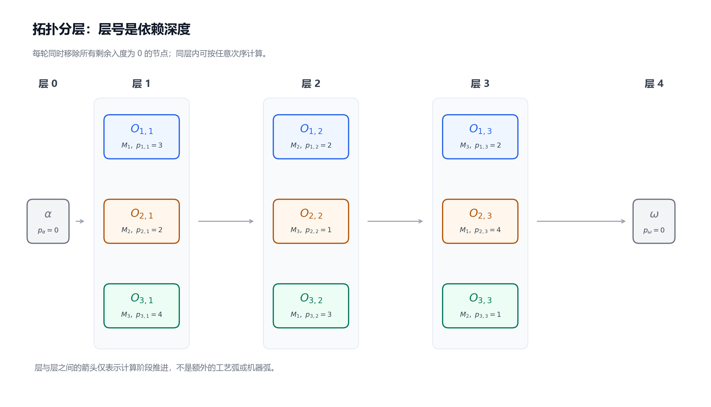
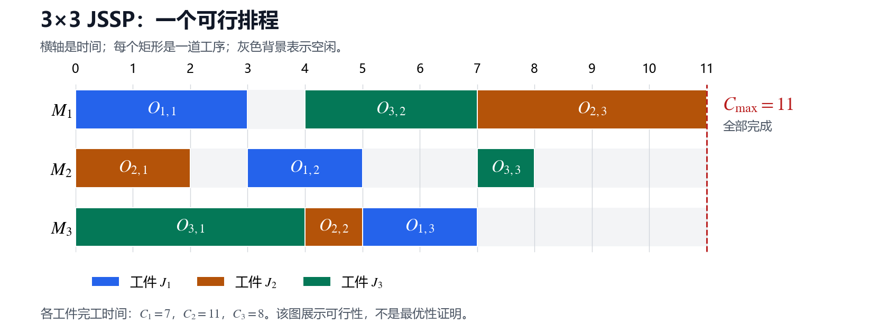
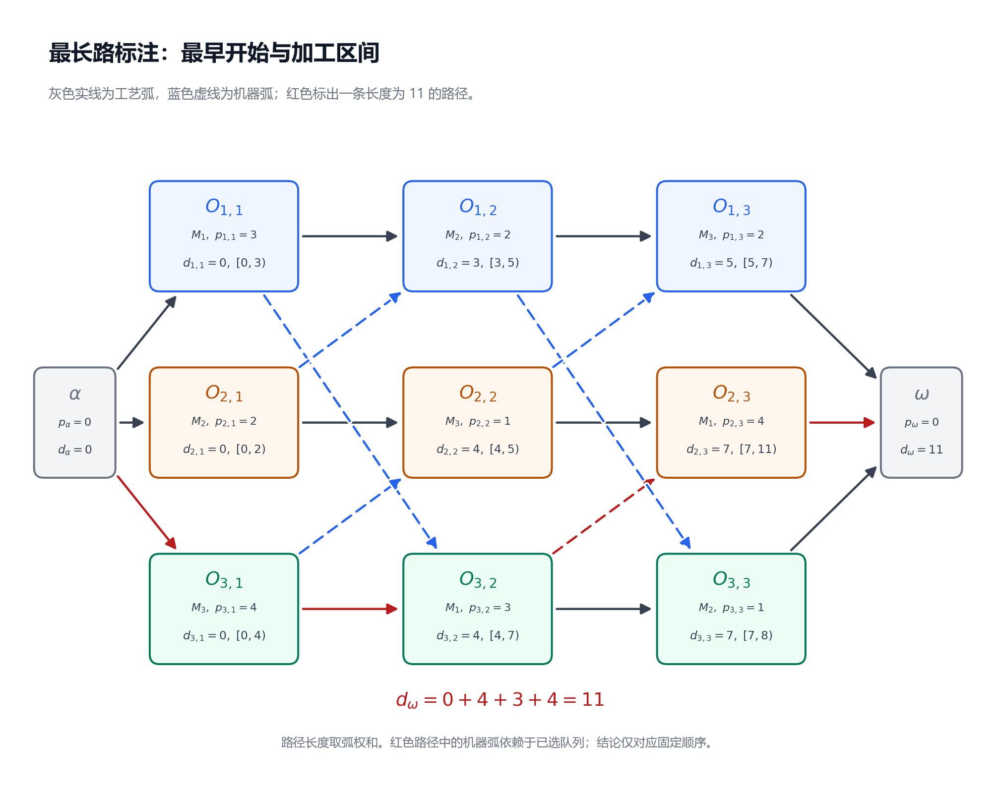

---
tags:
  - JSP
  - 图算法
  - 工程实现
---

# 第 3 节：拓扑排序、最长路与 Decoder

状态：第一版，待 review。<br>
本节目标：给定每台机器的完整工序顺序，能检查可行性，逐步算出最早排程与最大完工时间，并说明这个计算为什么是有向无环图上的最长路。

前置：[第 2 节：机器顺序与析取图](./02_机器顺序与析取图.md)。继续使用同一基础模型：所有 job 在时间 0 可投入，真实工序加工时间为正，机器始终可用，工序不可抢占，工序间允许等待。

## 3.1 机器顺序已知，时间怎样重新算出来？

上一节把排程转换成了图，也证明了：完整机器顺序与工艺路线合并后，没有有向环，就存在可行排程。

现在我们采用第 1 节的机器顺序：

$$
\begin{aligned}
M_1&:\quad O_{1,1}\longrightarrow O_{3,2}\longrightarrow O_{2,3},\\
M_2&:\quad O_{2,1}\longrightarrow O_{1,2}\longrightarrow O_{3,3},\\
M_3&:\quad O_{3,1}\longrightarrow O_{2,2}\longrightarrow O_{1,3}.
\end{aligned}
$$

加工数据也保持不变：

| Job | 第一道工序 | 第二道工序 | 第三道工序 |
|---|---|---|---|
| $J_1$ | $O_{1,1}$：$M_1$，3 | $O_{1,2}$：$M_2$，2 | $O_{1,3}$：$M_3$，2 |
| $J_2$ | $O_{2,1}$：$M_2$，2 | $O_{2,2}$：$M_3$，1 | $O_{2,3}$：$M_1$，4 |
| $J_3$ | $O_{3,1}$：$M_3$，4 | $O_{3,2}$：$M_1$，3 | $O_{3,3}$：$M_2$，1 |

这一节要从这些输入重新算出开始时间，不直接照抄第 1 节的甘特图。

以 $O_{2,3}$ 为例，它使用 $M_1$，要等两件事：$J_2$ 的前一道工序 $O_{2,2}$ 完成，以及机器队列中排在它前面的 $O_{3,2}$ 完成。只知道其中一项完成，还不能开工。

**Decoder（解码器）把机器顺序这样的解表示，转换成具体时间排程和目标值**。本节的 decoder 输入的是已经确定的完整机器队列；它负责实现这些顺序，并报告不可行的输入。后面若换成优先级编码，解码规则也需要另行说明。

## 3.2 固定图与直接前序：哪些时间必须先知道？

沿用第 2 节的稀疏图：

$$
G_{\mathrm{adj}}=(V,E),\qquad E=A\cup B_{\mathrm{adj}}.
$$

$V$ 包含九道真实工序、虚拟起点 $\alpha$ 和终点 $\omega$。$A$ 包含工艺弧及起终点连接弧；$B_{\mathrm{adj}}$ 包含每条机器队列中的相邻弧。这里 $E$ 是两类已定向弧的总集合，本例有十八条弧。

用 $u,v$ 泛指节点，$p_u$ 表示节点加工时间；$p_\alpha=p_\omega=0$。每条弧仍表示：

$$
s_v\ge s_u+p_u.
$$

把直接指向 $v$ 的节点集合记为 $\operatorname{Pred}(v)$，叫 **直接前序集合**。只列直接前序就足够，因为更早的依赖会沿路径逐步传递。

| 节点 | 工艺方向的直接前序 | 机器方向的直接前序 |
|---|---|---|
| $O_{1,1}$ | $\alpha$ | 无 |
| $O_{2,1}$ | $\alpha$ | 无 |
| $O_{3,1}$ | $\alpha$ | 无 |
| $O_{1,2}$ | $O_{1,1}$ | $O_{2,1}$ |
| $O_{2,2}$ | $O_{2,1}$ | $O_{3,1}$ |
| $O_{3,2}$ | $O_{3,1}$ | $O_{1,1}$ |
| $O_{1,3}$ | $O_{1,2}$ | $O_{2,2}$ |
| $O_{2,3}$ | $O_{2,2}$ | $O_{3,2}$ |
| $O_{3,3}$ | $O_{3,2}$ | $O_{1,2}$ |
| $\omega$ | $O_{1,3}$、$O_{2,3}$、$O_{3,3}$ | 无 |

$\alpha$ 没有前序。其他节点的最早时刻，需要先得到表中直接前序的完成时刻。

## 3.3 先理解递推：为什么一定要取最大值？

用 $d_v$ 表示 **固定机器顺序下，节点 $v$ 最早可行的开始时刻**。对具体工序简写为 $d_{j,k}=d_{O_{j,k}}$，与实际排程的 $s_{j,k}$ 区分：可行排程允许 $s_{j,k}$ 更晚，而最早排程取 $s_{j,k}=d_{j,k}$。

如果 $O_{2,2}$ 最早在 5 完成，$O_{3,2}$ 最早在 7 完成，那么 $O_{2,3}$ 必须同时满足：

$$
s_{2,3}\ge 5,\qquad s_{2,3}\ge 7.
$$

最早满足两项要求的时刻是：

$$
d_{2,3}=\max(5,7)=7.
$$

取较小值 5，会与 $M_1$ 上仍在加工的 $O_{3,2}$ 重叠。把两项相加得到 12 也没有必要：这两道前序可以在不同机器上并行，它们的等待要求不是两段必须串行累加的时间。

因此，先把起点固定为：

$$
d_\alpha=0.
$$

对于其他节点，最早时刻的递推为：

$$
d_v=\max_{u\in\operatorname{Pred}(v)}(d_u+p_u).
$$

每一项 $d_u+p_u$ 是直接前序 $u$ 的最早完成时刻；最大值表示等到所有前序都完成。起终点连接弧确保本图中除了 $\alpha$，每个节点都有前序，不需要对空集合取最大值。[最早开始时刻的前向递推参见 Zhang 等论文第 4.1 节，式 (1)](https://arxiv.org/html/2402.17606v3#S4.SS1)

但还有一个实际问题：计算 $d_v$ 时，怎样保证每个 $d_u$ 已经算好？这就是拓扑排序的作用。

## 3.4 拓扑顺序是计算顺序，不是全车间串行加工顺序

**拓扑顺序** 是把图中所有节点列成一个列表，使每条弧 $u\to v$ 都满足：$u$ 在列表中先于 $v$。

这样按列表计算 $d_v$，它的全部直接前序就已经计算完成。没有直接或间接依赖的节点，往往可以交换在列表中的位置，所以拓扑顺序一般不唯一。

例如，本图的 $O_{1,1}$、$O_{2,1}$、$O_{3,1}$ 都只有起点 $\alpha$ 作为前序。计算程序可以先算 $O_{1,1}$ 再算 $O_{2,1}$，也可以反过来；它们的最早开始时间仍然都是 0。

**程序逐个计算节点，不代表工序逐个串行加工**。程序是在算时间，不是在让机器随循环一台一台工作。



图按“每轮移除当前全部无前序节点”的方式分层。层号表示计算上的依赖深度；同一层的 $O_{1,2}$ 最早在 3 开始，$O_{2,2}$ 和 $O_{3,2}$ 最早在 4 开始，并不同时开工。本例中同一道次恰好位于同层；一般应按图中的依赖分层，不能直接按工序下标分组。图中层间箭头只表示计算阶段推进，不表示新增的调度约束。具体逐节点的队列实现如下。

## 3.5 用入度队列逐步得到拓扑顺序

节点的 **入度**（in-degree）是直接指向它的弧的数量。处理过前序后，相当于移除对应的入弧；我们维护的是剩余图中的入度。

队列式拓扑排序通常称为 **Kahn 算法**，步骤如下：

1. 统计每个节点的初始入度，把所有入度为 0 的节点放入队列。
2. 取出队首节点 $u$，将它加入拓扑列表。
3. 对每条出弧 $u\to v$，把 $v$ 的剩余入度减 1；降到 0 时，把 $v$ 加入队尾。
4. 重复，直到队列为空。
5. 如果处理的节点数少于 $\lvert V\rvert$，说明图中存在有向环。

这是一种在移除前序的过程中建立拓扑顺序的算法；入度变为 0，表示它的所有直接前序都已经处理，不表示它在车间当前时刻能开工。[可对照 Sedgewick 与 Wayne 的队列式拓扑排序参考实现](https://raw.githubusercontent.com/kevin-wayne/algs4/master/src/main/java/edu/princeton/cs/algs4/TopologicalX.java)

本例的初始入度为：

| 节点组 | 初始入度 | 原因 |
|---|---:|---|
| $\alpha$ | 0 | 没有前序 |
| $O_{1,1}$、$O_{2,1}$、$O_{3,1}$ | 各 1 | 只有起点连接弧 |
| 六道非首道工序 | 各 2 | 一个工艺前序、一个机器前序 |
| $\omega$ | 3 | 等待三个 job 的最后工序 |

为把队列过程固定下来，我们让 $\alpha$ 的出弧按 job 编号访问；每个真实工序先访问工艺方向的出弧，再访问机器方向的出弧。队列从左向右表示从队首到队尾：

| 步骤 | 本次取出的节点 | 本次新入队的节点 | 处理后的队列 |
|---:|---|---|---|
| 初始 | — | $\alpha$ | $\alpha$ |
| 1 | $\alpha$ | $O_{1,1}$、$O_{2,1}$、$O_{3,1}$ | $O_{1,1},O_{2,1},O_{3,1}$ |
| 2 | $O_{1,1}$ | 无 | $O_{2,1},O_{3,1}$ |
| 3 | $O_{2,1}$ | $O_{1,2}$ | $O_{3,1},O_{1,2}$ |
| 4 | $O_{3,1}$ | $O_{3,2}$、$O_{2,2}$ | $O_{1,2},O_{3,2},O_{2,2}$ |
| 5 | $O_{1,2}$ | 无 | $O_{3,2},O_{2,2}$ |
| 6 | $O_{3,2}$ | $O_{3,3}$ | $O_{2,2},O_{3,3}$ |
| 7 | $O_{2,2}$ | $O_{2,3}$、$O_{1,3}$ | $O_{3,3},O_{2,3},O_{1,3}$ |
| 8 | $O_{3,3}$ | 无 | $O_{2,3},O_{1,3}$ |
| 9 | $O_{2,3}$ | 无 | $O_{1,3}$ |
| 10 | $O_{1,3}$ | $\omega$ | $\omega$ |
| 11 | $\omega$ | 无 | 空 |

例如步骤 2 处理了 $O_{1,1}$，但 $O_{1,2}$ 还有来自 $O_{2,1}$ 的入弧，不能立即入队。到步骤 3，这项依赖也处理完，才把 $O_{1,2}$ 加入队列。

如果图有环，算法为什么会停？环上每个节点都有一个尚未移除的环内前序，没有任何一个能率先降到入度 0。反过来，有限的非空 DAG 一定有入度为 0 的节点，否则沿入弧不断往前追，最终会重复节点并形成环。

因此，处理节点数就是可靠的判环依据。**未处理的节点不一定都在环上**：环后面的节点也可能被阻塞。例如虚拟终点 $\omega$ 可以无法入队，却不会参与有向环。

## 3.6 沿拓扑顺序，完整手算最早排程

现在沿上面得到的列表递推。表中“前序完成候选值”就是各个 $d_u+p_u$，取最大值得到当前节点的 $d_v$。

| 计算节点 | 前序完成候选值 | 最早开始 $d_v$ | 最早结束 $d_v+p_v$ |
|---|---|---:|---:|
| $\alpha$ | 时间原点 | 0 | 0 |
| $O_{1,1}$ | $\alpha$：0 | 0 | 3 |
| $O_{2,1}$ | $\alpha$：0 | 0 | 2 |
| $O_{3,1}$ | $\alpha$：0 | 0 | 4 |
| $O_{1,2}$ | $O_{1,1}$：3；$O_{2,1}$：2 | 3 | 5 |
| $O_{3,2}$ | $O_{3,1}$：4；$O_{1,1}$：3 | 4 | 7 |
| $O_{2,2}$ | $O_{2,1}$：2；$O_{3,1}$：4 | 4 | 5 |
| $O_{3,3}$ | $O_{3,2}$：7；$O_{1,2}$：5 | 7 | 8 |
| $O_{2,3}$ | $O_{2,2}$：5；$O_{3,2}$：7 | 7 | 11 |
| $O_{1,3}$ | $O_{1,2}$：5；$O_{2,2}$：5 | 5 | 7 |
| $\omega$ | $O_{1,3}$：7；$O_{2,3}$：11；$O_{3,3}$：8 | 11 | 11 |

从这张表可看出三个细节：

- $O_{1,2}$ 受工艺前序限制：机器前序在 2 完成，仍要等自己的前一道工序到 3 完成。
- $O_{2,3}$ 受机器前序限制：自己的前一道工序在 5 完成，仍要等 $M_1$ 上的 $O_{3,2}$ 到 7 完成。
- $O_{1,3}$ 的两项前序恰好都在 5 完成，取最大值时可以出现并列。

虽然计算程序先处理 $O_{3,3}$、$O_{2,3}$，最后才处理 $O_{1,3}$，计算结果却允许 $O_{1,3}$ 在时间 5 开始，另外两道在 7 开始。计算顺序与时间顺序的区别在这里非常直观。

把真实工序的开始时间设为 $s_{j,k}=d_{j,k}$，结束时间设为 $c_{j,k}=d_{j,k}+p_{j,k}$，就得到第 1 节的排程：



三个 job 的完工时间以及目标值为：

$$
C_1=7,\qquad C_2=11,\qquad C_3=8,
$$

$$
C_{\max}=\max(C_1,C_2,C_3)=d_\omega=11.
$$

注意 $\omega$ 的加工时间是 0；它的最早开始与最早结束相同，都表示整个车间最早能全部完成的时刻。

## 3.7 为什么这个递推就是“最长路”？

目前加工时间挂在节点上。为了使用常见的带权图表述，给每条弧 $u\to v$ 定义权重：

$$
w(u,v)=p_u.
$$

也就是 **一条弧携带它出发节点的加工时间**。同一节点的不同出弧使用相同的权重；沿一条路径走过它时，加一次它的加工时间。

例如：

| 弧 | 权重 | 表示什么等待？ |
|---|---:|---|
| $\alpha\to O_{3,1}$ | 0 | 起点自身不需要加工 |
| $O_{3,1}\to O_{3,2}$ | 4 | 等 $O_{3,1}$ 的加工完成 |
| $O_{3,2}\to O_{2,3}$ | 3 | 等 $O_{3,2}$ 释放 $M_1$ |
| $O_{2,3}\to\omega$ | 4 | 等 $J_2$ 的最后工序完成 |

一条从 $\alpha$ 到某个工序 $v$ 的路径，其弧权和计算的是到达 $v$ 前必须经过的加工，**不包含终点工序 $v$ 自身的时长**。所以它对应 $v$ 的开始时刻。再加 $p_v$，才得到该工序的结束时刻。

对于终点 $\omega$，最后一道真实工序的时长已经通过进入 $\omega$ 的弧计入，因此从 $\alpha$ 到 $\omega$ 的路径长度包含路径上全部真实工序的加工时间。

现在看本例中的一条路径：

$$
\alpha\longrightarrow O_{3,1}\longrightarrow O_{3,2}\longrightarrow O_{2,3}\longrightarrow\omega.
$$

其长度为：

$$
0+4+3+4=11.
$$

沿路径串起不等式，就要求终点不能早于 11。其他路径也会给出各自的时间下限；排程必须同时满足全部路径的要求，所以最终取 **最长路径给出的最强下限**。



图中 $d_{j,k}$ 是工序最早开始时刻，节点内下方标出加工区间。红色路径混合了工艺弧和机器弧，不一定属于同一个 job。它证明的是这组机器顺序下无法早于 11 完成；机器顺序改变后，这条路径可能消失，因此它本身不构成整个 JSSP 的最优性证明。

任何到 $v$ 的路径，最后一定经过某个直接前序 $u$。把“到 $u$ 的最长路”接上弧 $u\to v$，就得到同一个递推：

$$
d_v=\max_{u\in\operatorname{Pred}(v)}\bigl(d_u+w(u,v)\bigr)
=\max_{u\in\operatorname{Pred}(v)}(d_u+p_u).
$$

因此，本图的最早开始时刻就是从 $\alpha$ 出发的最长路长度，$d_\omega$ 就是最早排程的 $C_{\max}$。这里路径的“长”指 **权重和**，不是图上画线的长度，也不是经过的边数。

## 3.8 为什么算出的时间既可行，又是分量意义上最早的？

这个结论要同时证明“没有违反约束”和“任何其他可行安排都不能在某个工序上更早”。

### A. 递推结果满足全部约束

对任何弧 $u\to v$，递推取了所有前序候选值的最大值，必然有：

$$
d_v\ge d_u+p_u.
$$

把实际开始时间设为 $s_v=d_v$，所有工艺弧与机器弧就都满足。起点在 0，全部真实工序都可以从起点沿工艺路线到达，所以开始时间非负。完整机器队列的相邻弧也保证同机所有工序互不重叠。

### B. 任何可行开始时间都不小于递推结果

考虑遵守同样机器顺序的任意可行安排 $s$。沿拓扑顺序归纳：起点 $s_\alpha=d_\alpha=0$；假设当前节点的所有前序都已有 $s_u\ge d_u$，则：

$$
s_v\ge\max_{u\in\operatorname{Pred}(v)}(s_u+p_u)
\ge\max_{u\in\operatorname{Pred}(v)}(d_u+p_u)=d_v.
$$

每道工序都满足 $s_v\ge d_v$。这就是 **分量意义上最早**：它们各自的开始时刻，均不能在保持同样顺序时进一步提前。

所以，在固定机器顺序下，递推结果的每道工序结束时间也最早，$C_{\max}$ 自然最小。

这个证明还说明：换一个合法拓扑顺序，得到的 $d_v$ 不会变，因为每个节点仍然取同一组已经确定的前序候选值。不同的合法计算顺序只是不同的计算过程。

**最长路长度等于 $C_{\max}$，这里指固定顺序下的最早排程**。若把全部加工整体延后一个单位，图和最长路仍然不变，但实际排程的 $C_{\max}$ 变成 12；这时最长路给出的是该顺序下可以达到的最早值 11。

## 3.9 把判环与最长路合成一个 Decoder

手算时我们先找拓扑顺序，再计算时间。实现时，可以在处理入度队列的同时，把时间下限传给后继。

对弧 $u\to v$，当 $u$ 已计算完成时，用候选值 $d_u+p_u$ 更新 $v$：

$$
d_v\leftarrow\max(d_v,d_u+p_u).
$$

这是 **松弛操作**（relaxation）：用一条弧检查并更新当前保存的路径长度。最长路保留较大值；这里的名字不表示把排程约束放宽。

此时 $v$ 可能还有别的前序未处理，所以保存的是暂时下限。只有它的剩余入度降到 0，才说明全部候选值都已经收到，$d_v$ 可以最终确定。

下面是伪代码。`p[v]` 对应 $p_v$，`d[v]` 对应 $d_v$，`indegree[v]` 是剩余入度，`succ[u]` 是 $u$ 的直接后继列表。`alpha`、`omega` 对应两个虚拟节点。

```text
decode(instance, machine_orders):
    if machine_orders 不是指定机器上全部工序的完整排列:
        return INVALID_INPUT

    建立 V 和 E：工艺弧、起终点连接弧、相邻机器弧
    对相同的 (u, v) 去重，建立 succ 和 indegree
    p[alpha] = p[omega] = 0

    for v in V:
        d[v] = -infinity
    d[alpha] = 0

    Q = 所有 indegree 为 0 的节点组成的队列
    processed = 0

    while Q 非空:
        u = Q.pop_front()
        processed += 1

        for v in succ[u]:
            d[v] = max(d[v], d[u] + p[u])
            indegree[v] -= 1
            if indegree[v] == 0:
                Q.push_back(v)

    if processed != 节点总数:
        return CYCLIC

    for 每道真实工序 v:
        start[v] = d[v]
        end[v] = d[v] + p[v]

    return FEASIBLE, start, end, d[omega]
```

这里采用常见的最长路初始化：除起点外，先设为负无穷，表示尚未收到任何从起点传来的路径。对本节正确构造的图，每个节点都从 $\alpha$ 可达；被出队的节点已经得到有限的 $d_u$，不会对负无穷做实际时间加法。用整数哨兵表示负无穷时，仍要避免对哨兵相加造成溢出。

这个 decoder 有三种不同结果：

| 结果 | 含义 | 示例 |
|---|---|---|
| `INVALID_INPUT` | 工序遗漏、重复，或被放进不属于它的机器队列 | $O_{2,3}$ 被列在 $M_2$ 上 |
| `CYCLIC` | 队列各自完整，但合并图有环 | 第 2 节的跨机器循环反例 |
| `FEASIBLE` | 全部节点处理完成，输出最早排程和 $C_{\max}$ | 本节的机器顺序得到 11 |

**发现有环后，不能把已经算出的少量时间当作完整可行解返回**。搜索算法可以拒绝这组顺序，或者按另行定义的规则修复它；修复会改变原顺序，不属于这段 decoder 的计算。

实现时，邻接表和入度必须描述同一组弧。若某条弧同时来自工艺与机器关系，按有序节点对去重可以简化表示；不能在入度里计两次、邻接表里却只保留一次。

## 3.10 复杂度与使用边界

队列算法中，每个节点最多出队一次，每条弧恰好用于一次更新和一次入度递减，因此建好邻接表后的时间复杂度是：

$$
O(\lvert V\rvert+\lvert E\rvert).
$$

存储整张图、入度、时间与队列也需要 $O(\lvert V\rvert+\lvert E\rvert)$ 空间。本例只有十一个节点、十八条弧。采用相邻机器弧，可以避免完整同机团带来的大量冗余弧。[有向无环图最长路的拓扑递推及线性复杂度，可对照教材作者的参考实现](https://raw.githubusercontent.com/kevin-wayne/algs4/master/src/main/java/edu/princeton/cs/algs4/AcyclicLP.java)

本节不需要枚举全部路径，也不需要使用最短路算法。虽然图可能有很多条路径，但拓扑递推把每个节点之前的最强限制汇总成一个数 $d_v$。

对于这里的整数加工时间，可以用 64 位整数存储时间，并依据实例的加工时间总和检查累加范围。每次解码一组新机器顺序时，重建或重置剩余入度和时间数组；上一次解码已经递减过的入度不能直接复用。

最后区分两个容易混用的概念：

- **固定队列的图解码**：机器先后关系已经确定，在这些约束下计算最早时间。本节讲的是这一种。
- **优先级序列的构造解码**：输入表示待调度工序的选择优先级，decoder 还会选择加工位置，可能在机器空档中插入工序。它最终形成的机器队列未必等于输入序列在该机器上的投影。

它们都可以称为 decoder，但输入语义和决策范围不同。后面讲构造启发式、搜索编码或 FJSP 时，再说明采用哪一种。

## 3.11 六个容易混淆的地方

| 容易形成的误解 | 正确理解 |
|---|---|
| 拓扑列表前面的工序必须先加工完，才轮到后面的 | 列表规定计算先后；无依赖的加工仍可并行 |
| 入度变为 0，说明工序在时间 0 可以开工 | 它表示计算所需的前序都已处理；实际时刻由 $d_v$ 决定 |
| 前序完成时刻取最小值或相加 | 要同时满足全部前序约束，所以取最大值 |
| 到工序节点的路径长度就是它的结束时间 | 按 $w(u,v)=p_u$ 的约定，它是最早开始时间；结束时间还要加自己的时长 |
| 有环时，剩下的节点全都属于这个环 | 环后的节点也会被阻塞；处理不完证明存在环，不直接定位全部环节点 |
| 解码得到了最早排程，就证明 JSSP 全局最优 | 它只对固定机器顺序最优；还要比较其他可行顺序 |

## 3.12 自检题

先自己回答，再看下面的参考答案。

1. $O_{3,2}$ 的两个直接前序分别最早在 4 和 3 完成。它的最早开始、结束时刻各是多少？若取较小的候选值，会违反什么约束？
2. 从 $\alpha$ 到 $O_{2,3}$ 的最长路长度是多少？为什么不是 11？进入 $\omega$ 的最后一条弧又加上了什么？
3. 调换 $O_{1,1}$、$O_{2,1}$ 在合法拓扑列表中的计算先后，会改变本例的最早排程吗？是否意味着改变了机器队列？
4. 如果暂时只收到 $O_{2,2}$ 传给 $O_{2,3}$ 的候选值 5，可以立即让 $O_{2,3}$ 入队并把时间定为 5 吗？
5. 采用第 2 节第 2.8 小节的不可行机器顺序，队列算法能否处理完十一个节点？若 $\omega$ 未被处理，是否意味着它在环上？
6. 只把 $p_{3,2}$ 从 3 改为 4，机器顺序与其他数据都保持不变。重新解码后，$O_{2,3}$、$O_{3,3}$ 的开始时刻和 $C_{\max}$ 各变成多少？
7. 将本节排程整体延后一个时间单位，图的最长路长度与实际 $C_{\max}$ 分别是多少？为什么二者不再相等？

### 参考答案

1. 最早开始为 $\max(4,3)=4$，结束为 $4+3=7$。若在 3 开始，$J_3$ 的前一道工序 $O_{3,1}$ 尚未完成，违反工艺先后约束。
2. 长度是 $d_{2,3}=7$，例如路径 $\alpha\to O_{3,1}\to O_{3,2}\to O_{2,3}$ 的权重和为 $0+4+3$。它还没有计入 $O_{2,3}$ 自身的加工；弧 $O_{2,3}\to\omega$ 再加 $p_{2,3}=4$，到终点的长度变为 11。
3. 不会改变最早排程。这两道工序没有彼此依赖，使用不同机器；改变计算先后不会添加机器弧，也没有改变任何机器队列。
4. 不可以。它还要等待机器前序 $O_{3,2}$ 的候选值 7。只有全部直接前序都处理完，剩余入度降为 0，才能入队；最终取 $\max(5,7)=7$。
5. 不能。按本节建图，只能处理 $\alpha$ 与 $O_{2,1}$ 两个节点，之后队列为空，剩下九个节点未处理。$\omega$ 没有出弧，不会在环上；它是被环及其后续依赖阻塞的节点。
6. $O_{3,2}$ 仍在 4 开始，但改为在 8 完成。$O_{2,3}$ 从 8 开始、到 12 完成；$O_{3,3}$ 从 8 开始、到 9 完成。$J_1$ 仍在 7 完成，所以新的 $C_{\max}=12$。
7. 图和加工时间不变，最长路仍为 11；实际 $C_{\max}=12$。等于最长路的结论对应最早排程，而延后的排程没有取最早开始时刻。

## 3.13 复习速记卡

| 以后复习时要立即想起的点 | 本节对应的要点 |
|---|---|
| Decoder 的输入与输出？ | 完整机器队列输入；可行性状态、最早时间表和 $C_{\max}$ 输出 |
| 为什么先拓扑排序？ | 保证计算当前节点时，全部直接前序都已算好 |
| 最早时刻的递推？ | $d_\alpha=0$；$d_v=\max_{u\in\operatorname{Pred}(v)}(d_u+p_u)$ |
| 弧权怎样定义？ | $w(u,v)=p_u$，携带出发节点时长 |
| 为什么是最长路？ | 所有依赖路径都给出时间下限，必须满足其中最强的一项 |
| 到工序和到终点有什么区别？ | 到工序得到开始时间；到 $\omega$ 已计入最后一道真实工序的时长 |
| 怎样判环？ | 队列为空后，处理节点数仍少于节点总数 |
| 换一个合法拓扑顺序会怎样？ | 计算过程可以变，最早时刻不变 |
| 这组顺序的最早 $C_{\max}$？ | 11，由长度为 11 的路径限制 |
| 为何仍需搜索？ | 不同机器顺序会改变依赖路径和最早完工时间 |

下一节：[关键路径、head/tail、松弛量与关键块](./04_关键路径_head_tail_松弛量与关键块.md)。我们会继续追问：哪些工序和机器先后关系正在限制完工时间？怎样找到它们，而不只凭甘特图猜测？

参考核验：2026-10-08。递推定义与算法结构已对照上文链接的论文和教材作者代码；贯穿实例、队列过程、图示与证明按本节模型自行展开。本节不讨论算法的历史贡献归属。

提交前检查：已核算队列过程、最早时间与自检题答案，检查图文数据及相对链接；已用 CommonMark 与 MathJax 本地预览检查公式、表格、加粗、伪代码与图片。未直接检查 IDE 内置 Markdown 预览。
