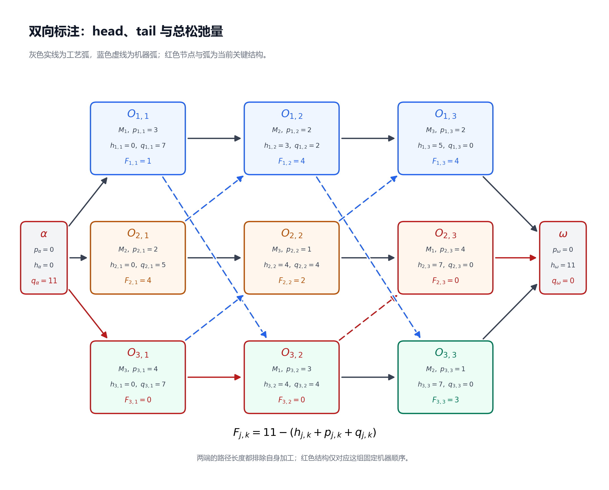
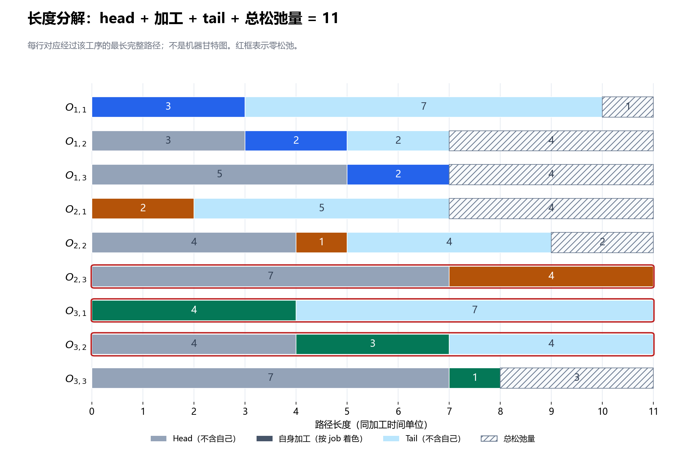
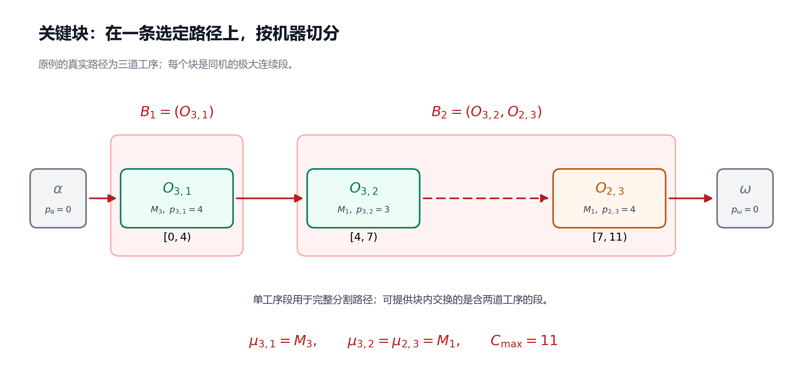

# 第 4 节：关键路径、head/tail、松弛量与关键块

状态：本轮审校完成，待用户 review。<br>
本节目标：能从固定机器顺序的图中计算 head、tail 与松弛量，识别关键工序、关键弧和关键块，并说明这些结构对后续搜索有什么用、又不能保证什么。

前置：[第 3 节：拓扑排序、最长路与 Decoder](03_拓扑排序_最长路与Decoder.md)。继续采用相同基础模型：所有 job 在时间 0 可投入，真实工序加工时间为正，机器始终可用，工序不可抢占，工序间允许等待；没有换型时间、额外交期或机器日历。

## 4.1 算出了 11，接下来应该盯住谁？

上一节的 decoder 已经给出 $C_{\max}=11$。如果想让车间更早完成，接下来要回答：这个 11 是被哪些加工和先后关系撑起来的？

先把贯穿实例的数据放在一起。每个单元格表示“指定机器，加工时长”：

| Job | 第一道工序 | 第二道工序 | 第三道工序 |
|---|---|---|---|
| $J_1$ | $O_{1,1}$：$(M_1,3)$ | $O_{1,2}$：$(M_2,2)$ | $O_{1,3}$：$(M_3,2)$ |
| $J_2$ | $O_{2,1}$：$(M_2,2)$ | $O_{2,2}$：$(M_3,1)$ | $O_{2,3}$：$(M_1,4)$ |
| $J_3$ | $O_{3,1}$：$(M_3,4)$ | $O_{3,2}$：$(M_1,3)$ | $O_{3,3}$：$(M_2,1)$ |

工艺路线仍为每个 job 的第一、第二、第三道工序依次加工，固定机器顺序仍为：

$$
\begin{aligned}
M_1&:\quad O_{1,1}\longrightarrow O_{3,2}\longrightarrow O_{2,3},\\
M_2&:\quad O_{2,1}\longrightarrow O_{1,2}\longrightarrow O_{3,3},\\
M_3&:\quad O_{3,1}\longrightarrow O_{2,2}\longrightarrow O_{1,3}.
\end{aligned}
$$

考虑两道同样从时间 0 开始的工序：

- $O_{1,1}$ 从 0 加工到 3。它完成后，$M_1$ 还要等到 4，才能加工工艺前序尚未结束的 $O_{3,2}$。
- $O_{3,1}$ 从 0 加工到 4。它一结束，$O_{3,2}$ 就开始；$O_{3,2}$ 一结束，$O_{2,3}$ 就开始，后者到 11 才结束。

这提示我们：加工时间最长、机器总负荷最大、开始最早，都不能单独定义“关键”。要看某道工序前后的整条依赖链。

## 4.2 关键路径：一条达到最大完工时间的依赖链

本节的图记为 $G=(V,E)$。节点包含真实工序、虚拟起点 $\alpha$ 与虚拟终点 $\omega$；$E$ 包含工艺弧、起终点连接弧及固定机器队列的相邻弧。图已经通过判环检查，是 DAG。

沿用上一节的弧权约定：

$$
w(u,v)=p_u,\qquad p_\alpha=p_\omega=0.
$$

**关键路径**（critical path）是从 $\alpha$ 到 $\omega$ 的一条最长路径。对固定机器顺序的最早排程，它的长度等于 $C_{\max}$。

本例的一条关键路径是：

$$
\alpha\longrightarrow O_{3,1}\longrightarrow O_{3,2}
\longrightarrow O_{2,3}\longrightarrow\omega.
$$

长度为 $0+4+3+4=11$。真实工序的加工区间依次为 $[0,4)$、$[4,7)$、$[7,11)$：前一道完成，后一道立即开始。这条链同时包含工艺关系与机器关系。

在最早排程中，关键路径上的每条弧 $u\to v$ 都是紧的，即 $h_v=h_u+p_u$，所以相邻工序之间没有等待空隙。若等式不成立，就能用到 $v$ 的更长前缀替换原路径前缀，得到更长的完整路径，与关键路径定义矛盾。这里讨论的是最早排程；若人为推迟工序，原图关键路径上也可能出现等待。第 4.7 小节会进一步解释这个判据。

这里的“关键”依赖于 **当前机器顺序和加工时间**。改变机器顺序后，这条路径可能消失；它证明当前顺序无法早于 11 完成，不能单凭它证明整个 JSSP 的全局最优。

## 4.3 Head 与 tail：把一条链拆成前、自己、后

为了不枚举所有路径，我们给每个节点保存两个汇总量。$u$、$v$、$w$ 是一般节点；对于真实工序 $v=O_{j,k}$，写 $p_v=p_{j,k}$、$h_v=h_{j,k}$、$q_v=q_{j,k}$。

| 记号 | 名称 | 本节采用的含义 | 是否包含 $p_v$？ |
|---|---|---|---|
| $h_v$ | Head，前部长度 | 从 $\alpha$ 到 $v$ 的最长路径长度，即最早开始时刻 | 不包含 |
| $q_v$ | Tail，后部长度 | 从 $v$ 完成后到 $\omega$，沿依赖路径还需经历的最长加工长度 | 不包含 |
| $h_v+p_v+q_v$ | 经过 $v$ 的最长完整路径长度 | 前部、自己、后部三段相加 | 包含一次 |

所以，head 就是上一节的 $d_v$，现在使用 $h_v$ 是为了与 tail 配对：

$$
h_\alpha=0,\qquad
h_v=\max_{u\in\operatorname{Pred}(v)}(h_u+p_u).
$$

其中 $\operatorname{Pred}(v)$ 是 $v$ 的直接前序集合，按拓扑顺序计算即可。

Tail 看的是后继。令 $\operatorname{Succ}(v)$ 为 $v$ 的直接后继集合，则：

$$
q_\omega=0,\qquad
q_v=\max_{w\in\operatorname{Succ}(v)}(p_w+q_w).
$$

要按 **逆拓扑顺序** 计算：先算后继，再算当前节点。若接下来走向 $w$，当前工序完成后还要经历 $w$ 的加工和 $w$ 的后部，所以加的是 $p_w$。

尤其要注意：按本节弧权，从节点 $v$ 到 $\omega$ 的最长路径长度是 $p_v+q_v$，因为第一条出弧已经携带 $p_v$。因此：

$$
q_v=\text{从 }v\text{ 到 }\omega\text{ 的最长路径长度}-p_v.
$$

有些文献把包含自身时长的后向距离也称为 tail；阅读时应先检查定义。本节始终使用“不包含自身加工时间”的 $q_v$。[Jain、Rangaswamy 与 Meeran 的原始研究稿第 1.2 小节采用了这一 head/tail 定义，并给出关键工序的判据](https://www.researchgate.net/publication/220403549_New_and_Stronger_Job-Shop_Neighbourhoods_A_Focus_on_the_Method_of_Nowicki_and_Smutnicki_1996)。

Tail 也不是实际排程中“从完成到全车间结束”的钟表时间。例如 $O_{1,3}$ 没有真实后继，$q_{1,3}=0$，但它在 7 完成，车间还要到 11 才全部完成。那四个单位属于其他分支的加工，并非它后面的依赖链。

## 4.4 从终点往前，完整手算 tail

上一节的一种拓扑顺序为：

$$
\alpha,\ O_{1,1},\ O_{2,1},\ O_{3,1},\ O_{1,2},\ O_{3,2},
\ O_{2,2},\ O_{3,3},\ O_{2,3},\ O_{1,3},\ \omega.
$$

将它反过来，逐节点计算。表中的候选值是 $p_w+q_w$。

| 本次计算节点 | 后继候选值 | Tail $q_v$ |
|---|---|---:|
| $\omega$ | 定义为 0 | 0 |
| $O_{1,3}$ | $\omega$：$0+0=0$ | 0 |
| $O_{2,3}$ | $\omega$：$0+0=0$ | 0 |
| $O_{3,3}$ | $\omega$：$0+0=0$ | 0 |
| $O_{2,2}$ | $O_{2,3}$：$4+0=4$；$O_{1,3}$：$2+0=2$ | 4 |
| $O_{3,2}$ | $O_{3,3}$：$1+0=1$；$O_{2,3}$：$4+0=4$ | 4 |
| $O_{1,2}$ | $O_{1,3}$：$2+0=2$；$O_{3,3}$：$1+0=1$ | 2 |
| $O_{3,1}$ | $O_{3,2}$：$3+4=7$；$O_{2,2}$：$1+4=5$ | 7 |
| $O_{2,1}$ | $O_{2,2}$：$1+4=5$；$O_{1,2}$：$2+2=4$ | 5 |
| $O_{1,1}$ | $O_{1,2}$：$2+2=4$；$O_{3,2}$：$3+4=7$ | 7 |
| $\alpha$ | $O_{1,1}$：$3+7=10$；$O_{2,1}$：$2+5=7$；$O_{3,1}$：$4+7=11$ | 11 |

例如 $O_{3,2}$ 完成后，有两条后续分支：自己的最后一道工序耗时 1，或机器队列中的 $O_{2,3}$ 耗时 4。它们的限制要同时满足，因此取较长的 4；不能把两条分支相加成 5。

对虚拟节点也有 $h_\alpha=0$、$q_\alpha=11$、$h_\omega=11$、$q_\omega=0$。它们可用于核对两次计算是否一致：从前往后和从后往前，都应得到整张图的最长路径长度 11。



图中每道工序的 $h_{j,k}$、$q_{j,k}$ 都不包含自身时长；$F_{j,k}$ 是下面定义的总松弛量。红色标记对应当前顺序下的关键结构，不表示全局最优性。

## 4.5 总松弛量：不晚于 11 完成，还有多少余地？

先说明 $h_v+p_v+q_v$ 为什么有用。选取一条最长前部路径和一条最长后部路径，在 $v$ 处拼接，就得到经过 $v$ 的路径。DAG 中这两段不会在 $v$ 之外重复节点，否则会形成有向环。因此它们可以拼成一条完整路径。

反过来，任何经过 $v$ 的完整路径，其前部不长于 $h_v$，后部不长于 $q_v$。所以，$h_v+p_v+q_v$ 恰好等于 **所有经过 $v$ 的完整路径中最长一条的长度**。

下面固定共同完成上限 $T=11$。它取自当前顺序最早排程的 $C_{\max}$，是分析用的时间上限，基础问题并没有额外输入一项交期。

若要全部在不晚于 $T$ 时完成，从 $v$ 的开始时刻起，至少还要留下 $p_v+q_v$ 的时间。因此 $v$ 的最迟开始时刻记为 $\ell_v$：

$$
\ell_v=T-p_v-q_v.
$$

定义 **总松弛量**（total float / total slack）$F_v$ 为最迟开始与最早开始之差：

$$
F_v=\ell_v-h_v=T-(h_v+p_v+q_v).
$$

这里 $F_{j,k}=F_{O_{j,k}}$、$\ell_{j,k}=\ell_{O_{j,k}}$。在当前可行图且 $T=C_{\max}$ 的条件下，每条路径长度都不超过 $T$，所以 $F_v\ge0$。

| 工序 | $h_{j,k}$ | $p_{j,k}$ | $q_{j,k}$ | $h_{j,k}+p_{j,k}+q_{j,k}$ | $\ell_{j,k}$ | $F_{j,k}$ |
|---|---:|---:|---:|---:|---:|---:|
| $O_{1,1}$ | 0 | 3 | 7 | 10 | 1 | 1 |
| $O_{1,2}$ | 3 | 2 | 2 | 7 | 7 | 4 |
| $O_{1,3}$ | 5 | 2 | 0 | 7 | 9 | 4 |
| $O_{2,1}$ | 0 | 2 | 5 | 7 | 4 | 4 |
| $O_{2,2}$ | 4 | 1 | 4 | 9 | 6 | 2 |
| $O_{2,3}$ | 7 | 4 | 0 | 11 | 7 | 0 |
| $O_{3,1}$ | 0 | 4 | 7 | 11 | 0 | 0 |
| $O_{3,2}$ | 4 | 3 | 4 | 11 | 4 | 0 |
| $O_{3,3}$ | 7 | 1 | 0 | 8 | 10 | 3 |

例如 $O_{1,1}$ 的最长前部为 0，自身加工为 3，最长后部为 7，合计 10，距离共同上限 11 还差 1。



图中每行表示经过该工序的最长路径长度及其余量，不是机器甘特图；灰色 head 和浅蓝色 tail 是路径长度汇总。三道零松弛工序的三段长度正好达到 11。

为什么称 $\ell_v$ 为“最迟”，而不只是一个必要上限？把所有节点设为 $s_v=\ell_v$，并取 $s_\omega=T$。对于任意弧 $v\to w$，tail 的递推给出 $q_v\ge p_w+q_w$，于是：

$$
\ell_v+p_v=T-q_v
\le T-p_w-q_w=\ell_w.
$$

所以全部先后约束成立；又因为 $\ell_v\ge h_v\ge0$，真实工序不会在时间 0 之前开始。这组最迟开始时刻本身就是一个可行安排，每道工序都能在该安排中达到自己的 $\ell_v$。

对于实际排程，仍将虚拟起点固定在 0；本例公式也恰好给出 $\ell_\alpha=T-q_\alpha=0$。最迟排程允许主动等待，通常与最早排程不同，但在本例仍于 11 完成。

由经过工序的最长路径性质，得到关键工序（critical operation）的判据：

$$
v\text{ 是关键工序}
\quad\Longleftrightarrow\quad
h_v+p_v+q_v=T
\quad\Longleftrightarrow\quad F_v=0.
$$

这里“关键工序”表示位于 **至少一条关键路径** 上。本例是 $O_{3,1}$、$O_{3,2}$、$O_{2,3}$。若把完成上限选成大于当前 $C_{\max}$ 的数，算出的松弛量会整体增加，零松弛判据就不能照搬来识别原图的关键工序。

## 4.6 总松弛量不等于可以单独移动的空档

$O_{1,1}$ 的总松弛量是 1。能否只把它从 $[0,3)$ 移到 $[1,4)$，其他工序保持原来的时间？

不可以。$O_{1,2}$ 还在 3 开始，而自己的工艺前序要到 4 才结束，约束立刻被破坏。

但允许后继一起调整，确实能把 $O_{1,1}$ 延迟一个单位，仍在 11 完成：

| 工序 | 原最早加工区间 | 调整后的加工区间 |
|---|---|---|
| $O_{1,1}$ | $[0,3)$ | $[1,4)$ |
| $O_{1,2}$ | $[3,5)$ | $[4,6)$ |
| $O_{1,3}$ | $[5,7)$ | $[6,8)$ |
| 其余真实工序 | 沿用第 3 节的时间 | 保持原时间 |

检查 $M_1$ 上 $O_{1,1}$ 到 4 完成、$O_{3,2}$ 从 4 开始；$M_2$ 上 $O_{1,2}$ 到 6 完成、$O_{3,3}$ 从 7 开始；$M_3$ 上 $O_{2,2}$ 到 5 完成、$O_{1,3}$ 从 6 开始，均不冲突。$J_2$ 仍在 11 完成，所以 $C_{\max}$ 不变。

如果要求“其余工序都保持最早时刻”，可定义 **自由松弛量**（free float）$f_v$：

$$
f_v=\min_{w\in\operatorname{Succ}(v)}h_w-(h_v+p_v).
$$

它表示只延后当前工序、所有直接后继的开始时刻保持不动，最多能延后多少。这里将 $h_\omega=T$ 也作为最后工序的后继时刻。

对于 $O_{1,1}$，两个后继最早在 3 和 4 开始，因此：

$$
f_{1,1}=\min(3,4)-(0+3)=0,
\qquad F_{1,1}=1.
$$

对比就很清楚：总松弛量允许协调调整后续时间，自由松弛量要求后续时间保持不动。这两个量都与第 3 节更新最长路时的“松弛操作”不同；后者是算法中的更新动作。

还有一个容易说错的结论：**各工序在自己的最早、最迟区间内任选时间，不保证彼此相容**。上面只延后 $O_{1,1}$ 就是反例。但“把全部工序都取各自最迟开始时刻”却是可行的，上一小节已经证明了；不能把这两件事混为一谈。

## 4.7 怎样找一条关键路径？怎样判断关键弧？

可以从 $\omega$ 向前回溯。当前节点为 $v$ 时，找一个满足下式的直接前序 $u$：

$$
h_v=h_u+p_u.
$$

因为 $h_v$ 本来就是前序候选值的最大值，至少有一个前序达到这个等式。不断回溯到 $\alpha$，再把列表反转，就得到一条关键路径。本例的过程为：

| 当前节点 | 前序候选值 | 选中的前序 |
|---|---|---|
| $\omega$ | $O_{1,3}$：7；$O_{2,3}$：11；$O_{3,3}$：8 | $O_{2,3}$ |
| $O_{2,3}$ | $O_{2,2}$：5；$O_{3,2}$：7 | $O_{3,2}$ |
| $O_{3,2}$ | $O_{3,1}$：4；$O_{1,1}$：3 | $O_{3,1}$ |
| $O_{3,1}$ | $\alpha$：0 | $\alpha$ |

于是又得到第 4.2 小节的路径。若多个前序并列，可选择任意一个来找一条路径；若要找全部关键结构，应利用 head/tail 判据，不必枚举所有路径。

一条弧 $u\to v$ 称为 **关键弧**（critical arc），当且仅当它位于至少一条关键路径上。经过这条弧的最长完整路径长度为：

$$
h_u+p_u+p_v+q_v.
$$

前两项到达 $v$ 的开始位置，后两项包含 $v$ 的加工及之后的最长后部。与上面的拼接论证相同，在 DAG 中可据此判断：

$$
u\to v\text{ 是关键弧}
\quad\Longleftrightarrow\quad
h_u+p_u+p_v+q_v=T.
$$

例如关键机器弧 $O_{3,2}\to O_{2,3}$ 满足 $4+3+4+0=11$。

也可以使用等价判据：$u$、$v$ 都是关键节点，且 $h_v=h_u+p_u$。后一条件表示这条先后约束在最早排程中 **取等号**，也称为紧弧（tight arc）。

但仅有等号不够。$O_{1,1}\to O_{1,2}$ 同样满足 $3=0+3$，经过该弧的最长完整路径却只有 $0+3+2+2=7$。它是紧弧，却不是关键弧。无等待连接可能出现在非关键分支上。

## 4.8 有多条关键路径时，零松弛意味着什么？

现在做一个小变体：只把 $p_{1,1}$ 从 3 改为 4，机器顺序和其他加工时间保持不变。

$O_{3,2}$ 的两个前序此时都在 4 完成，所以它仍在 4 开始，$O_{2,3}$ 仍在 7 开始、到 11 结束。$O_{1,2}$ 改为 $[4,6)$，$O_{1,3}$ 改为 $[6,8)$；$O_{3,3}$ 仍为 $[7,8)$。新的 $C_{\max}$ 仍是 11。

现在有两条不同的关键路径：

$$
\alpha\longrightarrow O_{3,1}\longrightarrow O_{3,2}
\longrightarrow O_{2,3}\longrightarrow\omega,
$$

$$
\alpha\longrightarrow O_{1,1}\longrightarrow O_{3,2}
\longrightarrow O_{2,3}\longrightarrow\omega.
$$

两条长度都为 $4+3+4=11$。$O_{1,1}$、$O_{3,1}$、$O_{3,2}$、$O_{2,3}$ 都是零松弛工序，但前两道分别出现在不同路径上。

因此，关键工序不一定在程序选出的那一条路径上，也不一定在每一条关键路径上。一次回溯得到的工序集合，可能小于全部零松弛工序的集合。

若在这个变体中把 $p_{3,1}$ 从 4 减为 3，经过 $O_{3,1}$ 的那条路径变短，另一条仍长 11，所以 $C_{\max}$ 仍为 11。这个时长变化只用于理解瓶颈；标准 JSSP 的搜索决策通常是改变机器顺序，而不是任意缩短输入的加工时间。

由此得到一个一般的必要条件：**若某条原关键路径连同它的时长完整保留，新图的最长路就仍至少为原来的 $C_{\max}$**。要严格改善，必须使每条原关键路径都失去原有的长度限制；即便如此，仍可能出现新的同样长或更长的路径，改善并不自动成立。

## 4.9 关键块：在选定路径上，按机器切成连续段

下面回到原始数据，即 $p_{1,1}=3$。取关键路径的真实工序部分：

$$
O_{3,1}\longrightarrow O_{3,2}\longrightarrow O_{2,3}.
$$

它们的指定机器依次是 $M_3$、$M_1$、$M_1$。把连续使用同一机器的工序切成一段，就得到 **关键块**（critical block）。

准确地说，给定一条关键路径，关键块是这条路径上使用同一台机器的 **极大连续工序子序列**。“极大”表示不能再向左或向右扩展一个路径工序而仍保持同一机器；不表示这是全图中工序数量最多的块。[原始研究稿第 1.2 小节也以此方式分解关键路径](https://www.researchgate.net/publication/220403549_New_and_Stronger_Job-Shop_Neighbourhoods_A_Focus_on_the_Method_of_Nowicki_and_Smutnicki_1996)。

本节用 $B_b$ 表示第 $b$ 个块，允许单道工序构成一段，以便完整分割路径：

$$
B_1=(O_{3,1}),\qquad B_2=(O_{3,2},O_{2,3}).
$$

有些邻域定义只把至少含两道工序的段称为关键块，因为单道工序无法提供块内交换。按这种约定，本例可用于块内移动的关键块只有 $B_2$。阅读算法时要检查采用哪一种约定。



图中的分段依赖于选定的关键路径；全部零松弛工序按机器分组，不能代替这一步。在多关键路径的例子中，不同选路也可能得到不同分块。

$B_2$ 中两道工序在 $M_1$ 上相邻加工，区间分别为 $[4,7)$、$[7,11)$，中间没有空闲。由于图只保留相邻机器弧，且加工时间为正，关键路径上连续同机的工序也必须在机器队列中相邻；若队列中间还夹着另一道同机工序，经过它的路径会多出正时长，原来的两道工序就不可能在关键路径上相邻。

为什么这对搜索有用？工艺路线由输入固定，而机器先后关系可以选择。关键块把一条限制完工时间的路径中，可通过机器排序影响的连续部分暴露出来，为候选移动提供位置。[Nowicki 与 Smutnicki 的原始算法论文确实使用关键路径与工序块构造邻域](https://pubsonline.informs.org/doi/10.1287/mnsc.42.6.797)。具体哪些位置值得交换，以及 N5 如何筛选，将放到第 7 节。

## 4.10 交换关键块里的工序，会自动改善吗？

试着交换 $B_2$ 中的两道工序，让 $M_1$ 的队列变为：

$$
M_1:\quad O_{1,1}\longrightarrow O_{2,3}\longrightarrow O_{3,2}.
$$

其余机器队列、工艺路线与加工时间均不变。注意这次改变的是队列：原来的相邻机器弧要被替换，再由 decoder 重新计算，不能只交换甘特图中的两个矩形。

新的图通过判环检查，最早时间如下：

| 工序 | 原加工区间 | 交换后的最早加工区间 | 改变原因 |
|---|---|---|---|
| $O_{2,3}$ | $[7,11)$ | $[5,9)$ | 改为等待 $O_{2,2}$ 到 5 完成；机器前序 $O_{1,1}$ 已在 3 完成 |
| $O_{3,2}$ | $[4,7)$ | $[9,12)$ | 改为等待机器前序 $O_{2,3}$ 到 9 完成 |
| $O_{3,3}$ | $[7,8)$ | $[12,13)$ | 等待自己的工艺前序 $O_{3,2}$ 到 12 完成 |
| 其余真实工序 | 沿用第 3 节的时间 | 保持原时间 | 最强前序限制没有改变 |

于是 $C_1=7$、$C_2=9$、$C_3=13$，新的 $C_{\max}=13$，反而变差。新图的一条最长路径是：

$$
\alpha\longrightarrow O_{3,1}\longrightarrow O_{2,2}
\longrightarrow O_{2,3}\longrightarrow O_{3,2}
\longrightarrow O_{3,3}\longrightarrow\omega,
$$

长度为 $4+1+4+3+1=13$。

这说明，关键块提供的是 **候选移动的结构依据**，不是改善证书。一次移动会同时改变多个前后关系；原路径被打断后，可能形成更长的新路径。一般移动还需检查是否形成有向环，具体邻域若有可行性定理，也必须满足定理的前提。

后续搜索的基本闭环会是：生成候选队列，检查可行性，重新解码，比较目标值，再按算法规则决定是否接受。接受后的解还要重新计算关键结构，不能沿用上一个解的 head、tail 或关键块。

## 4.11 在 decoder 后增加一次反向扫描

不需要枚举全部路径。第 3 节已经算出 head 并得到拓扑列表，只需补一次逆向扫描，就能标记全部关键工序和关键弧。

下面伪代码中，`h[v]`、`q[v]`、`p[v]`、`float[v]` 分别对应 $h_v$、$q_v$、$p_v$、$F_v$；`topo` 是已通过判环检查的完整拓扑列表，`succ`、`pred` 是同一组弧的后继表和前序表。

```text
analyse_critical_structure(topo, succ, pred, p, h):
    T = h[omega]
    q[omega] = 0

    for v in reverse(topo):
        if v != omega:
            q[v] = max(p[w] + q[w] for w in succ[v])

    for 每道真实工序 v:
        latest[v] = T - p[v] - q[v]
        float[v] = latest[v] - h[v]
        critical_operation[v] = (float[v] == 0)

    for 每条弧 (u, v):
        critical_arc[u, v] = (h[u] + p[u] + p[v] + q[v] == T)

    path = [omega]
    v = omega
    while v != alpha:
        u = 任取 pred[v] 中满足 h[u] + p[u] == h[v] 的节点
        path.append(u)
        v = u
    path.reverse()

    real_path = 去掉 path 中的 alpha 和 omega
    blocks = 将 real_path 按指定机器切成极大连续段
    return q, latest, float, critical_operation, critical_arc, path, blocks
```

在本节正确构造的图中，每个真实工序都能沿工艺路线到达 $\omega$，所以除 $\omega$ 外的节点都有后继，不会对空集合取最大值。逆拓扑扫描保证用到的 $q_w$ 已经计算完成。

两次扫描及逐弧标记的时间复杂度均为 $O(\lvert V\rvert+\lvert E\rvert)$；回溯一条路径并分块也在线性范围内。全部关键路径的数量可能很大，但标记全部关键节点、关键弧不需要把所有路径逐条列出。

本例加工时间为整数，可直接比较等式；若实现使用浮点数，需根据时间尺度约定误差容限，避免舍入使理论上的零松弛变成很小的正数或负数。

## 4.12 八个容易混淆的地方

| 容易形成的误解 | 正确理解 |
|---|---|
| Tail 一定是节点到终点的弧权和 | 本节的 $q_v$ 排除自身时长；弧权和是 $p_v+q_v$ |
| Tail 等于 $C_{\max}-c_{j,k}$ | 它只汇总工序后面的依赖路径；其他分支的加工不属于它 |
| 松弛量大于 0，就能只移动这一道工序 | 总松弛量可能需要后继配合调整；只移动自己应看自由松弛量 |
| 每个开始时刻各自落在 $[h_v,\ell_v]$ 内，就一定可行 | 还必须满足全部弧约束；区间不是互相独立的选择空间 |
| 零松弛工序都在当前回溯出的一条路径上 | 它们属于至少一条关键路径；多路径时一次回溯可能漏掉其他关键工序 |
| 相邻加工无等待，就一定是关键弧 | 紧弧还可能位于非关键分支；需检查完整路径长度 |
| 将所有同机零松弛工序合起来，就是一个关键块 | 关键块在选定路径上定义，要求同机、连续、极大 |
| 交换关键块内工序，一定可行且改善 | 要检查候选的可行性并重新解码；本例交换后可行，但目标值从 11 变为 13 |

## 4.13 自检题

先自己计算，再看参考答案。除第 6 题明确使用变体外，均使用原始加工时间。

1. $O_{3,2}$ 的 head、tail、自身加工时间分别是多少？为什么从该节点到 $\omega$ 的最长弧权和不是它的 tail？
2. 手算 $q_{2,1}$。它的两个后继分支应该取最大值还是相加？
3. 求 $O_{2,2}$ 的最迟开始时刻与总松弛量。它是否是关键工序？
4. $O_{1,1}$ 的总松弛量为 1。只把它延后 1，其他工序保持最早时刻，为什么不可行？自由松弛量是多少？
5. $O_{1,1}\to O_{1,2}$ 和 $O_{3,2}\to O_{2,3}$ 都在最早排程中无等待。哪条是关键弧？分别算经过它们的最长完整路径长度。
6. 在 $p_{1,1}=4$ 的变体中，一次回溯选到了经过 $O_{3,1}$ 的关键路径。能否据此断定 $O_{1,1}$ 不关键？若再将 $p_{3,1}$ 改为 3，$C_{\max}$ 会不会降到 10？
7. 原例选定关键路径上的两个极大同机连续段是什么？$O_{1,1}$ 为什么不属于 $M_1$ 上那个关键块？
8. 交换 $O_{3,2}$ 与 $O_{2,3}$ 后，$O_{3,3}$ 在什么时候开始、结束？新目标值是多少？这说明关键块的用途是什么？

### 参考答案

1. $h_{3,2}=4$、$q_{3,2}=4$、$p_{3,2}=3$。从节点到终点的最长弧权和为 $3+4=7$，第一条出弧携带自身的 3；tail 从该工序完成以后算起，排除了这个 3。
2. $q_{2,1}=\max(1+4,2+2)=5$。两个候选分别经 $O_{2,2}$ 和 $O_{1,2}$；取最大值，不把分支串成一条不存在的路径。
3. $\ell_{2,2}=11-1-4=6$，$F_{2,2}=6-4=2$。经过它的最长完整路径长 9，小于 11，因此不关键。
4. 它移到 $[1,4)$ 后，$O_{1,2}$ 仍在 3 开始，违反工艺约束。$f_{1,1}=\min(3,4)-3=0$；要使用总松弛量，需让受影响后继一起调整。
5. 第一条的完整路径长度为 $0+3+2+2=7$，不关键；第二条为 $4+3+4+0=11$，是关键机器弧。紧弧与关键弧不能混同。
6. 不能。此时 $h_{1,1}+p_{1,1}+q_{1,1}=0+4+7=11$，$O_{1,1}$ 位于另一条关键路径上。将 $p_{3,1}$ 改为 3 后，经过 $O_{1,1}$ 的路径仍长 11，$C_{\max}$ 仍为 11。
7. 分别为 $(O_{3,1})$ 和 $(O_{3,2},O_{2,3})$。$O_{1,1}$ 虽使用 $M_1$，却不在原例的选定关键路径上，且其总松弛量为 1；不能把整条机器队列当成关键块。
8. $O_{3,3}$ 从 12 开始、到 13 完成，新 $C_{\max}=13$。关键块指出可考虑改变的机器先后关系；实际效果仍需通过可行性检查与重新解码评估。

## 4.14 复习速记卡

| 以后复习时要立即想起的点 | 本节对应的要点 |
|---|---|
| 关键路径是什么？ | 固定顺序图中，从 $\alpha$ 到 $\omega$ 的最长路径 |
| Head 包含自己吗？ | 不包含；$h_v$ 是最早开始时刻，也是上一节的 $d_v$ |
| Tail 包含自己吗？ | 本节不包含；从 $v$ 到 $\omega$ 的最长弧权和是 $p_v+q_v$ |
| Tail 怎样递推？ | $q_\omega=0$；逆拓扑计算 $q_v=\max_{w\in\operatorname{Succ}(v)}(p_w+q_w)$ |
| 总松弛量怎么算？ | $F_v=T-(h_v+p_v+q_v)$，本节取 $T=C_{\max}$ |
| 关键工序怎样判断？ | $F_v=0$，等价于位于至少一条关键路径上 |
| 怎样找一条关键路径？ | 从 $\omega$ 沿达到 head 等式的前序回溯到 $\alpha$ |
| 关键弧怎样判断？ | $h_u+p_u+p_v+q_v=T$；仅仅无等待还不够 |
| 关键块是什么？ | 一条选定关键路径上，使用同机的极大连续工序段 |
| 为什么移动后重算？ | 机器弧改变会使路径、时间与关键结构一起改变 |

下一节：[构造启发式：SPT、LPT、MWKR 与排程生成](05_构造启发式_SPT_LPT_MWKR.md)。我们已经知道如何评价一组机器顺序；下一步要解决的是，怎样从空排程开始快速造出一组可行顺序。

审校与核算范围见 [全套审校记录](assets/01_14_review.md)。
