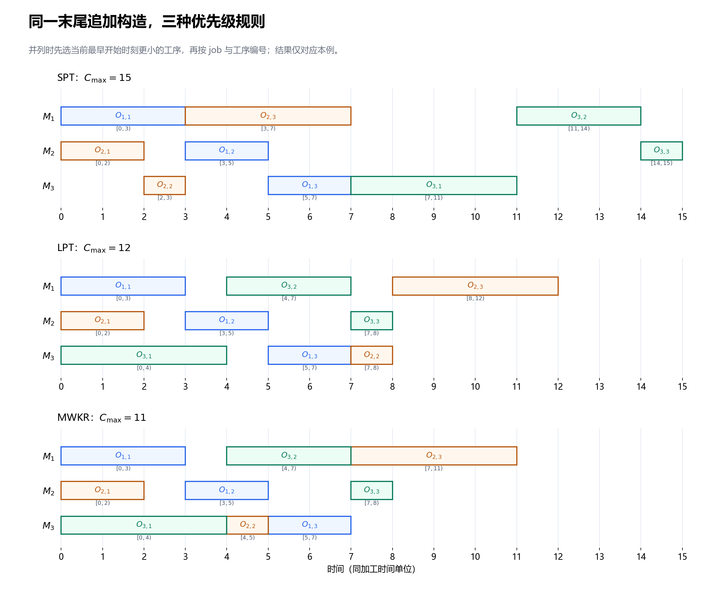
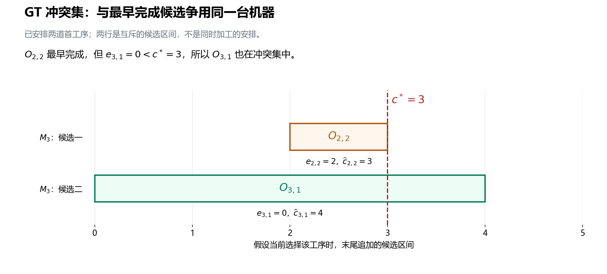
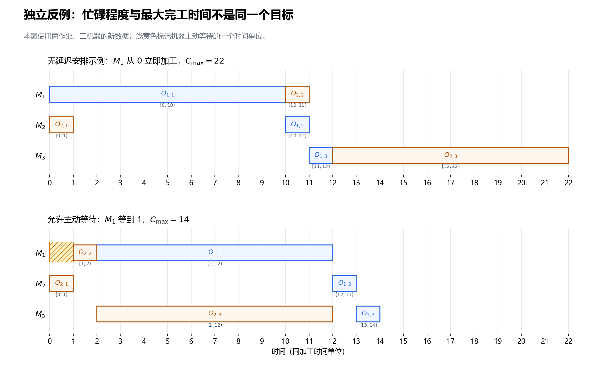

---
tags:
  - JSP
  - 启发式算法
---

# 第 5 节：构造启发式——SPT、LPT、MWKR 与排程生成

状态：第一版，待 review。<br>
本节目标：能从空排程逐步构造一组可行机器顺序，手算 SPT、LPT、MWKR 的选择，区分优先级规则与排程生成框架，并理解半主动、主动、无延迟排程的区别。

前置：[第 4 节：关键路径、head/tail、松弛量与关键块](./04_关键路径_head_tail_松弛量与关键块.md)。继续采用相同基础模型：所有 job 在时间 0 可投入，加工时间为正，机器始终可用，工序不可抢占，允许工序等待与机器空闲；没有换型、运输、故障或额外交期约束。

## 5.1 现在不再给机器队列：第一道应该选谁？

前面几节已经知道：给定完整机器队列，可以判环、解码，再分析关键路径。但搜索通常要从一个可行解出发，不能一直等待别人把队列交给我们。

**构造启发式** 从空排程开始，每次作出一个局部选择，逐步形成完整排程。它首先解决“快速得到可行解”，解的质量则取决于构造过程中的选择。

仍使用原来的 3×3 数据。每个单元格给出工序、指定机器与加工时间：

| Job | 第一道工序 | 第二道工序 | 第三道工序 |
|---|---|---|---|
| $J_1$ | $O_{1,1}$：$(M_1,3)$ | $O_{1,2}$：$(M_2,2)$ | $O_{1,3}$：$(M_3,2)$ |
| $J_2$ | $O_{2,1}$：$(M_2,2)$ | $O_{2,2}$：$(M_3,1)$ | $O_{2,3}$：$(M_1,4)$ |
| $J_3$ | $O_{3,1}$：$(M_3,4)$ | $O_{3,2}$：$(M_1,3)$ | $O_{3,3}$：$(M_2,1)$ |

工艺路线依次为每个 job 的第一、第二、第三道工序。现在机器队列尚未确定；初始可考虑的工序是 $O_{1,1}$、$O_{2,1}$、$O_{3,1}$，不能直接选择后面的工序。

若只看眼前加工时间，最短的是 $O_{2,1}$，最长的是 $O_{3,1}$。若看整个 job 尚未安排的工作量，三个 job 分别还有 $7$、$7$、$8$，又会偏向 $J_3$。这正是不同优先级规则的出发点。

## 5.2 一条优先级规则，还不是一个完整算法

**优先级规则**（priority rule / dispatching rule）负责比较候选工序。例如 SPT 说“较短的当前工序优先”，但这句话还没有交代：

1. 候选是所有未安排工序，还是每个 job 的下一道工序？
2. 在所有候选中比较，还是只比较某一台机器上的候选？
3. 选中工序以后，放在机器队列末尾，还是插入已有空档？
4. 分数相同怎么办？允许为了未来工序主动等待吗？

**排程生成框架** 决定这些问题。本节先完整定义一个末尾追加框架，再介绍通过冲突集筛选候选的 Giffler–Thompson（GT）框架。

因此，报告一个构造方法时，应同时说明：候选集、优先级、并列处理、放置方式。只写“用了 SPT”，不能唯一复现排程。[Ingimundardottir 与 Runarsson 的原始研究将 SPT、LPT、MWKR 等作为派工规则，并讨论构造状态中的加工时间、剩余工作量和机器可用时刻](https://www.researchgate.net/publication/221608767_Supervised_Learning_Linear_Priority_Dispatch_Rules_for_Job-Shop_Scheduling)。

本节是在离线规划中逐步填写时间表。“选择一道工序”表示决定它的加工位置和时间，不表示车间此刻真的开始执行它。

## 5.3 SPT、LPT、MWKR 分别在看什么？

设 $J_j$ 有 $n_j$ 道工序，本例 $n_j=3$。对候选工序 $O_{j,k}$，定义当前工序及其后续工序的总加工量：

$$
R_{j,k}=\sum_{\ell=k}^{n_j}p_{j,\ell}.
$$

这里的 $\ell$ 是求和索引。$R_{j,k}$ **包含当前工序**，不包含已经安排的前序；即使那些前序在真实车间尚未加工，它们也已经退出本构造过程的“未安排工作量”。

| 规则 | 英文全称 | 在候选中优先选择 | 直觉 |
|---|---|---|---|
| SPT | Shortest Processing Time | $p_{j,k}$ 最小 | 先处理眼前较短的加工 |
| LPT | Longest Processing Time | $p_{j,k}$ 最大 | 先处理眼前较长的加工 |
| MWKR | Most Work Remaining | $R_{j,k}$ 最大 | 优先推进后面尚有较多工作的 job |

注意 LPT 看的是当前工序，不是 job 的总长度；MWKR 看的是剩余加工时间之和，不是剩余工序的数量。不同文献对规则缩写和组合方式可能有差异，本节以这张表为准。

本例的剩余工作量可预先按 job 反向累加：

| Job | $R_{j,1}$ | $R_{j,2}$ | $R_{j,3}$ |
|---|---:|---:|---:|
| $J_1$ | 7 | 4 | 2 |
| $J_2$ | 7 | 5 | 4 |
| $J_3$ | 8 | 4 | 1 |

例如安排 $O_{2,1}$ 后，$J_2$ 下一次参与比较的值从 7 变成 5；安排 $O_{2,2}$ 后，又变成 4。不能始终拿原始总工作量 7 比较。

$R_{j,k}$ 也不同于上一节的 tail $q_{j,k}$。它只沿自己的工艺路线累加，而且包含当前工序；tail 排除自身时长，并考虑固定图中跨 job 的机器依赖。机器顺序还没有完成时，也不能直接套用前一完整解的 tail 来解释本节的 MWKR。

## 5.4 末尾追加构造：候选、状态、时间和更新

用 $t$ 表示构造步骤，$E^{(t)}$ 表示该步的候选集：对每个尚未全部安排的 job，只取它的 **第一道未安排工序**。这样每个 job 至多提供一个候选。

候选的工艺前序已经安排了，但未必在车间已经完成。因此 $E^{(t)}$ 是“前序已安排”的集合，不是某个实际时刻“全部能立刻开工”的集合。

维护两个状态量：

| 状态 | 含义 | 初始值 |
|---|---|---:|
| $b_j$ | $J_j$ 已安排前缀中最后一道工序的完成时刻 | 0 |
| $a_r$ | $M_r$ 已安排队列中最后一道工序的完成时刻 | 0 |

对候选 $O_{j,k}$，若 $\mu_{j,k}=M_r$，在机器队列末尾追加时的最早开始、候选完成时刻为：

$$
e_{j,k}=\max(b_j,a_r),\qquad
\widehat c_{j,k}=e_{j,k}+p_{j,k}.
$$

$e_{j,k}$、$\widehat c_{j,k}$ 只是当前状态下假设选择该候选的时刻。未选中的候选没有被安排；其他选择更新状态后，它们的候选时间可能改变。

选中 $O_{j,k}$ 后，执行：

$$
s_{j,k}=e_{j,k},\qquad c_{j,k}=\widehat c_{j,k},
$$

$$
b_j\leftarrow c_{j,k},\qquad a_r\leftarrow c_{j,k}.
$$

同时把 $O_{j,k}$ 放到 $M_r$ 队列末尾，将 $J_j$ 的候选推进到下一道工序；若整个 job 已安排完，就不再提供候选。每一步只安排一道真实工序。

本节的末尾追加框架在整个 $E^{(t)}$ 中使用优先级规则。主指标并列时，依次选择：

1. 当前 $e_{j,k}$ 更小的工序；
2. job 编号 $j$ 更小的工序；
3. 工序编号 $k$ 更小的工序。

这是本节为复现结果作出的算法约定。对于三种规则，可以统一写成按以下比较键取最小值：

$$
\begin{aligned}
\text{SPT}:&\quad(p_{j,k},e_{j,k},j,k),\\
\text{LPT}:&\quad(-p_{j,k},e_{j,k},j,k),\\
\text{MWKR}:&\quad(-R_{j,k},e_{j,k},j,k).
\end{aligned}
$$

这里按字典序比较：前一项不同时就决定大小，相同时才比较下一项。不是把这几个数相加，也不是先选择最早能开始的工序，再应用主规则。

## 5.5 完整手算：用 MWKR 从空排程构造原来的解

下面每个候选后面的二元组是 $(R_{j,k},e_{j,k})$，先比较剩余工作量，再按上面约定处理并列。

| 步骤 | 候选及 $(R_{j,k},e_{j,k})$ | 选中工序 | 加工区间 | 选择原因 |
|---:|---|---|---|---|
| 1 | $O_{1,1}:(7,0)$；$O_{2,1}:(7,0)$；$O_{3,1}:(8,0)$ | $O_{3,1}$ | $[0,4)$ | 剩余工作量 8 最大 |
| 2 | $O_{1,1}:(7,0)$；$O_{2,1}:(7,0)$；$O_{3,2}:(4,4)$ | $O_{1,1}$ | $[0,3)$ | 两个 7 并列，开始时刻也相同，取 $J_1$ |
| 3 | $O_{1,2}:(4,3)$；$O_{2,1}:(7,0)$；$O_{3,2}:(4,4)$ | $O_{2,1}$ | $[0,2)$ | 剩余工作量 7 最大 |
| 4 | $O_{1,2}:(4,3)$；$O_{2,2}:(5,4)$；$O_{3,2}:(4,4)$ | $O_{2,2}$ | $[4,5)$ | 剩余工作量 5 最大 |
| 5 | $O_{1,2}:(4,3)$；$O_{2,3}:(4,5)$；$O_{3,2}:(4,4)$ | $O_{1,2}$ | $[3,5)$ | 三个 4 并列，最早开始 3 最小 |
| 6 | $O_{1,3}:(2,5)$；$O_{2,3}:(4,5)$；$O_{3,2}:(4,4)$ | $O_{3,2}$ | $[4,7)$ | 两个 4 并列，最早开始 4 更小 |
| 7 | $O_{1,3}:(2,5)$；$O_{2,3}:(4,7)$；$O_{3,3}:(1,7)$ | $O_{2,3}$ | $[7,11)$ | 剩余工作量 4 最大 |
| 8 | $O_{1,3}:(2,5)$；$O_{3,3}:(1,7)$ | $O_{1,3}$ | $[5,7)$ | 剩余工作量 2 更大 |
| 9 | $O_{3,3}:(1,7)$ | $O_{3,3}$ | $[7,8)$ | 只剩一个候选 |

挑两步把状态更新展开。

步骤 4 之前，三个 job 的已安排前缀完成时刻为 $(b_1,b_2,b_3)=(3,2,4)$，三个机器队列的末尾完成时刻为 $(a_1,a_2,a_3)=(3,2,4)$。选中的 $O_{2,2}$ 使用 $M_3$，所以：

$$
e_{2,2}=\max(b_2,a_3)=\max(2,4)=4,\qquad c_{2,2}=4+1=5.
$$

更新 $b_2=5$、$a_3=5$。下一步的 $O_{1,2}$ 使用 $M_2$，所以：

$$
e_{1,2}=\max(b_1,a_2)=\max(3,2)=3,\qquad c_{1,2}=3+2=5.
$$

步骤 5 比步骤 4 更晚作出决定，却把工序放在更早的开始时刻。**构造步骤不是车间统一推进的时间轴**；在其他机器上填写较早的加工区间完全合法。

最终形成的机器队列为：

$$
\begin{aligned}
M_1&:\quad O_{1,1}\longrightarrow O_{3,2}\longrightarrow O_{2,3},\\
M_2&:\quad O_{2,1}\longrightarrow O_{1,2}\longrightarrow O_{3,3},\\
M_3&:\quad O_{3,1}\longrightarrow O_{2,2}\longrightarrow O_{1,3}.
\end{aligned}
$$

恰好重建前几节的排程：$C_1=7$、$C_2=11$、$C_3=8$，$C_{\max}=11$。这说明它能由一个明确的构造过程得到，不能据此断定 MWKR 对所有实例最好。

## 5.6 为什么末尾追加一定能给出可行解？

证明可以沿构造步骤归纳，假设此前安排的工序已经可行。

工艺方面：候选只取每个 job 的第一道未安排工序，前一道已经安排；令 $s_{j,k}\ge b_j$，就不会在工艺前序完成之前开始。首道工序的 $b_j=0$。

机器方面：工序只放到指定机器队列末尾，令 $s_{j,k}\ge a_r$，就不会与该机器先前安排的加工重叠。队列末尾之外此前没有已安排工序，新加入的区间不会破坏旧区间。

于是新安排仍可行。只要有未完成的 job，它就能提供一个候选；每步安排一道工序，经过全部工序数量那么多步，构造结束。

从图的角度也能理解：给工序标上其构造步骤编号，工艺弧和追加产生的机器弧都从较小编号指向较大编号，因此真实工序之间不可能形成有向环。这与第 2 节的可行性结论一致。

对最终机器队列，每道工序仍满足“工艺前序完成、机器前序完成”两者取最大值的递推；后来追加的工序不会改变它的前序。因此，本构造给出的时间也就是第 3 节 decoder 对这些最终队列算出的最早时间。

这个保证来自候选限制和放置方式，**不是来自 MWKR 分数**。换成 SPT、LPT 或随机选候选，按同一框架也能构造可行解。若任意给各台机器分别排序，失去这套一致的构造过程，就仍可能出现第 2 节那样的跨机器有向环。

## 5.7 同一个构造框架，换规则会发生什么？

保留候选集、末尾追加方式和并列处理，只换主指标。各步选中的工序如下，供独立手算复现：

| 步骤 | SPT | LPT | MWKR |
|---:|---|---|---|
| 1 | $O_{2,1}$ | $O_{3,1}$ | $O_{3,1}$ |
| 2 | $O_{2,2}$ | $O_{1,1}$ | $O_{1,1}$ |
| 3 | $O_{1,1}$ | $O_{3,2}$ | $O_{2,1}$ |
| 4 | $O_{1,2}$ | $O_{2,1}$ | $O_{2,2}$ |
| 5 | $O_{1,3}$ | $O_{1,2}$ | $O_{1,2}$ |
| 6 | $O_{2,3}$ | $O_{1,3}$ | $O_{3,2}$ |
| 7 | $O_{3,1}$ | $O_{2,2}$ | $O_{2,3}$ |
| 8 | $O_{3,2}$ | $O_{2,3}$ | $O_{1,3}$ |
| 9 | $O_{3,3}$ | $O_{3,3}$ | $O_{3,3}$ |

| 规则 | $C_1$ | $C_2$ | $C_3$ | $C_{\max}$ |
|---|---:|---:|---:|---:|
| SPT | 7 | 7 | 15 | 15 |
| LPT | 7 | 12 | 8 | 12 |
| MWKR | 7 | 11 | 8 | 11 |



图中颜色继续按 job 区分，区间端点和工序下标与手算一致。它展示本例的构造结果，不表示规则的一般性能排序。

SPT 的前两步很值得看：先安排 $O_{2,1}=[0,2)$，再把短工序 $O_{2,2}$ 安排到 $M_3$ 的 $[2,3)$。此时 $O_{3,1}$ 虽能从 0 开始，却没有被选择。之后 $O_{1,3}$ 又排到 $M_3$ 的 $[5,7)$，才轮到 $O_{3,1}=[7,11)$，最终把 $J_3$ 推到 15 完成。

这是离线规划中提前决定未来位置的结果。不能把“SPT”理解为车间每台空闲机器立刻从已到达队列中选最短工序；后者是另一种候选与时间推进方式，未必得到这张图。

并列规则也会改变结果。MWKR 的步骤 6 中，$O_{2,3}$ 与 $O_{3,2}$ 的剩余工作量同为 4。本节先比较 $e_{j,k}$，选择能在 4 开始的 $O_{3,2}$。如果整个构造改成主指标并列时直接按 job 编号选择，则会先安排 $O_{2,3}=[5,9)$，后面的 $O_{3,2}$、$O_{3,3}$ 变为 $[9,12)$、$[12,13)$，得到 $C_{\max}=13$。

因此，这个简单实验支持的是“选择会改变队列和结果”，而不是“某个缩写天然保证较小的 makespan”。

## 5.8 半主动、主动、无延迟：三个不同的要求

这些术语描述排程结构，不是对算法名字的评价。本小节仍只讨论本节基础模型。

| 类型 | 中文直觉 | 精确关注点 |
|---|---|---|
| Semi-active，半主动排程 | 固定当前机器顺序，已经尽量靠左 | 保持机器加工顺序时，不能把工序进一步提前 |
| Active，主动排程 | 连换一个更早的位置也无法无代价提前 | 不存在能提前某道工序、又不推迟其他工序的可行移动；允许改变机器顺序 |
| Non-delay，无延迟排程 | 有工序能立即加工，就不让相应机器主动等着 | 机器空闲时，不存在工艺前序已完成、可立即在该机器开工的待加工工序 |

前面定义的末尾追加构造得到固定队列的最早排程，因此保证半主动。它不保证主动，因为先前留下的空档没有被用于插入后来选择的工序。

例如本例 LPT 构造的 $M_3$ 队列是：

$$
O_{3,1}:[0,4),\quad O_{1,3}:[5,7),\quad O_{2,2}:[7,8).
$$

$O_{2,2}$ 的工艺前序在 2 完成，而 $M_3$ 的 $[4,5)$ 空档能放下它。把 $O_{2,2}$ 改放到 $[4,5)$，其余工序保持原时间，仍然可行。这改变了机器队列，却没有推迟任何工序，所以原 LPT 排程不是主动排程。

在本节基础模型下，这些排程集合满足：

$$
\text{无延迟排程}\ \subseteq\ \text{主动排程}\ \subseteq\ \text{半主动排程}.
$$

“更严格”指可选排程集合更小，不表示从这个集合随便取一个解，就一定优于较大集合里的某个解。

对于最小化 $C_{\max}$，主动排程集合中至少存在一个最优解；这并不表示每个最优排程都必须主动，因为不影响最终完工的分支有时仍可保留等待。[Giffler 与 Thompson 的原始论文说明了主动排程生成及最优解可由主动排程代表的性质](https://pubsonline.informs.org/doi/abs/10.1287/opre.8.4.487)。无延迟排程集合则可能排除全部最优解，第 5.10 小节会给出可手算反例。

## 5.9 Giffler–Thompson：先找关键的机器冲突，再用规则选择

GT 同样维护每个 job 的第一道未安排工序，以及 $b_j$、$a_r$。不同之处是，它先筛选一个 **冲突集**，主优先级规则只在这个集合内比较。

在第 $t$ 步，对全部 $E^{(t)}$ 计算 $e_{j,k}$ 与 $\widehat c_{j,k}$，然后执行：

1. 找候选完成时刻最小的工序，记为 $O^*$；本节完成时刻并列时，依次比较 $e_{j,k}$、$j$、$k$。
2. 记 $c^*=\widehat c_{O^*}$、$M^*=\mu_{O^*}$，分别为它的候选完成时刻和指定机器。
3. 构造冲突集 $K^{(t)}$：使用 $M^*$，且候选开始时刻严格小于 $c^*$ 的候选工序。
4. 在 $K^{(t)}$ 内使用 SPT、LPT、MWKR 及本节并列约定，选一道工序按末尾追加方式安排；然后更新状态。

写成集合为：

$$
K^{(t)}=\{O_{j,k}\in E^{(t)}:\ \mu_{j,k}=M^*,\ e_{j,k}<c^*\}.
$$

$O^*$ 自身一定在集合内，因为 $p_{O^*}>0$，所以 $e_{O^*}<\widehat c_{O^*}$。不会遇到冲突集为空。

为什么要看“最早完成”，又为什么允许选其他工序？$O^*$ 标出了一次最早可能完成的加工，它对应的机器必须决定：先让这道工序加工，还是先让另一个会与它争用该机器的候选加工。冲突集把这个局部排序选择集中起来。

**最早完成候选不等于最终选中工序**。前者用于确定机器与冲突集，后者才由优先级决定。这里的“冲突”也不表示排程已经违反容量约束；它描述尚未确定的候选先后关系。

手算一个关键步骤。按 GT，第一步只会安排 $O_{2,1}=[0,2)$；第二步安排 $O_{1,1}=[0,3)$。第三步的状态为 $(b_1,b_2,b_3)=(3,2,0)$、$(a_1,a_2,a_3)=(3,2,0)$，于是：

| 候选工序 | 指定机器 | $p_{j,k}$ | $R_{j,k}$ | $e_{j,k}$ | $\widehat c_{j,k}$ |
|---|---|---:|---:|---:|---:|
| $O_{1,2}$ | $M_2$ | 2 | 4 | 3 | 5 |
| $O_{2,2}$ | $M_3$ | 1 | 5 | 2 | 3 |
| $O_{3,1}$ | $M_3$ | 4 | 8 | 0 | 4 |

最早完成候选是 $O_{2,2}$，故 $c^*=3$、$M^*=M_3$。冲突集却有两道工序：

$$
K^{(3)}=\{O_{2,2},O_{3,1}\}.
$$



图中两行是分别假设选中各候选时的区间，不能把它们当成同时在 $M_3$ 上加工的可行安排。

此时 SPT 会选 $O_{2,2}$，LPT 与 MWKR 会选 $O_{3,1}$。选中后只安排这一道；另一道保留到后续步骤重新计算时间。例如 MWKR 安排 $O_{3,1}=[0,4)$ 后，$O_{2,2}$ 的候选开始时刻会从 2 变为 4。

不等式采用严格小于。若同机候选恰好满足 $e_{j,k}=c^*$，它可以等 $O^*$ 完成后立即开始，本轮不把它作为这次冲突的成员。

在无换型时间的本节模型下，完整 GT 构造得到主动排程；这里不是“在所有候选中任意选择并追加”的版本。[Artigues、Lopez 与 Ayache 的原始研究稿第 2.3 小节明确给出了无换型时间下的追加式 GT、冲突集及主动性性质](https://www.researchgate.net/publication/1959504_Schedule_Generation_Schemes_for_the_Job-Shop_Problem_with_Sequence-Dependent_Setup_Times_Dominance_Properties_and_Computational_Analysis)。

把本节三种规则分别与 GT 配合，完整构造本例得到：

| 主规则 | 全部候选直接比较、末尾追加 | GT 冲突集内比较、末尾追加 |
|---|---:|---:|
| SPT | $C_{\max}=15$ | $C_{\max}=15$ |
| LPT | $C_{\max}=12$ | $C_{\max}=13$ |
| MWKR | $C_{\max}=11$ | $C_{\max}=11$ |

GT 的 LPT 构造虽然得到主动排程，仍比本例直接追加的 LPT 排程更差。这与集合关系不矛盾：它们选择了不同的机器队列，而主动性不是对任意两个解作目标值比较的保证。

GT 每步选一次、一直走到结束，是构造启发式。若把冲突集内的全部选择展开为分支，才是在探索一棵搜索树；不能把单次固定规则的构造等同于枚举全部主动排程。

## 5.10 独立反例：机器先等一下，为什么反而完工更早？

本小节临时换成两作业、三机器的数据；$J_j$、$O_{j,k}$、$M_r$ 仅在本小节按下表解释。结束后回到贯穿的 3×3 实例。

| Job | 第一道工序 | 第二道工序 | 第三道工序 |
|---|---|---|---|
| $J_1$ | $O_{1,1}$：$(M_1,10)$ | $O_{1,2}$：$(M_2,1)$ | $O_{1,3}$：$(M_3,1)$ |
| $J_2$ | $O_{2,1}$：$(M_2,1)$ | $O_{2,2}$：$(M_1,1)$ | $O_{2,3}$：$(M_3,10)$ |

要求无延迟时，时间 0 的 $M_1$ 必须立即加工 $O_{1,1}$，占用到 10；$M_2$ 必须立即加工 $O_{2,1}$，占用到 1。$J_2$ 的短工序 $O_{2,2}$ 从 1 就已经能加工，却要等 $M_1$ 到 10 空闲。

到时间 10，$O_{1,2}$ 与 $O_{2,2}$ 在不同机器上同时加工，均在 11 完成。$M_3$ 此前没有可加工工序，从 11 起还要处理时长分别为 1 和 10 的两道最后工序。不论先后，都要到 22 才全部完成。

允许主动等待则可安排如下：

| 工序 | 加工区间 | 原因 |
|---|---|---|
| $O_{2,1}$ | $[0,1)$ | 先在 $M_2$ 上完成短加工 |
| $O_{2,2}$ | $[1,2)$ | $M_1$ 主动等一个单位，让它先加工 |
| $O_{2,3}$ | $[2,12)$ | 尽早启动 $J_2$ 的长尾加工 |
| $O_{1,1}$ | $[2,12)$ | 同时在另一台机器 $M_1$ 上加工 |
| $O_{1,2}$ | $[12,13)$ | 等待自己的工艺前序完成 |
| $O_{1,3}$ | $[13,14)$ | $M_3$ 已在 12 空闲 |

此时 $C_1=14$、$C_2=12$，$C_{\max}=14$，比所有无延迟安排的 22 小。



图中浅黄色区间是 $M_1$ 在 $[0,1)$ 的主动等待。其代价是推后 $J_1$ 的首道工序，收益是让 $J_2$ 的后续长加工与它并行。这是一个更好的可行解，用来证明无延迟限制可能排除全部最优解；本小节不需要证明 14 已经最优。

所以，“只要能干就立刻干”是一种限制构造选择的策略，不能由机器忙碌程度直接推出 makespan 最小。此处允许等待也正是基础模型中的合法行为。

## 5.11 如何实现与使用这些构造方法？

下面回到贯穿实例。用 `next[j]` 表示 $J_j$ 第一道未安排工序的编号，`b[j]`、`a[r]`、`remaining[j,k]` 分别对应 $b_j$、$a_r$、$R_{j,k}$；`e[v]`、`candidate_end[v]` 对应 $e_{j,k}$、$\widehat c_{j,k}$。`framework` 指定使用全部候选还是 GT 冲突集。

```text
construct(instance, rule, framework):
    按 job 反向累加，预计算 remaining
    对每个 job j：next[j] = 1，b[j] = 0
    对每台机器 r：a[r] = 0，queue[r] = 空列表

    while 存在 next[j] 未超过该 job 工序数量的 job:
        E = 每个未完成 job 的第一道未安排工序
        for v in E:
            j = v 的 job 编号
            r = v 的指定机器编号
            e[v] = max(b[j], a[r])
            candidate_end[v] = e[v] + p[v]

        if framework == GT:
            pivot = 按 (candidate_end[v], e[v], j, k) 取最小的 v
            K = E 中与 pivot 同机，且 e[v] < candidate_end[pivot] 的工序
        else:
            K = E

        v = 在 K 中按 rule 的比较键取最小的工序
        j, k = v 的 job 与工序编号
        r = v 的指定机器编号
        start[v] = e[v]
        end[v] = candidate_end[v]
        queue[r].append(v)
        b[j] = end[v]
        a[r] = end[v]
        next[j] += 1

    Cmax = 所有 job 的 b[j] 的最大值
    return queue, start, end, Cmax
```

这里两个框架都使用末尾追加，已有工序的位置和时间不会被改写。若改用空档插入，不能仅保存 $a_r$；还要保存机器上已有区间并查找可行空档。这属于另一种生成方式，不能继续直接使用本节的末尾可用时刻公式作为全部决策依据。

设 $N=\sum_j n_j$ 为真实工序总数，$n$ 为 job 数，$m$ 为机器数。剩余工作量预处理与状态初始化需要 $O(N+n+m)$ 时间；每一步至多扫描 $n$ 个候选，使用本节常数时间的比较键时，构造循环的时间为 $O(Nn)$。队列和排程时间存储为 $O(N)$，状态数组另需 $O(n+m)$。GT 的冲突筛选也在每步的线性扫描范围内。

主规则和并列规则一旦固定，本节构造就是确定性的。重复运行同一输入不会产生新的解；若想生成多个初始解，可以尝试不同规则、不同并列方式，或明确规定随机选择方式。引入随机性时记录种子、重复次数和计算预算，才能复现实验。

一个基本使用流程是：用若干构造方法得到可行解，保留目标值较好的结果，再交给后续局部搜索。新写构造器时，可把最终机器队列交给第 3 节 decoder，核对可行性、起止时刻与 $C_{\max}$；本节两个追加框架的时间应与该检查一致。

构造阶段每次增加一道工序；局部搜索则从完整解开始，改变已有机器顺序。它们都可以使用优先级或关键结构，但解决的是不同阶段的决策问题。

## 5.12 八个容易混淆的地方

| 容易形成的误解 | 正确理解 |
|---|---|
| 知道 SPT 这个名字，就能唯一复现排程 | 还需规定候选集、放置方式与并列处理 |
| 所有未安排工序都能参与比较 | 本节每个 job 只提供第一道未安排工序，不能跳过未安排的工艺前序 |
| 进入候选集，说明工艺前序已在车间完成 | 离线构造只要求前序已安排；实际时刻由 $e_{j,k}$ 计算 |
| MWKR 比较 job 的原始总工作量或剩余工序数 | 本节比较从当前候选起的剩余加工时间之和，包含当前工序 |
| 先选最早能开始的，再按 SPT 或 MWKR | 本节主指标先比较，$e_{j,k}$ 只处理主指标并列；GT 另外先确定冲突集 |
| GT 每次直接安排最早完成候选 | 它先用该候选确定机器与冲突集，再在集内应用优先级 |
| 最早、半主动、主动、无延迟都指同一件事 | 最早针对固定队列；主动还允许改变队列；无延迟进一步限制机器主动等待 |
| 本例 MWKR 最好，说明无需再搜索 | 这是特定实例与具体约定的结果，未证明全局最优或普遍优势 |

## 5.13 自检题

除第 7 题明确使用独立反例外，均使用贯穿的 3×3 数据和本节并列约定。

1. 初始候选集是什么？SPT、LPT、MWKR 各选哪一道？为什么不能初始就选加工时间为 1 的 $O_{2,2}$？
2. 手算 $R_{2,1}$、$R_{2,2}$、$R_{2,3}$。为什么它们与上一节的 tail 不是同一个量？
3. MWKR 构造步骤 4 之前，$b_2=2$、$a_3=4$。$O_{2,2}$ 的开始、结束及更新后的两个状态值是什么？
4. MWKR 步骤 6 中，$O_{2,3}$ 和 $O_{3,2}$ 的主指标相同。选谁？如果直接按 job 编号处理并列，会得到怎样的最后三道相关加工及目标值？
5. 构造步骤 5 把 $O_{1,2}$ 放到时间 3 开始，而前一步选中的 $O_{2,2}$ 从时间 4 开始，这是否违反构造逻辑？
6. 第 5.9 小节 GT 第三步的最早完成候选、冲突集分别是什么？MWKR 最终选择哪一道？若某个同机候选满足 $e_{j,k}=c^*$，是否进入本轮冲突集？
7. 在独立两作业反例中，为什么所有无延迟安排都要到 22 完成？允许等待的安排在何时全部完成？这能说明什么？
8. 本例直接追加的 LPT 排程为什么不是主动排程？GT 生成主动排程，是否因此保证比直接追加的 LPT 更好？

### 参考答案

1. $E^{(1)}=\{O_{1,1},O_{2,1},O_{3,1}\}$。SPT 选 $O_{2,1}$，LPT 与 MWKR 选 $O_{3,1}$；$O_{2,2}$ 的工艺前序尚未安排，不是初始候选。
2. 分别为 $2+1+4=7$、$1+4=5$、$4$。它们包含当前工序，只沿自己的 job 累加；tail 排除自身，并考虑当前固定机器顺序造成的后续依赖。
3. $s_{2,2}=\max(2,4)=4$、$c_{2,2}=5$，然后 $b_2=a_3=5$。
4. 选 $O_{3,2}$，因为主指标都为 4，而它的 $e_{3,2}=4$ 小于 $e_{2,3}=5$。若整个构造改用主指标并列时直接按 job 编号选择，则先安排 $O_{2,3}=[5,9)$，再有 $O_{3,2}=[9,12)$、$O_{3,3}=[12,13)$，$C_{\max}=13$。
5. 不违反。构造是在离线填写各机器时间表，决策步骤不等于实际开始时间顺序；两道工序在不同机器上，均满足各自前序与机器末尾限制。
6. 最早完成候选为 $O_{2,2}$，$c^*=3$、$M^*=M_3$；冲突集为 $\{O_{2,2},O_{3,1}\}$。MWKR 比较 5 与 8，选择 $O_{3,1}$。等于 $c^*$ 的候选不满足严格小于，不进入本轮集合。
7. 无延迟要求 $M_1$ 从 0 加工长工序到 10，$J_2$ 因而只能在 10 加工其第二道；两道最后工序均到 11 才就绪，$M_3$ 还需加工 $1+10=11$，故到 22 完成。允许 $M_1$ 等一个单位的可行安排在 14 完成，说明无延迟限制可能排除全部最优解。
8. $O_{2,2}$ 可从 $[7,8)$ 移入 $M_3$ 的 $[4,5)$ 空档，其余工序保持时间仍可行，故原排程不主动。GT 不保证任意输出都比另一个框架的某个输出更好；本例 GT-LPT 得到 13，直接追加 LPT 得到 12。

## 5.14 复习速记卡

| 以后复习时要立即想起的点 | 本节对应的要点 |
|---|---|
| 构造启发式做什么？ | 从空排程逐步决定工序时间和机器队列 |
| 优先级规则为何不完整？ | 它只比较候选，还需规定候选、放置与并列方式 |
| 本节末尾追加的候选？ | 每个未完成 job 的第一道未安排工序 |
| 末尾追加的时间递推？ | 使用 $M_r$ 时，$e_{j,k}=\max(b_j,a_r)$，完成为 $e_{j,k}+p_{j,k}$ |
| 三种规则分别看什么？ | SPT 取最小 $p_{j,k}$，LPT 取最大 $p_{j,k}$，MWKR 取最大 $R_{j,k}$ |
| 可行性从哪里来？ | 前序先安排、指定机器末尾追加、两个时间限制取最大值 |
| 构造顺序是实际时间顺序吗？ | 不是，不同机器可以在较晚的构造步骤填写较早的区间 |
| GT 比直接追加多哪一步？ | 用最早完成候选确定机器，筛选同机且 $e_{j,k}<c^*$ 的冲突集 |
| GT 保证什么？ | 本节无换型模型下生成主动排程，不保证固定规则单次构造达到最优 |
| 为什么允许机器等待？ | 等待可能让重要后续加工更早启动，与其他加工并行 |
| 构造与搜索怎样衔接？ | 构造可行初始解；搜索修改完整解的机器顺序并重新评价 |

下一节：[局部搜索：移动、可行性与局部最优](./06_局部搜索_移动与可行性.md)。我们将从已有完整解出发，研究怎样定义邻居、修改机器顺序、检查有向环，以及为什么只接受改善的搜索会停在局部最优。

参考核验：2026-10-08。派工规则术语对照上文原始研究；主动排程与 GT 的适用条件对照原始论文及无换型时间的生成方案。贯穿实例的逐步构造、并列变体和独立等待反例按本节模型自行展开，未把论文实验排名当作本例的结论。

提交前检查：已核算两种生成框架与三种规则的结果、全部候选状态、最终队列解码、并列变体和等待反例，检查图文数据及相对链接；已用 CommonMark 与 MathJax 本地预览检查公式、表格、加粗、伪代码与图片。未直接检查 IDE 内置 Markdown 预览。
