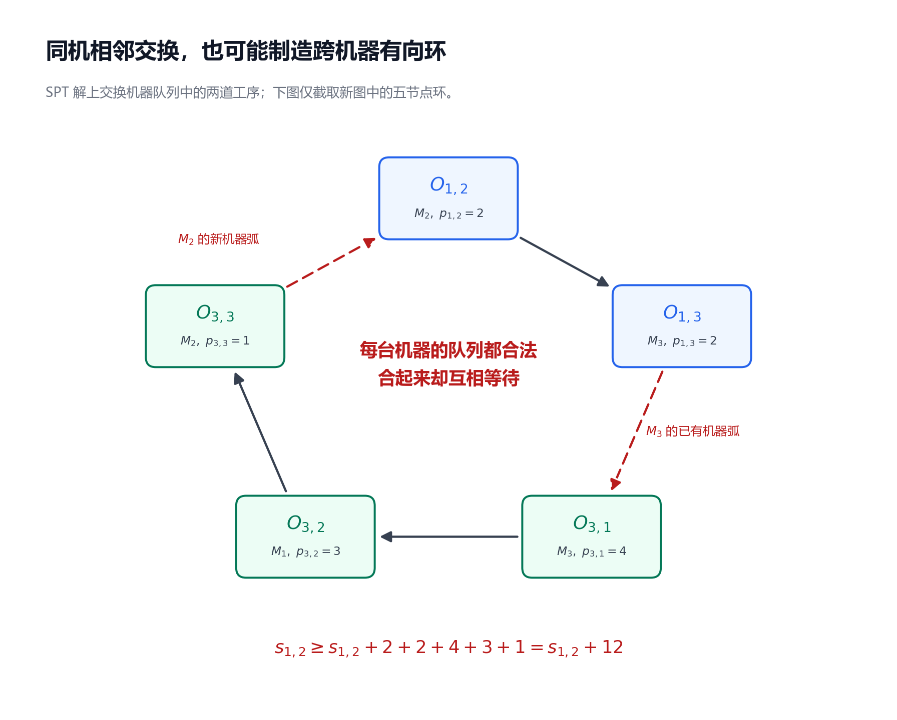
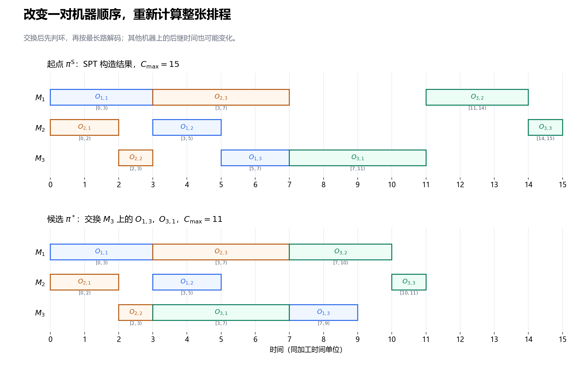
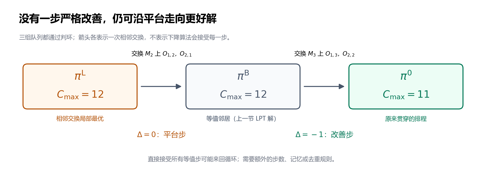

---
tags:
  - JSP
  - 启发式算法
---

# 第 6 节：局部搜索——移动、可行性与局部最优

状态：第一版，待 review。<br>
前置：[第 3 节：拓扑排序、最长路与 Decoder](./03_拓扑排序_最长路与Decoder.md)、[第 4 节：关键结构](./04_关键路径_head_tail_松弛量与关键块.md)、[第 5 节：构造启发式](./05_构造启发式_SPT_LPT_MWKR.md)。

本节继续使用标准、静态、确定性 JSSP：指定机器与正加工时间固定，工序不可抢占，所有作业从时间 0 可用，不加入换型、运输与机器停机。目标仍是最小化最大完工时间 $C_{\max}$。

## 6.1 已经有一个可行解，下一步改哪里？

第 5 节已经用构造启发式得到完整排程。现在不再从空排程逐道安排，而是从一个完整解出发，尝试修改少量机器顺序，再评价新解。

仍使用原来的 3×3 数据。每个单元格列出工序、指定机器和加工时间：

| Job | 第一道工序 | 第二道工序 | 第三道工序 |
|---|---|---|---|
| $J_1$ | $O_{1,1}:(M_1,3)$ | $O_{1,2}:(M_2,2)$ | $O_{1,3}:(M_3,2)$ |
| $J_2$ | $O_{2,1}:(M_2,2)$ | $O_{2,2}:(M_3,1)$ | $O_{2,3}:(M_1,4)$ |
| $J_3$ | $O_{3,1}:(M_3,4)$ | $O_{3,2}:(M_1,3)$ | $O_{3,3}:(M_2,1)$ |

取上一节 SPT 构造出的排程作为起点，机器队列为：

$$
\begin{aligned}
M_1:&\quad O_{1,1}\longrightarrow O_{2,3}\longrightarrow O_{3,2},\\
M_2:&\quad O_{2,1}\longrightarrow O_{1,2}\longrightarrow O_{3,3},\\
M_3:&\quad O_{2,2}\longrightarrow O_{1,3}\longrightarrow O_{3,1}.
\end{aligned}
$$

它的 $C_{\max}=15$。能否只交换 $M_3$ 上相邻的 $O_{1,3}$ 与 $O_{3,1}$，让 $J_3$ 更早推进？又能否随便交换其他机器上的相邻工序？

这就是本节的起点：一个小改动能带来改善，也可能变差，还可能使原来可行的解变得不可行。需要把 **产生候选、评价候选、接受候选** 分开。

## 6.2 搜索的对象：机器队列，而不是随意挪动时间

用 $\pi_r$ 表示 $M_r$ 上的完整工序队列，用 $\pi=(\pi_1,\ldots,\pi_m)$ 表示全部机器队列组成的一个解表示。这里 $m$ 是机器数；工序指定机器 $\mu_{j,k}$ 和加工时间 $p_{j,k}$ 都由输入固定。

本节用 $\pi^{\mathrm S}$ 表示第 6.1 小节的 SPT 起点，用 $\pi^0$ 表示前几节贯穿的原排程：

$$
\begin{aligned}
\pi^0_1&=(O_{1,1},O_{3,2},O_{2,3}),\\
\pi^0_2&=(O_{2,1},O_{1,2},O_{3,3}),\\
\pi^0_3&=(O_{3,1},O_{2,2},O_{1,3}).
\end{aligned}
$$

原排程的 $C_{\max}=11$。上标只是在区分不同解；$\pi^0$ 不表示所有搜索都必须从它开始。

每组完整队列先转换为“工艺弧 + 相邻机器弧”的有向图。若图无环，第 3 节的 decoder 给出最早开始时间 $s_{j,k}$、结束时间 $c_{j,k}=s_{j,k}+p_{j,k}$，以及各作业完工时间 $C_j=c_{j,n_j}$；$n_j$ 是 $J_j$ 的工序数。

记 $\Omega$ 为图无环的完整队列集合，定义评价函数：

$$
f(\pi)=C_{\max}(\pi)=\max_j C_j(\pi),\qquad \pi\in\Omega.
$$

这里的 $C_{\max}(\pi)$ 始终取 **固定队列的最早可行排程**。同一组队列下，额外推迟某些工序不能把最大完工时间变得更小，因此只评价最早排程不会遗漏该队列能达到的最好值。主动等待若有帮助，会体现为选择不同队列，而不是在同一队列下任意加空闲。

局部搜索通常修改 $\pi$，再让 decoder 重算时间。直接交换甘特图里的两个矩形，却保留原来的开始时间，可能同时破坏工艺顺序、机器容量或时长约束。

## 6.3 移动与邻域：规定“一步”允许改多少

**移动**（move）是把当前解表示改成一个候选解的操作。**邻域**（neighborhood）是按照某种移动规则，一步能到达的解集合。它取决于所选表示和规则，不是某个解天然唯一的一圈邻居。

本节先使用最容易完整手算的规则：只选一台机器，交换其队列中一对相邻工序，其余队列保持不变。用 $\operatorname{swap}_{r,i}(\pi)$ 表示交换 $\pi_r$ 中第 $i$ 与第 $i+1$ 道工序，机器和位置都从 1 编号。

先生成候选队列，再筛掉有环的候选。本节的可行邻域定义为：

$$
\mathcal N_{\mathrm{adj}}(\pi)
=\{\operatorname{swap}_{r,i}(\pi):\text{位置有效，且候选属于 }\Omega\}.
$$

设 $N=\sum_j n_j$ 是真实工序总数，$n_r^{\mathrm M}$ 是使用 $M_r$ 的工序数，$m_+$ 是非空机器队列的数量。未经判环筛选的相邻交换候选数为：

$$
A=\sum_{r=1}^m\max(n_r^{\mathrm M}-1,0)=N-m_+.
$$

本例每台机器有三道工序，故 $A=3\times2=6$。可行邻居的数量不超过 6；不能把有环候选也当成一个合法排程。

其他移动也可以定义，但会产生不同邻域：

| 移动 | 队列中怎样改变 | 要注意什么 |
|---|---|---|
| 同机相邻交换 | 交换相邻两道工序 | 只改变一个工序对的先后，但仍可能有环 |
| 同机任意交换 | 交换任意两个位置 | 两道工序与中间工序的先后关系也会变化 |
| 同机插入 | 抽出一道工序，再插到另一位置 | 要明确按删除后的队列定义插入位置，并更新沿途关系 |
| 多次交换组成的一步 | 一次同时改变多个队列位置 | 搜索范围更大，评价与枚举成本也可能更高 |

标准 JSSP 的本节邻域没有换机动作。FJSP 中的机器选择是另一类决策，不能直接并入本节固定机器的推导。

## 6.4 队列相邻交换，实际要改哪些弧？

设机器队列片段为 $(x,u,v,y)$，$u$、$v$ 是待交换的相邻工序，$x$、$y$ 是外侧的机器前后工序。交换后片段变为 $(x,v,u,y)$。

在相邻机器弧表示中，变化如下：

| 交换前的机器弧 | 交换后的机器弧 |
|---|---|
| $x\to u$ | $x\to v$ |
| $u\to v$ | $v\to u$ |
| $v\to y$ | $u\to y$ |

若交换发生在队列开头，则没有 $x$ 和相应弧；发生在结尾，则没有 $y$ 和相应弧。工艺弧始终保留。

因此，在相邻弧表示中，不能只反转 $u\to v$ 而保留所有边界弧。例如把 $(O_{2,2},O_{1,3},O_{3,1})$ 改为 $(O_{2,2},O_{3,1},O_{1,3})$ 时，必须同时把机器弧 $O_{2,2}\to O_{1,3}$ 改为 $O_{2,2}\to O_{3,1}$。

第 2 节还有“同机所有工序对都定向”的完整表示。相邻交换在这种表示中只改变 $u$、$v$ 这一对的先后，因为其他工序都在这两道之前或之后。但完整表示与相邻表示存储的弧不同，不能把前者的单弧修改方式直接用到后者的数据结构。

最容易检查的实现是：在候选队列上交换，重新生成相邻机器弧，再交给同一个 decoder。之后再考虑局部更新与增量计算。

## 6.5 不可行反例：每台机器排得有序，合起来仍有环

回到 $\pi^{\mathrm S}$。交换 $M_2$ 的第 2、3 道工序，让队列变成：

$$
M_2:\quad O_{2,1}\longrightarrow O_{3,3}\longrightarrow O_{1,2}.
$$

单看机器队列，它仍是完整排列，每道工序出现一次。但是结合其余机器顺序和工艺路线，新图中出现：

$$
O_{1,2}\longrightarrow O_{1,3}\longrightarrow O_{3,1}
\longrightarrow O_{3,2}\longrightarrow O_{3,3}\longrightarrow O_{1,2}.
$$

其中 $O_{1,3}\to O_{3,1}$ 是 $M_3$ 的已有机器弧，$O_{3,3}\to O_{1,2}$ 是 $M_2$ 的新机器弧，其余三条是工艺弧。

沿环把开始时间约束相加，得到：

$$
s_{1,2}\geq s_{1,2}+2+2+4+3+1=s_{1,2}+12.
$$

这不可能成立。机器排列本身正确，不能保证与全部工艺约束兼容。



图给的是不可行性证据。这个候选没有合法的 $C_{\max}$，不能根据拓扑排序已经处理到的少量节点，计算一个“部分完工时间”再与可行解比较。

## 6.6 怎样判断一次交换是否可行？

通用办法直接沿用第 3 节：对候选完整队列重建图，执行拓扑排序。全部节点都能处理，图才是 DAG，随后才能输出有效时间与目标值。若没有处理完，返回“不可行”。

只查看被交换机器的时间段不够，因为第 6.5 小节的环经过三台机器。移动前的拓扑顺序也不能直接沿用；新弧可能违反旧顺序。

还可以从路径理解相邻交换。为了让论证清楚，暂时使用第 6.4 小节的 **同机全部工序对定向图**，记为 $\overline G(\pi)$。假设当前解可行，$u$、$v$ 在同一机器队列中相邻，原先为 $u\to v$。

删除这条机器先后约束，得到 $\overline G^-$，其余工艺弧和机器弧都保留。完整表示中的相邻交换只需再加入 $v\to u$。因为删除弧不会制造环，新环若存在，必定经过新弧，所以：

$$
\text{交换后有环}
\quad\Longleftrightarrow\quad
\overline G^-\text{ 中仍存在从 }u\text{ 到 }v\text{ 的有向路径}.
$$

剩余路径加上 $v\to u$，就闭合成环；反过来，若新图有环，拿掉环上的新弧便得到这条剩余路径。

在反例中，删除原来的 $O_{1,2}\to O_{3,3}$ 机器约束以后，从 $O_{1,2}$ 经 $O_{1,3},O_{3,1},O_{3,2}$ 到 $O_{3,3}$ 的路径仍在，因此反向的新弧必定闭环。

完整定向图和正确更新后的相邻弧图表示同一组候选队列，二者的无环性等价。因此，上面的路径判据也足以判定候选队列是否可行。

这个推导限于相邻交换，不适用于任意交换或多工序插入直接套用“只删一条弧”。如果实现存储相邻机器弧，仍需按第 6.4 小节正确更新边界关系；本节伪代码采用重建图的通用检查。

删除的也只是机器约束。如果同一对节点还由固定工艺弧支持同方向关系，不能连工艺弧一起删除。用简单边集合存储时，要保留仍有其他约束支持的边；或分别维护弧的来源。只反转机器顺序不会取消输入的工艺顺序。

## 6.7 完整手算：SPT 起点的六个候选

本节按 $M_1,M_2,M_3$ 顺序枚举；每台机器先交换位置 1、2，再交换位置 2、3。每个候选都从同一个当前解 $\pi^{\mathrm S}$ 产生，未经接受的改动不累积到下一个候选。

定义目标差值：

$$
\Delta(\pi,\pi')=f(\pi')-f(\pi).
$$

对最小化问题，负数表示改善，零表示等值，正数表示变差。不可行候选不计算这个差值。起点 $f(\pi^{\mathrm S})=15$，全部结果为：

| 机器与左位置 | 交换的工序 | 判环结果 | 候选 $C_{\max}$ | $\Delta$ |
|---|---|---|---:|---:|
| $M_1, i=1$ | $O_{1,1},O_{2,3}$ | 无环 | 22 | $+7$ |
| $M_1, i=2$ | $O_{2,3},O_{3,2}$ | 无环 | 18 | $+3$ |
| $M_2, i=1$ | $O_{2,1},O_{1,2}$ | 无环 | 18 | $+3$ |
| $M_2, i=2$ | $O_{1,2},O_{3,3}$ | 有环 | 不可行 | 不定义 |
| $M_3, i=1$ | $O_{2,2},O_{1,3}$ | 无环 | 16 | $+1$ |
| $M_3, i=2$ | $O_{1,3},O_{3,1}$ | 无环 | 11 | $-4$ |

最后一个候选最好。记它为 $\pi^*$；星号是本节为这个候选取的名称，下面将另行说明它的全局最优性证据。其完整队列为：

$$
\begin{aligned}
\pi^*_1&=(O_{1,1},O_{2,3},O_{3,2}),\\
\pi^*_2&=(O_{2,1},O_{1,2},O_{3,3}),\\
\pi^*_3&=(O_{2,2},O_{3,1},O_{1,3}).
\end{aligned}
$$

把重新解码的结果逐项展开：

| 工序 | 原加工区间 | 新的最早加工区间 |
|---|---|---|
| $O_{1,1}$ | $[0,3)$ | $[0,3)$ |
| $O_{1,2}$ | $[3,5)$ | $[3,5)$ |
| $O_{1,3}$ | $[5,7)$ | $[7,9)$ |
| $O_{2,1}$ | $[0,2)$ | $[0,2)$ |
| $O_{2,2}$ | $[2,3)$ | $[2,3)$ |
| $O_{2,3}$ | $[3,7)$ | $[3,7)$ |
| $O_{3,1}$ | $[7,11)$ | $[3,7)$ |
| $O_{3,2}$ | $[11,14)$ | $[7,10)$ |
| $O_{3,3}$ | $[14,15)$ | $[10,11)$ |

新队列中，$O_{3,1}$ 等机器前序 $O_{2,2}$ 到 3 完成，因此 $s_{3,1}=3$、$c_{3,1}=7$。$O_{1,3}$ 则等待自己的工艺前序和新的机器前序：

$$
s_{1,3}=\max(c_{1,2},c_{3,1})=\max(5,7)=7,\qquad c_{1,3}=9.
$$

变化继续传播到其他机器：

$$
s_{3,2}=\max(c_{3,1},c_{2,3})=\max(7,7)=7,\qquad c_{3,2}=10,
$$

$$
s_{3,3}=\max(c_{3,2},c_{1,2})=\max(10,5)=10,\qquad c_{3,3}=11.
$$

于是 $C_1=9$、$C_2=7$、$C_3=11$，最大完工时间为 11。$J_1$ 比原来更晚完成，但 $J_3$ 大幅提前，整体目标仍然改善。不能要求每个 job 的完工时间都下降，才算一个有效的 makespan 改善。



图展示同一个实例的一步改善；改变的决策只在 $M_3$，改变的时间却传播到 $M_1$、$M_2$ 上的后继工序。

## 6.8 最陡下降与首次改善：怎样决定接受哪个邻居？

**下降式局部搜索**（descent local search）只接受严格改善，即 $\Delta<0$。下面两种策略使用相同邻域，但接受时机不同。

| 策略 | 一轮怎样扫描 | 接受什么 |
|---|---|---|
| 首次改善，first improvement | 按约定顺序扫描，发现严格改善就结束本轮 | 第一个改善邻居 |
| 最佳改善，best improvement，也称最陡下降 | 扫描完整邻域 | 目标值最低的严格改善邻居 |

最佳改善若多个候选目标值并列，本节按机器编号、左位置编号选择。首次改善的结果则可能受枚举顺序影响。本例首轮只有一个改善候选，所以两种策略都会选择 $\pi^*$；这不是它们在一般实例中等价的证据。

下面给出本节最陡下降伪代码。`current` 对应当前队列 $\pi$，`value` 对应 $f(\pi)$；`decode` 同时返回可行性、时间与目标值。

```text
steepest_descent(initial):
    result = decode(initial)
    若不可行: 返回输入错误
    current = initial 的独立副本
    value = result.Cmax

    while 搜索预算允许继续完整扫描:
        chosen = 空
        chosen_value = value

        for (r, i) 按机器编号、左位置编号枚举有效相邻位置:
            candidate = current 的独立副本
            交换 candidate[r] 的位置 i 与 i+1
            result = decode(candidate)
            if result 不可行:
                continue
            if result.Cmax < chosen_value:
                chosen = candidate
                chosen_value = result.Cmax

        if chosen 为空:
            返回 current, value, 停止原因=完整邻域没有严格改善
        current = chosen
        value = chosen_value

    返回 current, value, 停止原因=预算耗尽
```

使用严格小于更新最佳候选，可以保留枚举顺序中最先出现的并列项。若预算可能在扫描中途耗尽，需在实现中记录是否完成整轮；未完成时只能报告预算停止，不能据此宣称局部最优。

首次改善版本可以在找到第一个 $f(\pi')<f(\pi)$ 时立即接受，然后从新解重新开始枚举。它不需要先知道整个邻域中的最低值。

在有限解空间中，严格下降不可能回到已经访问的解，因为那个解的目标值不变；因此不设外部预算时，它会在有限次接受后停止。这个终止论证不需要目标值为整数。但终点只保证当前邻域内没有严格改善，不保证全局最优。[van Laarhoven、Aarts 与 Lenstra 的原始研究报告第 2 节也以邻域、目标比较和局部停点描述迭代改善](https://ir.cwi.nl/pub/5966/5966D.pdf)。

## 6.9 搜索停在 11，究竟证明了什么？

接受 $\pi^*$ 后，必须围绕新队列再扫描一次。不能沿用 $\pi^{\mathrm S}$ 上的候选目标值；同一个位置交换在不同当前解上会得到不同候选。

| 机器与左位置 | 在 $\pi^*$ 中交换的工序 | 新候选 $C_{\max}$ |
|---|---|---:|
| $M_1, i=1$ | $O_{1,1},O_{2,3}$ | 14 |
| $M_1, i=2$ | $O_{2,3},O_{3,2}$ | 14 |
| $M_2, i=1$ | $O_{2,1},O_{1,2}$ | 16 |
| $M_2, i=2$ | $O_{1,2},O_{3,3}$ | 15 |
| $M_3, i=1$ | $O_{2,2},O_{3,1}$ | 13 |
| $M_3, i=2$ | $O_{3,1},O_{1,3}$ | 15 |

六个候选均可行，且都比 11 大。下降搜索至此停止，完整接受序列为 $15\to11$。

对本节可行邻域，$\pi^{\mathrm L}$ 称为一个 **局部最优解**，若满足：

$$
f(\pi^{\mathrm L})\leq f(\pi')
\quad\text{对全部 }\pi'\in\mathcal N_{\mathrm{adj}}(\pi^{\mathrm L}).
$$

这里允许等值邻居；若所有邻居都严格更差，则称为严格局部最优。$\pi^*$ 属于后一种情况。局部最优始终相对于指定邻域；换一个邻域，结论可能改变。

**全局最优** 要求与全部 $\pi'\in\Omega$ 比较。完整扫完六个相邻候选，远没有检查全部队列，所以单凭下降搜索的停止原因不能证明全局最优。

这个微型实例可以另外做一次完整穷举：每台机器三道工序共有 $3!=6$ 种队列，三台机器共有 $6^3=216$ 组组合。逐组判环，64 组可行；对它们全部解码，最小值确为 11，且恰好由 $\pi^0$ 与 $\pi^*$ 两组队列达到。

因此，本例的全局最优性有 **完整穷举** 作为独立证据，不能把它归功于局部搜索本身。规模增大后，这种阶乘级枚举通常不再可用；下界与精确求解将在第 11 节系统讨论。

## 6.10 真正的次优停点：12 没有一步严格改善

现在保持同一份输入数据，换一个完整可行解：

$$
\begin{aligned}
\pi^{\mathrm L}_1&=(O_{1,1},O_{3,2},O_{2,3}),\\
\pi^{\mathrm L}_2&=(O_{1,2},O_{2,1},O_{3,3}),\\
\pi^{\mathrm L}_3&=(O_{3,1},O_{1,3},O_{2,2}).
\end{aligned}
$$

与原排程相比，$M_2$ 先等 $O_{1,2}$ 加工，$M_3$ 则把 $O_{2,2}$ 排在 $O_{1,3}$ 之后。它的关键限制可手算为：

$$
O_{1,1}:[0,3),\quad O_{1,2}:[3,5),\quad O_{1,3}:[5,7),
$$

$$
O_{2,2}:[7,8),\quad O_{2,3}:[8,12).
$$

这条依赖链的长度为 $3+2+2+1+4=12$。其余工序的最早区间是 $O_{2,1}:[5,7)$、$O_{3,1}:[0,4)$、$O_{3,2}:[4,7)$、$O_{3,3}:[7,8)$，所以 $C_1=7$、$C_2=12$、$C_3=8$，$f(\pi^{\mathrm L})=12$。

它的全部相邻交换结果为：

| 机器与左位置 | 交换的工序 | 候选 $C_{\max}$ | $\Delta$ |
|---|---|---:|---:|
| $M_1, i=1$ | $O_{1,1},O_{3,2}$ | 19 | $+7$ |
| $M_1, i=2$ | $O_{3,2},O_{2,3}$ | 16 | $+4$ |
| $M_2, i=1$ | $O_{1,2},O_{2,1}$ | 12 | 0 |
| $M_2, i=2$ | $O_{2,1},O_{3,3}$ | 15 | $+3$ |
| $M_3, i=1$ | $O_{3,1},O_{1,3}$ | 18 | $+6$ |
| $M_3, i=2$ | $O_{1,3},O_{2,2}$ | 12 | 0 |

六个候选都可行，没有一个目标值小于 12。因此 $\pi^{\mathrm L}$ 是本邻域的局部最优，严格下降从这里出发会立即停止；它有等值邻居，所以不是严格局部最优。已有值为 11 的可行解，明确说明它不是全局最优。

可沿以下两步到达更好的解：

| 当前解 | 执行的相邻交换 | 到达的解及目标值 |
|---|---|---|
| $\pi^{\mathrm L}$，12 | $M_2$ 上交换 $O_{1,2},O_{2,1}$ | $\pi^{\mathrm B}$，12；只把 $M_2$ 改为 $(O_{2,1},O_{1,2},O_{3,3})$ |
| $\pi^{\mathrm B}$，12 | $M_3$ 上交换 $O_{1,3},O_{2,2}$ | $\pi^0$，11；再把 $M_3$ 改为 $(O_{3,1},O_{2,2},O_{1,3})$ |

中间解 $\pi^{\mathrm B}$ 恰好是上一节的 LPT 构造结果。第一步把 $O_{2,1}$ 从 $[5,7)$ 提前到 $[0,2)$，但 $O_{2,2}$ 仍被机器前序 $O_{1,3}$ 限制到 7 开始，$O_{2,3}$ 仍到 12 完成，所以目标值不变。

第二步改掉这个机器限制，使 $O_{2,2}$ 能在 $[4,5)$ 加工，$O_{2,3}$ 提前为 $[7,11)$，才使目标值降到 11。



相邻解目标值相同的一片区域常称为 **平台**（plateau）。本例需要先走一个平台步，后面才有下降方向。它证明严格下降可能停在次优解，不表示任意平台步都会通向更好的解。

若简单地把接受条件从 $\Delta<0$ 改成 $\Delta\leq0$，又不加入任何限制，算法可能在 $\pi^{\mathrm L}$ 与 $\pi^{\mathrm B}$ 之间来回交换。严格下降的“目标值持续变小”终止证明随之失效。允许等值步时，需要另行规定步数上限、访问记忆或去重方式。

## 6.11 为什么关键结构可以指导移动，却不能代替评价？

第 4 节的关键路径给出了当前最早排程的最长依赖链。例如 SPT 起点的一条关键路径，其真实工序部分是：

$$
O_{1,1}\longrightarrow O_{1,2}\longrightarrow O_{1,3}
\longrightarrow O_{3,1}\longrightarrow O_{3,2}\longrightarrow O_{3,3},
$$

长度为 $3+2+2+4+3+1=15$。第 6.7 小节的改善移动改变了其中的机器先后关系 $O_{1,3}\to O_{3,1}$，使原链不再保留。

沿用第 4 节的必要条件：只要某条原关键路径连同加工时间仍完整保留在新图中，新最早排程的 $C_{\max}$ 就不可能小于原值。若想严格改善，必须解除每条原关键路径的原长度限制。

这解释了为什么可以优先考察关键机器关系。但是“打断原路径”只是必要的结构变化；候选可能有环，也可能形成更长的新路径。原排程 $\pi^0$ 中交换 $O_{3,2},O_{2,3}$，就是第 4 节已经核算过的 $11\to13$ 反例。

也不能将“两道工序都零松弛”理解为可以任意交换。关键节点、关键弧、选定关键路径及关键块是不同对象。下一节会专门定义关键块邻域与 N5 的具体筛选规则和前提。[Nowicki 与 Smutnicki 的原始算法论文使用关键路径与工序块来构造特定邻域](https://pubsonline.informs.org/doi/10.1287/mnsc.42.6.797)；本节的全相邻交换邻域只是用于建立基本闭环，不称为 N5。

接受移动后，必须重新计算 head、tail、关键路径与关键块。它们属于当前图，不能沿用上一轮的标注。

## 6.12 实现时，评价成本和状态管理怎样安排？

把每个候选完整重建图并解码，是本节的基础实现。对于相邻机器弧图，顶点数为 $N+2$；工艺弧、机器弧及虚拟起终点连接弧的总数为 $O(N)$。设输入与机器数量相关的初始化也计入，一次候选的复制、建图、判环与解码可以在 $O(N+m)$ 时间内完成。

一轮最多评价 $A=N-m_+$ 个候选。如果每轮先遍历机器队列发现可交换位置，再逐个评价，一轮时间为 $O(m+A(N+m))$；当机器数不超过工序数时，最坏为 $O(N^2)$。其中单独的 $O(m)$ 也计入了没有可交换位置时的枚举开销。这是一轮完整扫描的成本，不是整个搜索的成本；总成本还取决于扫描轮数和预算。若改用同机所有工序对的完整图，建图可能需要二次数量的机器弧，不能继续照搬这个线性解码计数。

先把候选和当前解的边界管理清楚：

| 实现位置 | 应保持的约定 |
|---|---|
| 生成候选 | 从当前解的独立副本产生；不要让多个候选共享可变队列 |
| 评价失败 | 丢弃候选；当前队列、时间、目标值保持有效 |
| 原地修改优化 | 确保队列、弧、入度、时间与缓存全部正确恢复，再评价下一个候选 |
| 保存最佳候选 | 保存队列和对应目标值；不要只保存指向临时数组的引用 |
| 接受移动 | 更新当前队列，重新获得有效排程和关键结构 |
| 日志 | 记录目标值、候选评价数、接受数、耗时及停止原因 |

纯严格下降中，当前目标值持续下降，所以当前解也是本次搜索已接受过的解中最好的。进入允许等值或变差移动的算法以后，`current` 与 `best` 就应分别维护，并把保存最佳解的队列复制出来。

随机只试若干候选，没找到改善，不能证明完整邻域没有改善。完整扫描停、达到时间上限停、达到评价上限停，也应区分记录。

若使用多个初始解分别下降，再保留最好结果，就是多起点局部搜索；相同确定性初始解、枚举顺序与并列约定重复运行，仍会得到相同路径。多起点实验需要说明初始解的变化方式，并把初始化和下降时间计入预算。

本例只需要平台步即可逃离一个次优停点，一般实例还可能需要先变差。后面的模拟退火和禁忌搜索会分别给出接受与记忆机制。[van Laarhoven、Aarts 与 Lenstra 的 JSSP 模拟退火原始论文将以非零概率接受目标值上升的转移用于避免局部停滞](https://pubsonline.informs.org/doi/10.1287/opre.40.1.113)。允许探索不等于允许破坏约束：候选仍须是可行解。

## 6.13 自检题

均使用本节的原始 3×3 数据和队列约定。先独立手算，再看参考答案。

1. 解表示 $\pi$、可行集合 $\Omega$、评价函数 $f$ 分别是什么？为什么同一组队列只评价最早排程就够了？
2. 本例未经判环的相邻交换候选为什么有 6 个？是否六个都一定可行？
3. 相邻弧表示中，将队列片段 $(x,u,v,y)$ 改为 $(x,v,u,y)$，要替换哪些机器弧？工艺弧是否改变？
4. 在 SPT 起点交换 $M_2$ 上的 $O_{1,2},O_{3,3}$，写出一个有向环。这个候选能否用“部分解码”的完工时间参加比较？
5. 在第 6.7 小节的改善候选中，$O_{1,3}$、$O_{3,2}$、$O_{3,3}$ 的区间分别是什么？为什么 $J_1$ 更晚完成仍算改善？
6. 首次改善与最佳改善的区别是什么？只随机评价三个候选都没找到改善，能否报告局部最优？
7. 为什么 $\pi^{\mathrm L}$ 的值为 12，却没有一步严格改善？写出 $12\to12\to11$ 的两个移动。它是否属于严格局部最优？
8. 严格下降为什么有限终止？允许所有等值步以后，这个论证哪里失效？搜索停在 11 与本例完整穷举得到最小值 11，提供的证据有何不同？

### 参考答案

1. $\pi$ 是当前解中各机器完整队列组成的元组，$\Omega$ 是诱导图无环的完整队列元组集合，$f(\pi)$ 是该队列的最早可行排程的 $C_{\max}$。固定队列下任意可行排程都不能早于最长路递推的相应时刻，因此额外推迟不能改善最大完工时间。
2. 每台机器三道工序，提供两个相邻位置，共 $3\times2=6$ 个。它们还需要结合工艺弧判环；SPT 起点的 $M_2$ 第 2 个候选不可行。
3. 删除机器弧 $x\to u,u\to v,v\to y$，加入 $x\to v,v\to u,u\to y$；边界缺少的节点和弧不处理。工艺弧保留。
4. 环为 $O_{1,2}\to O_{1,3}\to O_{3,1}\to O_{3,2}\to O_{3,3}\to O_{1,2}$，正时长总和为 12。有环候选没有合法目标值，部分解码结果不能参加可行解比较。
5. 分别为 $[7,9)$、$[7,10)$、$[10,11)$。新 $C_1=9,C_2=7,C_3=11$；目标是三者最大值，从 15 降到 11，不要求所有作业都改善。
6. 首次改善找到第一个改善候选就接受；最佳改善扫完后选最小值。仅抽样三个失败候选，没有检查其他邻居，不能证明局部最优。
7. 六邻居目标值为 $19,16,12,15,18,12$，均不小于 12。先在 $M_2$ 交换 $O_{1,2},O_{2,1}$ 得到 $\pi^{\mathrm B}$，值仍 12；再在 $M_3$ 交换 $O_{1,3},O_{2,2}$ 得到 $\pi^0$，值为 11。它有等值邻居，是局部最优，但不是严格局部最优。
8. 解空间有限且每次接受严格降低目标值，不会重复已访问解。允许等值步后可能来回访问相同目标值的解，不能再用严格下降排除循环。完整邻域无改善只给出邻域内的局部结论；穷举全部 216 组队列、筛出 64 组可行解并比较所有目标，才给本微实例的全局最优证据。

## 6.14 复习速记卡

| 以后复习时要立即想起的点 | 本节对应的要点 |
|---|---|
| 本节搜索什么？ | 完整机器队列；指定机器与加工时间固定 |
| 一步移动是什么？ | 本节只在一台机器上交换相邻两道工序 |
| 邻域是否包含有环候选？ | 本节的可行邻域已筛掉有环候选 |
| 交换后只改一条相邻弧吗？ | 还要改两侧的机器前后关系，工艺弧保留 |
| 怎样评价候选？ | 正确建图、拓扑判环、最早解码、比较 $C_{\max}$ |
| 差值怎样定义？ | $\Delta=f(\pi')-f(\pi)$；负数才是改善 |
| 首次改善与最佳改善？ | 第一个改善就收；或完整扫描后收最低值 |
| 为什么严格下降会停？ | 有限队列空间中目标值持续变小，不会重复解 |
| 局部最优保证什么？ | 指定邻域内没有严格改善，允许有等值邻居 |
| 次优局部停点怎样出现？ | 本例 12 的全部六邻居都不更好，但平台两步可到 11 |
| 关键结构有何作用？ | 指导候选选择；移动后仍需评价，并重新计算关键结构 |
| 预算停止能宣称局部最优吗？ | 完整邻域未扫完时不能，仅记录预算停止 |

下一节：[关键块邻域与 N5](./07_关键块邻域与N5.md)。我们将从全相邻交换进一步缩小候选范围，明确关键块边界、允许的交换位置，以及相关结论的适用条件。

参考核验：2026-10-08。迭代改善的邻域与局部停点对照原始研究报告，关键结构在邻域中的用途及模拟退火的探索机制对照上文原始论文。本例的全部邻居、平台路径、判环反例和 216 组队列穷举按本节模型独立计算，不借用论文的实验参考值。

提交前检查：已核算两轮下降扫描、次优局部停点、平台路径、全部工序区间、有向环及完整穷举，检查图文数据与相对链接；已用 CommonMark 与 MathJax 本地预览检查公式、表格、加粗、伪代码与图片。未直接检查 IDE 内置 Markdown 预览。
