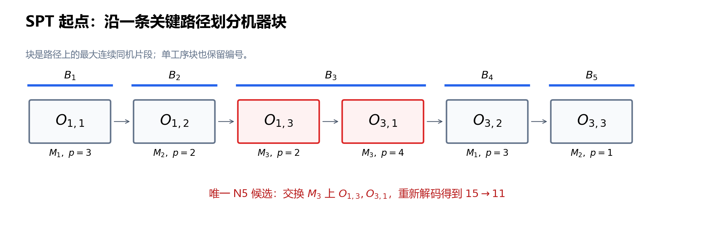

# 第 7 节：关键块邻域与 N5

状态：本轮审校完成，待用户 review。<br>
本节目标：从一条关键路径提取关键块，正确生成 N5 的边界交换，解释候选为什么少、何时可行，以及小邻域会失去什么。

前置：[第 4 节：关键结构](04_关键路径_head_tail_松弛量与关键块.md)、[第 6 节：局部搜索](06_局部搜索_移动与可行性.md)。沿用指定机器、正加工时间、不可抢占、无换型和运输的基础模型。本节关于经典 N5 的讨论采用每个 job 至多访问每台机器一次的经典 JSSP；重复访问机器的扩展需重新检查条件。

## 7.1 六个相邻候选，是否都值得评价？

第 6 节从 SPT 构造解 $\pi^{\mathrm S}$ 出发，对三台机器各试两次相邻交换。六个候选中，一项有环，四项变差，只有一项把 $C_{\max}$ 从 15 降到 11。

这个有效移动交换 $M_3$ 上的 $O_{1,3},O_{3,1}$。它们恰好位于同一条关键路径的同机连续片段上。能否先利用这个结构筛选，再花时间解码？

为便于复习，数据仍为：

| Job | 第一道工序 | 第二道工序 | 第三道工序 |
|---|---|---|---|
| $J_1$ | $O_{1,1}:(M_1,3)$ | $O_{1,2}:(M_2,2)$ | $O_{1,3}:(M_3,2)$ |
| $J_2$ | $O_{2,1}:(M_2,2)$ | $O_{2,2}:(M_3,1)$ | $O_{2,3}:(M_1,4)$ |
| $J_3$ | $O_{3,1}:(M_3,4)$ | $O_{3,2}:(M_1,3)$ | $O_{3,3}:(M_2,1)$ |

SPT 起点的队列是：

$$
\begin{aligned}
\pi^{\mathrm S}_1&=(O_{1,1},O_{2,3},O_{3,2}),\\
\pi^{\mathrm S}_2&=(O_{2,1},O_{1,2},O_{3,3}),\\
\pi^{\mathrm S}_3&=(O_{2,2},O_{1,3},O_{3,1}).
\end{aligned}
$$

搜索对象仍是完整机器队列 $\pi$，评价仍是最早排程的 $f(\pi)=C_{\max}(\pi)$。关键块决定候选来源，不改变目标函数，也不免除候选评价。

## 7.2 必须改变关键限制，但不是随便选两个关键节点

若某条原关键路径的全部约束在新解中仍保留，其长度也不变，那么新解的 $C_{\max}$ 至少等于原值。因此，严格改善必须解除每条原关键路径的原长度限制。

对同机相邻交换，只有被交换工序对的先后关系改变。这里可以用第 6 节的同机全部工序对定向图理解；实现若使用相邻弧，仍要正确修改外侧连接。

设选定关键路径为 $P$。若交换的机器工序对不在 $P$ 的机器关系上，那么在完整定向图中 $P$ 仍在，不能得到一步严格改善。这给出缩小候选的理由。

但以下三个条件不等价：

| 条件 | 能说明什么？ |
|---|---|
| 两道工序均为零松弛 | 各自在至少一条关键路径上，未必是同一条 |
| 两道工序在机器队列上相邻 | 具备相邻交换位置，不说明是否关键 |
| 两道工序在选定关键路径上由机器弧相连 | 是本节关键块相邻交换所需的结构 |

还要看弧是否紧，即 $h_v=h_u+p_u$，而不只是节点颜色是否都标红。多条关键路径并存时，改变其中一条不保证同时解除其他路径的限制。

## 7.3 关键块：先选路径，再分连续同机片段

选定一条从虚拟起点 $\alpha$ 到终点 $\omega$ 的关键路径 $P$，去掉虚拟节点。将真实工序序列划分为 **最大连续同机片段**，记为：

$$
B_1,B_2,\ldots,B_b.
$$

$b$ 是这条路径的块数。第 $\ell$ 块写为：

$$
B_\ell=(v_{\ell,1},\ldots,v_{\ell,k_\ell}),
$$

其中 $k_\ell$ 是块长；$v_{\ell,i}$ 是某道工序的简写，仍对应一个 $O_{j,k}$。“最大”表示不能再向路径左边或右边扩展而保持同机。

本节保留单工序片段的块编号，但它不产生交换。这样“首块”“尾块”始终指路径本身的首尾；不能先删除单工序片段，再把中间块误当成首块或尾块。

正加工时间保证同机路径连续工序也在机器队列中相邻。否则队列中的中间工序会给出更长的同机路径，使原先声称的紧弧不再紧。

SPT 解的一条关键路径为：

$$
O_{1,1}\to O_{1,2}\to O_{1,3}
\to O_{3,1}\to O_{3,2}\to O_{3,3}.
$$

对应机器依次是 $M_1,M_2,M_3,M_3,M_1,M_2$，故：

| 块 | 机器 | 工序序列 | 长度 |
|---|---|---|---:|
| $B_1$ | $M_1$ | $(O_{1,1})$ | 1 |
| $B_2$ | $M_2$ | $(O_{1,2})$ | 1 |
| $B_3$ | $M_3$ | $(O_{1,3},O_{3,1})$ | 2 |
| $B_4$ | $M_1$ | $(O_{3,2})$ | 1 |
| $B_5$ | $M_2$ | $(O_{3,3})$ | 1 |



图中的箭头是约束路径，不是车间的物理流向。该路径总加工长度为 $3+2+2+4+3+1=15$。

## 7.4 N5 的规则：边界、首尾例外与去重

**N5** 是基于选定关键路径的受限邻域，源自 [Nowicki 与 Smutnicki 的工作](https://pubsonline.informs.org/doi/10.1287/mnsc.42.6.797)。它是原论文禁忌搜索算法的一个组成部分，单独实现邻域不等于复现整套算法。

对 $b\ge2$，先按下表生成交换，再按工序身份去重：

| 块的位置 | 候选交换 |
|---|---|
| 首块 $B_1$ | 只交换末两道 $(v_{1,k_1-1},v_{1,k_1})$ |
| 中间块 $B_\ell$，$1<\ell<b$ | 交换前两道，或交换末两道；每次分别生成一个邻居 |
| 尾块 $B_b$ | 只交换前两道 $(v_{b,1},v_{b,2})$ |
| 任意长度为 1 的块 | 不产生交换 |

长度为 2 的中间块，其“前两道”和“末两道”是同一对，只保留一个候选。长度为 2 的首块仍交换这唯一一对（它就是末两道），尾块同理。这里按块的位置应用端点规则，再对候选去重；若把“首块前两道”或“尾块末两道”不分长度地一概排除，就会误删长度为 2 时唯一允许的交换。

经典模型下，两种特殊情况可直接用下界判断最优：若整条关键路径只有一个块，路径长度等于该机器负载；若每个块都只有一道工序，路径只沿一个 job 的工艺链前进，长度等于该 job 的总加工时间。两者都达到了相应下界，可停止搜索。此时 N5 不生成交换；下面的伪代码单列停止原因。图表脚本中的辅助函数 `n5` 只返回候选列表。

上述规则按 [Jain、Rangaswamy 与 Meeran 对原算法的逐项分析（第 3.2 节）](https://www.researchgate.net/publication/220403549_New_and_Stronger_Job-Shop_Neighbourhoods_A_Focus_on_the_Method_of_Nowicki_and_Smutnicki_1996)整理，包含长度为 2 的首尾块特例。这里将基于一条路径的版本记为 $\mathcal N_5(\pi;P)$；若对多条路径取并集，应另外记录这一变体。

## 7.5 为什么内部交换通常被排除？

考虑关键路径中的某个块：

$$
B=(u_1,u_2,u_3,u_4,u_5).
$$

假设只交换内部相邻对 $u_2,u_3$。新机器链是：

$$
u_1\to u_3\to u_2\to u_4\to u_5.
$$

原路径进入块的节点仍为 $u_1$，离开的节点仍为 $u_5$，块内的总加工时间未变。因此可以把原路径的前段、新机器链、原路径的后段接起来，得到一条同样长的路径。候选即使可行，也不可能一步严格改善。

首块的前两道交换在块长至少为 3 时有类似性质：路径可以从 $\alpha$ 进入新的首道，遍历全部块工序，再从未改变的末道离开，保留原总长度。尾块末两道交换在块长至少为 3 时同理。

长度为 2 时必须区别处理。首块 $(u_1,u_2)$ 交换以后，原来从 $u_2$ 离开的工艺弧未必还能接在遍历两道工序之后，前面的保长论证失效；这也解释了为什么规则仍保留该对。

这些论证排除的是 **立即严格改善**。一个当前不改善的内部交换，仍可能为后续探索创造机会。N5 缩小了每轮的评价工作，也删掉了一些平台步和变差步；不能据此推断所有搜索路径都得到了保留。

## 7.6 为什么这些关键相邻交换在经典模型下可行？

设 $u\to v$ 是选定关键路径上的机器弧，$u,v$ 在机器队列相邻，来自不同 job。关键路径上的这条弧满足：

$$
h_v=h_u+p_u.
$$

使用同机全部工序对定向图，删除 $u\to v$ 这一机器约束。若剩余图仍有一条经过中间真实工序的 $u\leadsto v$ 路径，其加工时间总和严格大于 $p_u$，便会强迫 $h_v>h_u+p_u$，与紧弧矛盾。

不同 job 之间也没有直接固定工艺弧 $u\to v$。因此删掉机器弧以后，不再有从 $u$ 到 $v$ 的路径，加入反向弧 $v\to u$ 不会闭环。再由第 6 节的等价表示，正确交换后的队列也可行。

这个论证依赖正加工时间、紧的关键机器弧以及没有另一条不可删除的同向直接约束。对于重复访问机器、零时长工序或扩展约束，不能不经检查照搬。

教学实现仍重新建图、拓扑判环和解码。它既用于防止实现错误，也让未来改变模型或邻域时保留统一接口。理论可行性不是保留旧入度、旧时间缓存的理由。

## 7.7 同一实例：六个候选缩成一个

对第 7.3 小节的 SPT 路径，只有 $B_3$ 长度为 2，且是中间块。因此 N5 去重后只有：

$$
\operatorname{swap}_{3,2}(\pi^{\mathrm S}).
$$

这里 $\operatorname{swap}_{r,i}$ 沿用第 6 节，交换 $M_r$ 队列第 $i,i+1$ 个位置。从原来的 $M_3$ 队列生成：

$$
(O_{2,2},O_{1,3},O_{3,1})
\longrightarrow (O_{2,2},O_{3,1},O_{1,3}).
$$

重新解码得到第 6 节的 $\pi^*$，三个 job 的完工时间为 9、7、11，所以 $f(\pi^*)=11$。这一轮，完整相邻规则评价六个候选，N5 只评价一个，且保留了本例唯一的一步改善。

这只是本例的结果。换成前几节原排程 $\pi^0$，队列为：

$$
\begin{aligned}
\pi^0_1&=(O_{1,1},O_{3,2},O_{2,3}),\\
\pi^0_2&=(O_{2,1},O_{1,2},O_{3,3}),\\
\pi^0_3&=(O_{3,1},O_{2,2},O_{1,3}).
\end{aligned}
$$

它的唯一关键路径真实工序部分是 $O_{3,1}\to O_{3,2}\to O_{2,3}$，分为首块 $(O_{3,1})$ 和尾块 $(O_{3,2},O_{2,3})$。N5 只生成尾块的前两道交换，即 $\operatorname{swap}_{1,2}$。

| 当前解 | 当前值 | N5 移动 | 候选值 | 差值 |
|---|---:|---|---:|---:|
| $\pi^{\mathrm S}$ | 15 | $M_3$，左位置 2 | 11 | $-4$ |
| $\pi^0$ | 11 | $M_1$，左位置 2 | 13 | $+2$ |

后一行说明：**属于 N5、打断关键路径、交换可行，都不保证改善**。接受规则仍由下降搜索、SA 或 TS 决定。

## 7.8 多条路径、小邻域与局部最优

第 6 节的 $\pi^{\mathrm L}$ 有两条长度为 12 的关键路径：

$$
\begin{aligned}
P_a:&\ O_{1,1}\to O_{1,2}\to O_{1,3}\to O_{2,2}\to O_{2,3},\\
P_b:&\ O_{1,1}\to O_{1,2}\to O_{2,1}\to O_{2,2}\to O_{2,3}.
\end{aligned}
$$

选 $P_a$，N5 候选是在 $M_3$ 上交换 $O_{1,3},O_{2,2}$；选 $P_b$，候选是在 $M_2$ 上交换 $O_{1,2},O_{2,1}$。两者都是等值步，候选值仍为 12。这与“另一条原关键路径未被改变”相符。

接受等值步以后再重算关键路径，下一步才可能到达 11。不能在接受前预先生成整个后续搜索的块。

路径选择需要约定。例如在最长路回溯的紧前序中，始终选工序编号最小者；或者使用记录种子的随机选择。若每轮重新随机选路径，则完整扫描某一轮 N5 只说明 **该条路径诱导的邻域没有改善**。

基于一条路径的 N5 不保证从任意初始解都能到达所有可行队列，甚至不保证任意起点都有一条通向最优解的 N5 路径。增大接受概率不能补回被邻域删掉的边。实际可用多起点、扰动、偶尔较大邻域等方式增加探索，但须分别评价其收益。

## 7.9 一个可检查的生成器

下面伪代码生成一次 N5 候选。`critical_path` 必须返回当前图的一条完整最长路径；`blocks` 保留单工序块；所有队列位置从 1 编号。

```text
n5_moves(current):
    result = decode(current)
    若不可行: 返回输入错误
    P = 从 result 回溯一条关键路径，去掉虚拟节点
    blocks = 按指定机器划分 P 的最大连续片段
    if blocks 数量 <= 1 或每个块都只有一道工序:
        return 空集合，原因=关键路径已达到机器负载或 job 长度下界

    moves = 空集合
    for ell 从 1 到 blocks 数量:
        B = blocks[ell]
        if B 的长度 < 2:
            continue
        pairs = 空列表
        if ell > 1:
            pairs 加入 B 的前两道
        if ell < blocks 数量:
            pairs 加入 B 的末两道
        for (u, v) in pairs:
            r = u 的指定机器
            i = u 在 current[r] 中的位置
            断言 current[r][i+1] == v
            moves 加入 (r, i)，集合自动去重
    return moves
```

生成器没有接受候选。外层逐个复制队列、交换、解码，再使用选定接受策略。若预算在扫描途中结束，记录预算停止。

设 $N$ 为真实工序总数、$m$ 为机器数。已有解码结果后，路径回溯、分块与位置表可在线性时间内完成。$b\ge2$ 时未经去重的候选数至多为 $2b-2$；单工序块、长度为 2 的中间块会进一步减少数量。使用一次 $O(N+m)$ 的完整解码，整轮成本仍取决于实际候选数；不能仅凭“N5 小”就声称整个算法是常数时间。

## 7.10 易错点

| 容易写错的地方 | 应采用的检查 |
|---|---|
| 对所有零松弛工序任意两两交换 | 先有一条关键路径，再识别同机块和边界 |
| 把机器队列整段都当作关键块 | 块必须是选定路径上的连续片段 |
| 删除单工序块后重新标首尾 | 保留路径片段编号，单工序块只是不生成移动 |
| 长度为 2 的首块被完全删除 | 按允许的末两道生成，再去重 |
| 在相邻弧图中只反转中间弧 | 正确更新外侧关系，或直接重建图 |
| 认为 N5 中所有移动都改善 | $\pi^0$ 的唯一候选把 11 变成 13 |
| 把 N5 停点叫作全局最优 | 除独立下界证明外，只能作指定邻域内的结论 |
| 把 N5 当作完整 TS 算法 | 邻域、评价、接受和记忆是不同部分 |

## 7.11 自检题

1. SPT 起点的关键路径为什么有五个块，而不是三个？其中哪个块产生 N5 候选？
2. 对一个长度为 5 的中间块，N5 交换哪两对？为什么交换第 2、3 道不能立即严格改善？
3. 首块长度为 2 时是否生成候选？长度为 1 时呢？
4. $\pi^0$ 上 N5 的候选是什么？值从 11 变成多少？
5. 关键相邻交换可行性的论证为什么需要紧弧、正加工时间和不同 job？
6. 扫完某条路径的 N5 没有改善，能否推出全部相邻交换没有改善？能否宣布全局最优？

### 参考答案

1. 块按路径上的连续同机片段划分，同一机器再次出现不能与前面隔开的片段合并。只有中间块 $(O_{1,3},O_{3,1})$ 长度为 2，产生一个候选。
2. 前两道和末两道。第 2、3 道交换保留块首尾及总加工长度，可以拼接出与原关键路径一样长的路径。
3. 长度为 2 时按末两道生成一个；长度为 1 时无候选。不能因前后两对重合而误删。
4. 交换 $M_1$ 上 $O_{3,2},O_{2,3}$，新值为 13。
5. 紧弧排除有更长的替代路径，正加工时间使经过中间工序的替代路径严格更长；不同 job 排除不可删除的直接工艺弧。改变这些条件应重新判环。
6. 一般都不能。N5 是受限邻域，结论还依赖路径选择；全局最优需另外的下界或完整精确搜索证据。

## 7.12 复习速记卡

| 要立即想起的问题 | 本节要点 |
|---|---|
| 为什么利用关键路径？ | 严格改善必须解除全部原关键路径的长度限制 |
| 关键块怎么找？ | 选一条关键路径，划分最大连续同机片段 |
| N5 中间块做什么？ | 分别交换前两道、末两道，重合则去重 |
| 首尾块的例外？ | 首块只取末两道，尾块只取前两道 |
| 单工序块怎么处理？ | 保留编号，不生成移动 |
| 小邻域的代价？ | 一些平台与变差探索边被删除，连通性不保证 |
| 怎样接入算法？ | 生成候选后仍解码，交给下降、SA 或 TS 接受 |

下一节：[模拟退火：温度、接受概率与 current/best](08_模拟退火_SA.md)。关键结构回答“往哪里试”，SA 回答“为什么有时接受一个更差的可行候选”。

审校与核算范围见 [全套审校记录](assets/01_14_review.md)。
