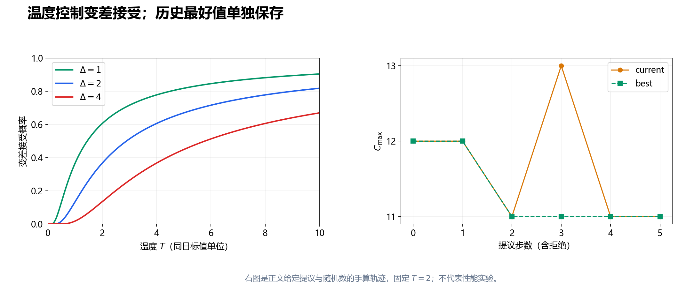

---
tags:
  - JSP
  - 启发式算法
---

# 第 8 节：模拟退火——温度、接受概率与 current/best

状态：第一版，待 review。<br>
本节目标：会计算模拟退火的接受概率，分别维护当前解与历史最好解，设计有明确预算的降温过程，并分清实用算法与渐近收敛结论。

前置：[第 6 节：局部搜索](./06_局部搜索_移动与可行性.md)、[第 7 节：关键块与 N5](./07_关键块邻域与N5.md)。实例、符号与基础模型不变；$\pi$ 是完整机器队列，$f(\pi)$ 是无环队列最早排程的 $C_{\max}$。

## 8.1 如果下一步更差，为什么还要走？

严格下降只接受 $f(\pi')<f(\pi)$，容易停在次优局部最优。第 6 节已经给出同一实例中的路径：

$$
\pi^{\mathrm L}:12\ \longrightarrow\ \pi^{\mathrm B}:12
\ \longrightarrow\ \pi^0:11.
$$

第一步只是持平，严格下降不会走；一般实例还可能需要先变差。模拟退火（Simulated Annealing，SA）把接受规则改成：改善与持平接受，变差也保留一定概率。

这里放宽的是 **对目标值的接受要求**。有环、机器重叠、违反工艺顺序的候选仍须拒绝。SA 不通过随机性把不可行排程变成合法排程。

SA 的名称来自物理退火的类比：先以较高温度允许较大变化，再逐步降低温度。用于调度时，温度是算法参数。[Kirkpatrick、Gelatt 与 Vecchi 的原始论文](https://doi.org/10.1126/science.220.4598.671)给出了这种优化与退火的联系；其公开原文中的 Metropolis 接受规则可见 [论文第 2–3 页](https://hedibert.org/wp-content/uploads/2013/12/1983KirkpatrickGelattVecchi.pdf)。

## 8.2 先固定差值的方向

对当前可行解 $\pi$ 与候选可行解 $\pi'$，定义：

$$
\Delta=f(\pi')-f(\pi).
$$

最小化问题中，$\Delta<0$ 是改善，$\Delta=0$ 是持平，$\Delta>0$ 才是变差。给定温度 $T>0$，本节采用接受概率：

$$
a(\Delta,T)=
\begin{cases}
1,&\Delta\le0,\\
\exp(-\Delta/T),&\Delta>0.
\end{cases}
$$

对于变差候选，生成均匀随机数 $U\in[0,1)$；当 $U<a(\Delta,T)$ 时接受，否则保留当前解。每次所需随机数独立产生，并由记录种子的随机数发生器提供。

本节把持平候选直接接受。这是明确的算法选择；若改成一定概率接受持平，轨迹和平台行为都会改变，应记录为另一版本。

判断差值必须比较 **candidate 与 current**。例如当前值为 13、历史最好值为 11，候选值为 12，则 $\Delta=12-13=-1$，应当接受。它没有刷新历史记录，但确实改善了当前状态。

## 8.3 温度究竟控制什么？

固定 $\Delta=2$，手算不同温度的变差接受率：

| 温度 $T$ | $\exp(-2/T)$ | 直观含义 |
|---:|---:|---|
| 10 | 0.8187 | 这类变差经常被接受 |
| 5 | 0.6703 | 仍保留较多上坡机会 |
| 2 | 0.3679 | 约三分之一会接受 |
| 1 | 0.1353 | 多数会被拒绝 |
| 0.5 | 0.0183 | 很少接受这类变差 |

固定温度，变差越大，接受率越低；固定正差值，温度越高，接受率越高。即使温度很高，候选也仍受邻域和可行性限制；不是从全部排程中均匀随机选一个。

比值 $\Delta/T$ 应当无量纲。因此温度与目标值具有同一数值尺度：若全部加工时间乘以 100，而温度不变，上坡接受会骤减；若温度也乘以 100，则同一对应移动的接受概率不变。

当 $T\to0^+$，正差值的接受率趋于 0；本节持平步仍接受。所以其低温极限接近“允许平台步的下降”，与只接受严格改善的第 6 节算法仍有区别。不要把 $T=0$ 直接代入除法。

## 8.4 current 与 best：探索位置和已保存成果

维护两个独立状态：

| 状态 | 含义 | 是否可能变差？ |
|---|---|---|
| `current`，记为 $\pi_t$ | 第 $t$ 次提议结束后的当前搜索位置 | 可以 |
| `best`，记为 $\pi_t^{\mathrm{best}}$ | 从初始化到当前为止保存的最好解 | 目标值不能变差 |

如果一次移动被接受，更新 current；只有新 current 严格优于 best，才复制其队列更新 best。若拒绝，current 与 best 都不变。相同目标值的历史最好队列，本节保留最早保存的一组。

历史记录满足：

$$
f(\pi_{t+1}^{\mathrm{best}})\le f(\pi_t^{\mathrm{best}}).
$$

这只是记录机制的性质，不说明 current 单调，也不证明最终 best 已最优。算法停止时返回 best 及其解码排程；仅返回最后的 current 可能丢掉先前得到的好解。

保存 best 必须复制队列，或使用不可变对象。若 best 只是指向 current 可变数组的引用，后面的上坡交换会把记录一起改坏；日志中的最好值与最终队列便可能不匹配。

## 8.5 五次提议的完整手算轨迹

本小节使用贯穿实例，固定 $T=2$，故意给定提议序列与所需随机数，以便逐项复核。这是一条算法轨迹，不能当作随机实验的平均表现。

起点是第 6 节的次优局部停点：

$$
\begin{aligned}
\pi^{\mathrm L}_1&=(O_{1,1},O_{3,2},O_{2,3}),\\
\pi^{\mathrm L}_2&=(O_{1,2},O_{2,1},O_{3,3}),\\
\pi^{\mathrm L}_3&=(O_{3,1},O_{1,3},O_{2,2}),
\end{aligned}
\qquad f(\pi^{\mathrm L})=12.
$$

仍用 $\operatorname{swap}_{r,i}$ 表示机器编号与左位置均从 1 编号的相邻交换。每次候选都从 **该步实际 current** 产生。

| 步 | 提议移动 | 候选值 | $\Delta$ | 接受概率 | 随机数 $U$ | 结果 | 步后 current / best |
|---:|---|---:|---:|---:|---:|---|---|
| 0 | 初始化 | — | — | — | — | — | 12 / 12 |
| 1 | $\operatorname{swap}_{2,1}$ | 12 | 0 | 1 | 无需 | 接受 | 12 / 12 |
| 2 | $\operatorname{swap}_{3,2}$ | 11 | $-1$ | 1 | 无需 | 接受 | 11 / 11 |
| 3 | $\operatorname{swap}_{1,2}$ | 13 | $+2$ | 0.3679 | 0.20 | 接受 | 13 / 11 |
| 4 | $\operatorname{swap}_{1,2}$ | 11 | $-2$ | 1 | 无需 | 接受 | 11 / 11 |
| 5 | $\operatorname{swap}_{2,1}$ | 12 | $+1$ | 0.6065 | 0.80 | 拒绝 | 11 / 11 |

前两步正是 $\pi^{\mathrm L}\to\pi^{\mathrm B}\to\pi^0$。第 3 步交换 $M_1$ 的 $O_{3,2},O_{2,3}$，接受较差队列；第 4 步立即交换回去，SA 允许这种回退；第 5 步只评价，没有把提议写入 current。



右图中 current 从 11 上升到 13，best 仍为 11；最后一次拒绝也计入提议步数。图用于解释状态管理，没有比较算法性能。

## 8.6 提议机制也必须写清楚

本节基础版本采用全机器相邻交换提议：把全部有效位置 $(r,i)$ 列成一个固定长度为 $A$ 的列表，每次等概率抽一个位置。机器上工序数量固定，故 $A$ 不随队列排序改变；本例 $A=6$。

抽到以后交换、判环、解码。有环则拒绝本次提议，留在 current；本次仍消耗一次尝试预算。若 $A=0$，没有交换位置，直接返回初始解及停止原因。

对任意一对可行的相邻交换状态，正向与反向都通过同一个机器位置产生，提议概率均为 $1/A$；因此本版本的提议是对称的。不可行提议只增加原地停留概率，不改变可行状态之间的这种对称性。

这与“不断重抽直到得到可行候选”不同。后者按当前解的可行邻居数量重新归一化提议概率，可能改变两个状态之间的正反向提议比例。两种做法都能定义实用搜索，但不能混用其理论解释和预算计数。

第 7 节 N5 也能用来提议，但它随 current 和关键路径选择变化，正向候选未必对应同概率的反向候选。若使用简单的 $\exp(-\Delta/T)$ 接受，可将其称为结合 N5 的实用 SA 变体；不能自动宣称它满足对称提议下的平衡分布结论。

若特定理论需要非对称提议的 Metropolis–Hastings 修正，接受率还会涉及正反向提议概率。本节不实现该修正，也不为关键路径偏置版本附加该理论保证。学习时先固定提议规则，再比较接受机制。

## 8.7 初始温度：从目标差值的尺度出发

温度不能只凭加工时间单位随意写成 100。可以先在若干初始解附近采样候选，收集正差值 $\Delta_1^+,\ldots,\Delta_K^+$，记其均值为 $\overline\Delta^+$。这里 $K$ 是正差值样本数。

希望“均值大小的变差”在初温下以概率 $\rho\in(0,1)$ 接受，则：

$$
\exp(-\overline\Delta^+/T_0)=\rho,
\qquad
T_0=-\frac{\overline\Delta^+}{\ln\rho}.
$$

例如正差值样本为 1、2、3，$\overline\Delta^+=2$；取 $\rho=0.8$，得到 $T_0\approx8.9628$。由于 $\ln0.8<0$，前面的负号保证温度为正。

这没有让全部样本的平均接受率精确等于 0.8。实际样本平均是各项 $\exp(-\Delta_i^+/T_0)$ 的平均，指数函数的非线性使它与“把平均差值代入”不同。这个公式只是便于解释的调参起点。

如果没有正差值样本，不能计算空集合均值，也不能据此断言已最优。可以扩大采样，或采用明确备用值，例如整数时间且无额外缩放时取 $T_0=1$，记录触发原因；这个备用值没有普遍性能保证。

采样与调参也消耗计算资源。实验须说明它们是否计入运行预算；正式比较前在开发实例上固定温度策略，不从每个测试实例的最优结果倒推参数。

## 8.8 降温：温度层与总预算要对齐

一个容易复现的版本采用几何降温：

$$
T_g=T_0\alpha^g,\qquad 0<\alpha<1.
$$

$g=0,1,\ldots,G-1$ 是温度层编号，每层尝试 $L$ 次提议，总尝试预算为 $G L$。有环和拒绝的提议也计入 $L$；否则同一温度层的工作量没有固定上限。

若希望第 $G-1$ 层达到 $T_{\mathrm{end}}>0$，且 $G\ge2$、$T_{\mathrm{end}}<T_0$，可以反算：

$$
\alpha=\left(\frac{T_{\mathrm{end}}}{T_0}\right)^{1/(G-1)}.
$$

例如 $T_0=10$、$T_{\mathrm{end}}=0.5$、$G=101$，则 $\alpha\approx0.9705$。比较不同 $L$ 时，总尝试次数也会改变，不能把多花时间得到的改善全归因于降温形状。

如果实验按墙钟时间停止，可按已用时间占预算的比例规划降温，或先估计可完成的提议数再安排层数；无论采用哪种，都应记录实际温度轨迹。固定种子加时间预算不保证每次恰好完成相同步数；固定提议预算、稳定遍历和同一随机数实现更适合逐步复现。

过快降温会很早失去上坡机会；温度长期过高也可能把大部分预算用于游走。这些是诊断方向，不能单凭一次较差结果判断是哪一个问题。

## 8.9 基础 SA 伪代码

`propose` 使用第 8.6 小节的固定位置列表。`decode` 返回可行性与有效目标值；`copy` 表示独立复制。本代码为说明流程的伪代码。

```text
simulated_annealing(initial, T0, alpha, G, L, seed):
    检查 T0 > 0，0 < alpha < 1，G、L 为正整数
    初始化记录种子的随机数发生器
    initial_result = decode(initial)
    若不可行: 返回输入错误
    current = copy(initial)
    current_value = initial_result.Cmax
    best = copy(current)
    best_value = current_value
    positions = 全部机器相邻交换位置
    若 positions 为空: 返回 best，原因=无交换位置
    T = T0

    for g 从 0 到 G-1:
        for trial 从 1 到 L:
            若外部时间预算已耗尽: 返回 best，原因=时间上限
            candidate = 从 current 复制并等概率交换一个 positions 位置
            result = decode(candidate)
            尝试计数 += 1
            if result 不可行:
                记录不可行提议
                continue
            delta = result.Cmax - current_value
            accept = (delta <= 0)
            if delta > 0:
                U = 均匀随机数 [0,1)
                accept = (U < exp(-delta / T))
            if accept:
                current = candidate
                current_value = result.Cmax
                if current_value < best_value:
                    best = copy(current)
                    best_value = current_value
            记录本步 current_value、best_value、T 与接受结果
        T = max(T0 * alpha^(g+1), 实现规定的最小正温度)

    重新解码并校验 best
    return best，原因=提议预算耗尽
```

实现中的最小正温度用于避免数值下溢把 $T$ 变成 0，其值及是否触发应记录。可在正差值分支改用对数比较 $\ln U<-\Delta/T$，但要处理 $U=0$ 的边界；基础版直接计算指数已足够理解。

重新加热、停滞重启或混合邻域都可以作为后续变体。重启改变 current 时保留全局 best，并把重启初始化算入预算；先验证基础版，再逐项加入策略，才能解释收益。

## 8.10 SA 能保证什么，不能保证什么？

SA 在有限预算内输出一个搜索到的可行上界；best 不变差是程序不变量。接受上坡提供逃离某些局部停点的机会，并不保证每次运行都逃离，也不保证逃离以后一定更好。

[van Laarhoven、Aarts 与 Lenstra 的 JSSP 原始论文](https://pubsonline.informs.org/doi/10.1287/opre.40.1.113)研究了特定邻域与退火过程的渐近收敛性质。这里的“渐近”涉及越来越长的计算过程及相应条件，不能换成“几何降温跑十秒必然最优”。也不能把其结论无条件移到删减连通性的 N5 上。

本例已经在第 6 节用穷举得到最优值 11。SA 手算轨迹到达 11，只是找到该最优解；最优性证据来自独立穷举或第 11 节的上下界闭合。

## 8.11 怎样检查和比较自己的实现？

先检查少量可逐步复现的日志，再看性能。每条提议至少记录当前值、候选值、差值、温度、是否可行、接受概率、是否接受与步后最好值；随机数可在调试日志保存。

| 现象 | 优先核对什么？ |
|---|---|
| 较差解几乎每次都接受 | 差值符号、温度尺度、随机数是否真在 $[0,1)$ |
| 从不接受上坡 | 整数除法、温度过低、概率比较方向 |
| best 日志变差 | 是否把 best 与 current 混用或共享可变队列 |
| 拒绝以后后续分数仍变化 | 候选是否在 current 上原地修改且没有完整回滚 |
| 相同种子路径不同 | 遍历顺序、随机调用次数、停止预算及线程行为 |
| 很多提议有环 | 邻域产生的候选质量；不是温度应解决的问题 |

与下降法比较时，使用相同初始解来源、解码器和预算。单次下降很快停下，SA 继续跑很久，不能直接作为同成本性能比较；可使用多起点下降消耗同预算，保存多种种子的结果与收敛曲线。

## 8.12 自检题

1. current 为 13、best 为 11，候选为 12，应该计算怎样的差值？是否接受、是否更新 best？
2. $\Delta=2,T=2,U=0.20$ 是否接受？若 $U=0.80$ 呢？
3. 为什么有环候选不应通过“大温度”接受？它是否消耗本节尝试预算？
4. 轨迹的第 3 步为何 current 为 13 而 best 为 11？停止时应返回谁？
5. 全部加工时间扩大十倍，怎样调整温度才能保留对应移动的接受率？
6. 正差值均值为 2、目标概率为 0.8，$T_0$ 是多少？它是否使样本平均接受率精确为 0.8？
7. 为什么“每次重抽直到可行”和“抽到不可行就停留”不是同一个提议机制？
8. 给 N5 接上指数接受规则，是否因此保证从任意初始解收敛到全局最优？

### 参考答案

1. $\Delta=12-13=-1$，接受；12 大于历史最好值 11，不更新 best。
2. 接受率为 $e^{-1}\approx0.3679$；0.20 时接受，0.80 时拒绝。
3. 温度只处理目标变差，不能解除硬约束。本节仍计一次尝试。
4. 接受了值为 13 的较差候选，探索位置变化，但历史记录保持。返回保存的 best 队列及其排程。
5. 温度也扩大十倍，使 $\Delta/T$ 不变。
6. $T_0=-2/\ln0.8\approx8.9628$。只校准均值大小的变差，不是精确拟合全部样本平均。
7. 条件重抽按当前可行邻居数量归一化，可能改变正反向提议概率；尝试计数也不同。
8. 不能。邻域可达性、提议概率、降温与运行时间等条件仍需单独分析，有限预算更没有一般最优保证。

## 8.13 复习速记卡

| 要立即想起的问题 | 本节要点 |
|---|---|
| 差值比较谁？ | candidate 减 current，不能减 best |
| 变差接受率？ | $\exp(-\Delta/T)$，仅用于 $\Delta>0,T>0$ |
| 温度的尺度？ | 与目标值一致，真正控制的是 $\Delta/T$ |
| current 和 best？ | 当前探索位置可变差，历史最好值不变差 |
| 何时拒绝不可行？ | 先判环；不参与目标值接受判断 |
| 初温如何选？ | 用正差值尺度校准，并记录采样与备用规则 |
| 怎样降温？ | 固定温度层与每层尝试数，或明确时间进度方案 |
| 最终返回谁？ | 独立保存、重新解码校验的 best |

下一节：[禁忌搜索：记忆、期限与特赦](./09_禁忌搜索_TS.md)。SA 可能立刻把刚走过的交换撤回，TS 将用短期记忆处理这种回退。

参考核验：2026-10-11。退火动机与接受规则对照 1983 年原始论文，JSSP 收敛结论的范围对照 1992 年原论文页面；温度校准、提议规则、伪代码与轨迹是本节明确规定的教学版本，不声称复现原论文全部实现。

提交前检查：概率表、温度校准与五次提议由 [第 7–9 节核算与绘图脚本](https://github.com/fengmaker/my-website/blob/main/Heuristic/fjsp_learning/jssp/scripts/07_09_build_figures.py) 重算，所有出现的候选均由队列解码。最终格式检查范围见目录中的验收记录。
