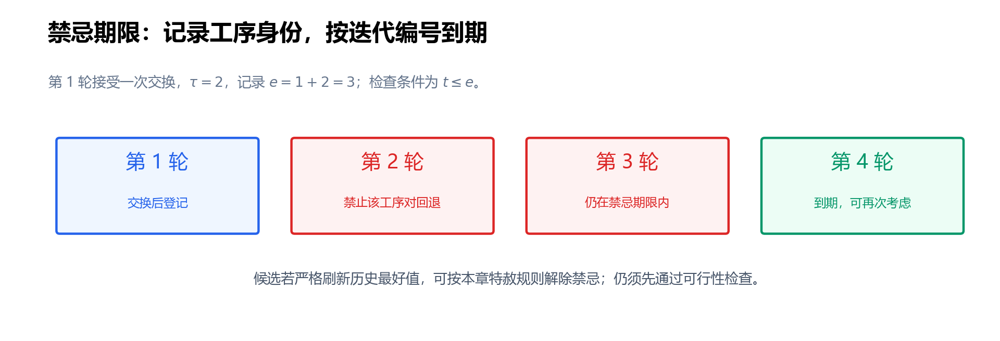

---
tags:
  - JSP
  - 启发式算法
---

# 第 9 节：禁忌搜索——记忆、期限与特赦

状态：第一版，待 review。<br>
本节目标：能为相邻交换设计明确的禁忌属性与到期规则，区分可行候选、禁忌候选和可选候选，并用 current/best 正确实现基础禁忌搜索。

前置：[第 6 节：局部搜索](./06_局部搜索_移动与可行性.md)、[第 7 节：N5](./07_关键块邻域与N5.md)、[第 8 节：SA](./08_模拟退火_SA.md)。仍研究固定机器、正加工时间、不可抢占、无换型与运输的 JSSP；$f(\pi)$ 是队列 $\pi$ 的最早排程最大完工时间。

## 9.1 接受了一个平台步，为什么又走回去？

第 6 节的次优停点 $\pi^{\mathrm L}$ 值为 12。先交换 $M_2$ 的 $O_{1,2},O_{2,1}$ 得到 $\pi^{\mathrm B}$，值仍为 12；再交换 $M_3$ 的 $O_{1,3},O_{2,2}$ 就能到 $\pi^0$ 的 11。

但是允许持平以后，也可能立即在 $M_2$ 上交换回去：

$$
\pi^{\mathrm L}:12\ \longrightarrow\ \pi^{\mathrm B}:12
\ \longrightarrow\ \pi^{\mathrm L}:12\ \longrightarrow\cdots
$$

SA 用概率决定是否接受变差，却不会自动记住刚交换过哪两道工序。**禁忌搜索**（Tabu Search，TS）加入搜索记忆：近期刚撤销或建立的某些关系，在一段期限内限制再次改变，鼓励继续向别处探索。

记忆、禁忌条件与解除禁忌的特赦条件是 TS 的重要组成部分。[Glover 的原始论文 Tabu Search—Part I](https://pubsonline.informs.org/doi/10.1287/ijoc.1.3.190)讨论了这些机制。本节先实现一种小而明确的短期记忆版本，不把 TS 简化成“保存所有访问过的解”。

## 9.2 基础选择规则：当前邻域中最好的可选候选

下降法要求下一步严格改善；本节 TS 则在满足限制的候选里选目标值最低者，**即使它比 current 更差，也接受**。

一次迭代分四步：

1. 从 current 生成候选并判定可行性。
2. 检查候选移动的禁忌属性是否仍在有效期内。
3. 检查特赦条件，确定哪些候选允许参与选择。
4. 在允许的候选中选目标值最小者，执行移动并更新记忆。

这里没有 SA 的指数接受概率，也没有温度。确定性版本在给定初始解、枚举顺序、并列规则和期限后，可以完整复现；若期限或并列选择随机化，则还需记录种子。

TS 也分别维护 current 与 best。current 可以变差，best 只在发现严格更好解时更新；最终返回独立保存的 best 队列及其排程。

## 9.3 禁忌属性：记工序身份，还是记数组位置？

本节采用无序工序对属性。若在 $M_r$ 上交换相邻工序 $u,v$，登记键：

$$
\kappa=(r,\{u,v\}).
$$

$u,v$ 是两个具体工序，例如 $O_{1,2},O_{2,1}$；$\{u,v\}$ 不区分交换前后的方向。实现可把两道工序的全局编号排序，存成 `(machine, smaller_id, larger_id)`。

接下来期限内，只要仍试图交换这两道工序，就匹配同一键。交换后左右位置对调，不会因顺序不同而漏掉立即回退。

只记 `(machine, left_position)` 不够。其他交换可能改变队列位置，之后同一位置放着另一对工序；这样既可能误禁无关移动，也可能放过真正的回退。

这是 **移动属性记忆**，不是完整解记忆。它只需保存少量工序对，但不保证排除所有较长循环，也可能限制从另一个状态出发的有用交换。它是一种有意粗化的记忆，需要期限和特赦配合。

另一种设计是禁止重新建立刚删除的有向机器关系，例如暂禁恢复 $u\prec v$；若用相邻弧属性，还需明确交换所改动的外侧弧。不同属性产生不同搜索过程，不能只报告“用了 tabu list”就认为算法已经定义完整。

## 9.4 Tenure：把到期时刻写成一个可检查的不等式

**禁忌期限**（tabu tenure）记为 $\tau$。本节以完成移动的迭代轮次计数，而不是候选评价次数或秒数；设 $t$ 是当前迭代编号，从 1 开始。

在第 $t$ 轮选中移动后，登记该键的到期编号：

$$
e_\kappa=t+\tau.
$$

未来第 $t'$ 轮检查该键时，采用：

$$
\operatorname{tabu}(\kappa,t')
\quad\Longleftrightarrow\quad t'\le e_\kappa.
$$

未登记键的到期编号取 0。所以 $\tau=2$ 时，第 1 轮交换后登记 $e_\kappa=3$；第 2、3 轮禁忌，第 4 轮到期。这正好限制后面两轮，避免“期限为 2，实际只限制一轮”的差一错误。



同一键若被特赦选中后再次登记，使用新旧到期编号的最大值，保证不会意外缩短原来仍有效的期限。本节固定 $\tau=2$ 用于手算；大实例不应照搬这个数值当作推荐参数。

期限短，限制很快消失；期限长，更多候选可能同时被禁。效果还取决于邻域大小、属性定义和搜索状态，不能用“越长越能跳出局部最优”作单向判断。

## 9.5 Aspiration：为什么有些禁忌候选可以破例？

**特赦条件**（aspiration criterion）允许足够有价值的移动解除禁忌。本节采用常见的“严格刷新历史最好值”：

$$
f(\pi')<f(\pi^{\mathrm{best}}).
$$

比较的是 best，不只是 current。如果 current 为 13、best 为 11，禁忌候选为 12，它虽然改善当前值，却不满足本节特赦条件。

为说明判断逻辑，假设某轮历史最好值为 12，已评价以下可行候选；这张表只演示筛选，不指定某一组 current 队列：

| 候选值 | 是否禁忌 | 是否刷新 best | 能否参加选择？ |
|---:|---|---|---|
| 13 | 否 | 否 | 能 |
| 12 | 是 | 否 | 不能 |
| 11 | 是 | 是 | 能，特赦 |

持平于 best 不算特赦。有限期属性记忆可能误挡一个来自不同状态的新好解，因此特赦给它保留机会。[Glover 与 Laguna 的作者教程讨论了超越当前历史最好值的特赦规则及属性记忆](https://leeds-faculty.colorado.edu/glover/Publications/TS%20-%20Interfaces%20Tutorial%201990%20aw.pdf)。

**特赦只能解除搜索限制，不能解除输入约束**。有环候选没有合法目标值，不进入上述比较。

## 9.6 Admissible move：三个筛选层次

本节把 **可选移动**（admissible move）定义为：候选可行，并且未禁忌或满足特赦。设候选移动为 $a$，应用后得到 $a(\pi)$，则：

$$
\operatorname{admissible}(a)=
\operatorname{feasible}(a(\pi))
\ \land\
\bigl(\neg\operatorname{tabu}(a)\ \lor\ \operatorname{aspire}(a)\bigr).
$$

三个层次不能混淆：

| 层次 | 由什么决定？ | 结果 |
|---|---|---|
| 可行性 | JSSP 的工艺、机器与时间约束 | 有环候选直接排除 |
| 可选性 | 当前记忆和特赦规则 | 同一可行移动在不同轮次可能不同 |
| 最终选择 | 可选候选的目标值与并列规则 | 只有选中的移动更新 current |

“有更差的可选候选”仍足以继续 TS；“所有可行候选都被禁”则是记忆造成的暂时阻塞，不能据此说 current 已局部最优或问题不可行。

## 9.7 三轮完整手算：平台、改善、再变差

使用第 6 节完整相邻交换邻域，按 $(r,i)$ 从小到大枚举，目标值并列也按该顺序选择。期限 $\tau=2$，初始化无禁忌记录。

起点队列与第 8 节相同：

$$
\begin{aligned}
\pi^{\mathrm L}_1&=(O_{1,1},O_{3,2},O_{2,3}),\\
\pi^{\mathrm L}_2&=(O_{1,2},O_{2,1},O_{3,3}),\\
\pi^{\mathrm L}_3&=(O_{3,1},O_{1,3},O_{2,2}),
\end{aligned}
\qquad f(\pi^{\mathrm L})=12.
$$

### 第 1 轮：没有严格改善，选择最先枚举的等值步

六个候选全部可行、未禁忌，目标值按枚举顺序为：

$$
19,\ 16,\ 12,\ 15,\ 18,\ 12.
$$

最小值 12 出现两次，按并列规则选择 $\operatorname{swap}_{2,1}$，得到 $\pi^{\mathrm B}$。登记：

$$
\kappa_1=(2,\{O_{1,2},O_{2,1}\}),\qquad e_{\kappa_1}=3.
$$

current 为 12，best 为 12。下一轮不能立刻交换该对回到 $\pi^{\mathrm L}$，除非满足特赦。

### 第 2 轮：继续前进，得到 11

此时只有 $M_2$ 队列变为 $(O_{2,1},O_{1,2},O_{3,3})$，其他队列不变。重新评价如下：

| 移动 | 候选值 | 禁忌状态 | 是否可选 |
|---|---:|---|---|
| $\operatorname{swap}_{1,1}$ | 19 | 否 | 是 |
| $\operatorname{swap}_{1,2}$ | 16 | 否 | 是 |
| $\operatorname{swap}_{2,1}$ | 12 | 是，$\kappa_1$ | 否，不刷新 best |
| $\operatorname{swap}_{2,2}$ | 17 | 否 | 是 |
| $\operatorname{swap}_{3,1}$ | 18 | 否 | 是 |
| $\operatorname{swap}_{3,2}$ | 11 | 否 | 是 |

选择 $\operatorname{swap}_{3,2}$，得到 $\pi^0$，current 与 best 都更新为 11。登记：

$$
\kappa_2=(3,\{O_{1,3},O_{2,2}\}),\qquad e_{\kappa_2}=4.
$$

### 第 3 轮：最好的可选邻居也变差，仍然接受

以 $\pi^0$ 为 current，重新扫描：

| 移动 | 候选值 | 禁忌状态 | 是否可选 |
|---|---:|---|---|
| $\operatorname{swap}_{1,1}$ | 14 | 否 | 是 |
| $\operatorname{swap}_{1,2}$ | 13 | 否 | 是 |
| $\operatorname{swap}_{2,1}$ | 12 | 是，$3\le e_{\kappa_1}=3$ | 否 |
| $\operatorname{swap}_{2,2}$ | 12 | 否 | 是 |
| $\operatorname{swap}_{3,1}$ | 14 | 否 | 是 |
| $\operatorname{swap}_{3,2}$ | 12 | 是，$3\le e_{\kappa_2}=4$ | 否 |

本轮没有候选严格优于 best 的 11，所以特赦不触发。选择唯一目标值为 12 的可选候选 $\operatorname{swap}_{2,2}$，将 $M_2$ 队列改为 $(O_{2,1},O_{3,3},O_{1,2})$。

current 变为 12，best 仍为 11；登记交换的 $O_{1,2},O_{3,3}$，到期编号为 5。三轮 current 轨迹为 $12\to12\to11\to12$，best 轨迹为 $12\to12\to11\to11$。

本例中 11 的全局最优性已有独立证据；演示仍继续一轮，是为了说明 TS 的状态与接受规则。实际实现若得到有效下界并闭合，可以提前停止。

## 9.8 换成 N5，会发生什么？

本章手算用全相邻交换，便于与第 6、8 节直接比较。若换成第 7 节的一条路径 N5，候选更少，TS 的选择和轨迹也会改变。

例如 $\pi^0$ 的 N5 只有 $M_1$ 上交换 $O_{3,2},O_{2,3}$，候选值为 13。若该移动未禁忌，基础 TS 会接受 $11\to13$；它不能选择本节全相邻邻域中的其他值为 12 的候选，因为它们根本没有被生成。

较小邻域每轮评价快，但同时禁掉少量候选就可能无路可走。记忆策略和邻域必须一起设计；仅把完整邻域的期限照搬到 N5，可能产生不同程度的阻塞。

N5 本身的可达性限制也不会因禁忌记忆而消失。多起点、扰动或偶尔扩大邻域属于额外策略，应明确记录触发条件与预算。

## 9.9 无可选移动时怎么办？

必须事先规定策略，不能依赖程序偶然保留的临时变量。本节基础实现选择：**停止本次轨迹并返回 best，停止原因记为“无可选移动”**。

其他合理变体包括：扩展候选集；解除最早到期的一部分限制后重新选择；从新初始解重启。采用放宽策略时，日志要能区分特赦、到期和强制解除，它们不是同一种事件。

如果当前所有可行候选被禁，单纯“再扫描一遍”不会改变期限。若使用空转轮次推动到期，要把它明确定义为算法的一部分；本节不通过悄悄递增计数来解除限制。

选择哪一种属于算法设计，不存在一个脱离邻域、预算与实验结果的统一最佳答案。无可选移动不证明整个 JSSP 不可行，也不证明 best 最优。

## 9.10 基础 TS 伪代码

`key` 使用无序工序对，`expiry` 是到期编号映射，默认值 0；期限是固定非负整数。每轮完整扫描可行邻域，目标值并列按机器编号与左位置选择。

```text
tabu_search(initial, tenure, iteration_limit):
    检查 tenure >= 0
    result = decode(initial)
    若不可行: 返回输入错误
    current = copy(initial)
    current_value = result.Cmax
    best = copy(current)
    best_value = current_value
    expiry = 空映射，未登记键取 0

    for t 从 1 到 iteration_limit:
        chosen = 空
        for (r, i) 按约定顺序枚举 current 的候选位置:
            若时间上限已到: 返回 best，原因=时间上限
            u, v = current[r] 中待交换的工序
            kappa = (r, u与v的编号排序后的二元组)
            candidate = copy(current)，交换 r 上 i 与 i+1
            result = decode(candidate)
            if result 不可行:
                continue
            tabu = (t <= expiry[kappa])
            aspire = (result.Cmax < best_value)
            if tabu and not aspire:
                continue
            if chosen 为空，或 result.Cmax < chosen.value:
                chosen = 候选队列、目标值、kappa 的独立记录

        if chosen 为空:
            返回 best，原因=无可选移动
        current = chosen.queue
        current_value = chosen.value
        expiry[chosen.kappa] = max(expiry[chosen.kappa], t + tenure)
        if current_value < best_value:
            best = copy(current)
            best_value = current_value
        记录 current、best、选择的键、到期编号、禁忌与特赦统计

    重新解码并校验 best
    return best，原因=迭代上限
```

关键结构若用于生成候选，接受后重新计算。评价未选候选时，不能更新其禁忌键；禁忌记忆记录实际执行的轨迹，而不是所有试过的移动。

过期键可以删除以控制内存；若保留，判断仍按到期编号。时间中途停止只报告预算停止，不能报告完整邻域无改善。

## 9.11 期限变化与长期记忆：先分清作用

固定期限容易检查；随机期限例如每次从规定整数区间抽取，可减少某些固定节奏的回退，但也改变轨迹和可复现要求。自适应期限则按重复访问、停滞等信息调整，必须写明反馈规则，不能只称“动态 tenure”。

较长期的机制常分为：

| 机制 | 主要目的 | 教学例子 |
|---|---|---|
| 强化搜索，intensification | 在已发现的好区域中进一步搜索 | 从精英解重新出发，研究其周边结构 |
| 多样化，diversification | 避免持续停留于同一类队列 | 用访问频率信息偏向较少探索的关系 |

这些策略在原始 TS 文献中已有讨论。本节并未实现完整长期记忆；第 12 节再衔接优秀解集合与混合方法。参数更复杂本身不构成改进证据。

## 9.12 易错点与实验检查

| 误解或实现错误 | 应核对的地方 |
|---|---|
| TS 只接受改善 | 本节选最好的可选候选，可接受变差 |
| 禁忌就是排程不可行 | 前者来自暂时记忆，后者来自硬约束 |
| 特赦只要改善 current | 本节要求严格刷新 best |
| 登记交换后的 `(v,u)`，检查时只查 `(u,v)` | 使用无序对，或明确有向关系恢复规则 |
| 用数组位置代替工序身份 | 位置会随交换变化，应记录稳定工序 ID |
| 所有评价过的移动都入表 | 只登记实际执行的移动 |
| tenure 为 2 却只禁下一轮 | 用具体到期表检查差一错误 |
| 短期记忆保证永不循环 | 只限制匹配属性的近期移动，不排除全部较长循环 |
| 所有候选被禁就宣布最优 | 报告无可选移动，按预先规定策略处理 |

性能比较时记录候选评价次数与墙钟时间。TS 每轮常评价多项，SA 每步通常只评价一个提议；“都运行一万步”不代表同样计算成本。使用相同 decoder、初始化来源和时间预算，并报告多个随机重复或多起点结果。

## 9.13 自检题

1. 为什么只记机器与数组位置不能可靠阻止回退？本节的属性键是什么？
2. 第 5 轮执行某键，$\tau=3$，到期编号是多少？第 8、9 轮分别是否禁忌？
3. current 为 13、best 为 11，值为 12 的可行禁忌候选是否特赦？
4. 手算第 3 轮为何选 $\operatorname{swap}_{2,2}$，而不是另两个值为 12 的候选？接受后 best 是多少？
5. 交换候选有环，却被某个评分缓存标成“比 best 好”，能否特赦？
6. 无可选移动是否等于当前解无可行邻居？是否等于局部最优？
7. 把 N5 换进 TS 后，$\pi^0$ 上未禁忌的唯一候选值为 13，基础 TS 如何处理？
8. 比较 SA 与 TS 时，为什么不能只固定相同迭代数？

### 参考答案

1. 位置上的工序会改变，容易误禁或漏禁。本节键为 $(r,\{u,v\})$，实现用稳定 ID 排序保存。
2. $e=5+3=8$；第 8 轮仍禁忌，第 9 轮到期。实际还可被特赦规则解除。
3. 不特赦。12 仅改善 current，没有严格优于 best 的 11。
4. 另两个 12 分别匹配到期编号为 3、4 的有效禁忌键，且没有特赦；选中后 current 为 12，best 保持 11。
5. 不能。先排除有环候选，错误缓存分数不构成可行性证据。
6. 都不等价。可行邻居可能全部被暂时禁忌；无可选移动也不是目标值比较意义上的局部最优证明。
7. 接受这个最好的可选候选，current 变成 13，best 保持 11；若已有最优性下界闭合，可另行提前停止。
8. 每步或每轮评价的候选数量不同。应统一时间或合理评价预算，同时记录实际成本。

## 9.14 复习速记卡

| 要立即想起的问题 | 本节要点 |
|---|---|
| TS 怎样继续探索？ | 选最好的可选邻居，允许变差 |
| 记忆存什么？ | 本节存机器与无序工序对，不存瞬时数组位置 |
| 期限怎样算？ | 第 $t$ 轮登记 $e=t+\tau$，未来轮次满足 $t'\le e$ 时有效 |
| 什么是特赦？ | 本节为严格刷新历史 best，不能解除硬约束 |
| 什么是可选移动？ | 可行，并且未禁忌或获特赦 |
| 何时登记记忆？ | 实际执行移动以后 |
| 无可选移动怎么办？ | 按预先规定策略处理；本节返回 best 并报告原因 |
| 最终保存什么？ | 独立复制的 best 队列及重新校验的排程 |

下一节：[Shifting Bottleneck 与单机子问题](./10_Shifting_Bottleneck与单机子问题.md)。我们将从“修改完整队列”转向“逐台决定机器顺序”，看分解方法怎样用 head/tail 识别瓶颈。

参考核验：2026-10-11。记忆与特赦的基本思想对照 Glover 原论文及作者教程；无序对属性、到期不等式、并列与无可选移动处理是本节明确规定的基础版本。三轮轨迹独立计算，不声称复现某篇论文的完整 JSSP 求解器。

提交前检查：三轮全部候选、禁忌期限、最终队列与 current/best 由 [第 7–9 节核算与绘图脚本](https://github.com/fengmaker/my-website/blob/main/Heuristic/fjsp_learning/jssp/scripts/07_09_build_figures.py) 重算；检查符号、表格及相对链接。最终格式检查范围见目录中的验收记录。
