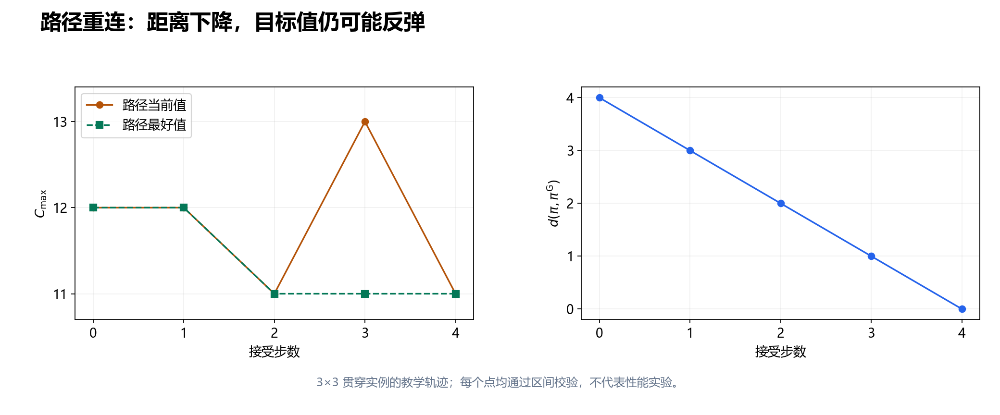

# 第 12 节：优秀解集合、Big Valley、Path Relinking 与混合搜索

状态：本轮审校完成，待用户 review。<br>
本节目标：用机器顺序定义解之间的距离，理解优秀解集合怎样同时保存质量与多样性；手算一条 Path Relinking 路径，并把混合算法拆成职责、接口和预算。

前置：[第 9 节：禁忌搜索](09_禁忌搜索_TS.md)、[第 11 节：下界与精确求解](11_下界与精确求解_BB_MILP_CP.md)。仍使用前文的固定机器、正整数加工时间、不可抢占、最小化 $C_{\max}$ 的 3×3 JSSP。每个解用机器队列 $\pi=(\pi_1,\pi_2,\pi_3)$ 表示，并按最长路生成该队列下的最早排程。

## 12.1 搜索已经找到几个好解，为什么还要保存多个？

第 8、9 节把搜索过程分为当前解 `current` 和历史最好解 `best`。现在考虑另一个问题：一次运行找到多个质量接近、机器顺序不同的解，除了最小的 $C_{\max}$，其余解有没有用？

有可能有用。例如两个解分别在不同机器上采用了有利的顺序；从其中一个出发，逐渐引入另一个的顺序关系，沿途可能遇到新的好解。但“两个好解组合后仍然好”没有一般保证：机器顺序相互牵制，混合后甚至可能成环。

因此增加一个 **优秀解集合**（elite set）$\mathcal E$：保存少量经过校验、质量较好且结构不完全重复的解。它与 `best` 的职责不同：

| 保存对象 | 主要回答什么问题 | 更新时注意什么 |
|---|---|---|
| 当前解 | 下一步从哪里继续？ | 可以接受等值或变差移动 |
| 历史最好解 | 本次运行最后返回什么？ | 只被更好的可行解替换，保存副本 |
| 优秀解集合 $\mathcal E$ | 下次从哪些结构继续，或用谁来引导？ | 同时考虑目标值、距离、容量与去重 |

优秀解集合不是“把最后几轮的解存下来”。最后几轮可能都是同一小区域里的近重复解；它们占用内存，却没有增加多少可探索结构。

## 12.2 先规定距离：比较同机工序对的相对顺序

相同的 $C_{\max}$ 不意味着相同的机器顺序。要描述结构差异，先定义本节采用的距离。

令 $\mathcal P_r$ 为机器 $M_r$ 上所有无序工序对的集合。对每一对 $\{u,v\}$，按工序编号固定一个书写方向；令 $b_\pi(u,v)=1$ 表示在 $\pi$ 中 $u$ 排在 $v$ 前，否则为 0。定义：

$$
d(\pi,\sigma)
=\sum_r\sum_{\{u,v\}\in\mathcal P_r}
\mathbf 1[b_\pi(u,v)\ne b_\sigma(u,v)].
$$

$\mathbf 1[\cdot]$ 是指示函数，条件成立计 1，否则计 0。这是逐机器求和的 Kendall 相对顺序距离：**同机工序对有多少对先后关系不一致**。不比较开始时刻，也不只比较队列中相邻的弧。

本例每台机器三道工序，共有 $3\binom32=9$ 对，因此 $0\leq d\leq9$。若需要不同规模之间的粗略归一化，可除以 $D=\sum_r\binom{n_r}{2}$，其中 $n_r$ 为 $M_r$ 的工序数；$D=0$ 时另行约定归一化距离为 0。归一化不会让不同实例的景观自动可比。

为什么不直接比较数组位置？一个工序向前插入两格，会同时改变它与两道工序的相对次序；相对顺序距离能逐一记录这两项改变。若只数“有几处位置不同”，一次插入可能涉及三个位置，含义就不同了。距离没有唯一正确选法，必须说明定义与表示。

在单台机器队列中交换一对相邻工序，只改变该对的相对顺序。若交换方向与目标队列一致，本节距离恰好减少 1；这只是 **结构距离的性质**，尚未说明交换可行或目标值改善。

## 12.3 用贯穿实例计算一次距离

取第 6 节的局部停点作为起点 $\pi^{\mathrm A}$，取第 11 节的最优队列作为引导解 $\pi^{\mathrm G}$。为便于核对，重列两组队列：

| 机器 | 起点 $\pi^{\mathrm A}$ | 引导解 $\pi^{\mathrm G}$ |
|---|---|---|
| $M_1$ | $O_{1,1},O_{3,2},O_{2,3}$ | $O_{1,1},O_{2,3},O_{3,2}$ |
| $M_2$ | $O_{1,2},O_{2,1},O_{3,3}$ | $O_{2,1},O_{1,2},O_{3,3}$ |
| $M_3$ | $O_{3,1},O_{1,3},O_{2,2}$ | $O_{2,2},O_{3,1},O_{1,3}$ |
| 最早排程目标值 | $C_{\max}=12$ | $C_{\max}=11$ |

逐对比较，$M_1$ 只有 $O_{3,2},O_{2,3}$ 这一对不同；$M_2$ 只有 $O_{1,2},O_{2,1}$ 这一对不同；$M_3$ 上 $O_{2,2}$ 与另外两道工序的关系都不同，$O_{3,1},O_{1,3}$ 的关系相同。因此：

$$
d(\pi^{\mathrm A},\pi^{\mathrm G})=1+1+2=4.
$$

第 1 节的原队列 $\pi^0$ 与 $\pi^{\mathrm G}$ 都达到 11，但二者在 $M_1$ 和 $M_3$ 上各有一对关系不同，所以距离为 2。目标值记录质量，距离记录结构；二者不能互相替代。

本例已由第 11 节证明最优值为 11。因此下面的重连只用于观察过程，不可能找到小于 11 的合法排程。不能用这个例子宣称重连有性能收益。

## 12.4 Big Valley：一种值得检验的景观观察

把一个可行机器队列看作一点，把允许的移动看作点之间的连接，把 $C_{\max}$ 看作高度，这就得到一种 **搜索景观**。邻域、表示或局部改进规则变化后，所讨论的景观也会变化。

**Big Valley**（大谷地）通常用来描述某些组合优化实验中的现象：较好的局部最优解在所选距离下相对集中，或质量与到最好解的距离存在关联。这给出一个搜索动机：已经找到的好结构可能帮助定位其他好结构，因此可以保存优秀解、从它们重启，或在它们之间重连。

这不是“任意两点之间都一路下降”的几何结论，也不是对所有 JSSP 实例、所有邻域都成立的定理。即使总体上有质量与距离的关联，局部仍可能有平台、障碍和多个吸引区域。

历史阅读时要区分研究对象：[Boese、Kahng、Muddu 的 1994 年原论文](https://vlsicad.ucsd.edu/Publications/Journals/j15.pdf)讨论启发式组合优化的新框架，其实验对象是旅行商问题与图二分；[Reeves、Yamada 的 1998 年工作](https://doi.org/10.1162/evco.1998.6.1.45)研究置换流水车间。这些观察不能直接写成 JSSP 定理。

JSSP 中，[Nowicki、Smutnicki 的 2005 年论文](https://doi.org/10.1007/s10951-005-6364-5)以 Big Valley 现象作为算法动机，并结合部分 PR 机制与邻域性质。本节借用这一动机，距离与重连规则在下文另行定义；该论文及其他来源的阅读范围见 [来源核验记录](assets/12_sources_verified.md)。

若要在自己的 JSSP 程序中检验这种现象，应固定一套下降规则与 tie-break，从多个起点取得局部最优，再绘制“目标值—到已知最好解的距离”。最好解若未证最优，只能称为当前参考解；若存在多个并列最优，可以计算到该集合的最小距离。单条搜索轨迹、未经下降的随机点、或一张示意山谷图，都不能代替这项实验。

## 12.5 优秀解集合怎样同时保留质量与多样性？

先给一套可实现的教学策略。容量为 $K\geq1$，距离门槛为整数 $\delta\geq1$。它是一种算法选择，不是所有 elite set 的统一定义。

1. 候选先独立校验，再按机器队列去重；同一队列不因不同时间表而重复入库。
2. 集合为空时直接加入。否则，找距离最近的成员作为 $e^*$；若并列，选 $C_{\max}$ 较大的成员，再并列则取机器队列字典序最小者。
3. 若 $d(x,e^*)<\delta$，只有 $x$ 严格优于 $e^*$ 才考虑替换；替换后还要检查与其余成员的距离均至少为 $\delta$。
4. 若候选与所有成员距离均至少为 $\delta$，集合未满就加入；集合已满时，只有候选严格优于最差成员才替换。最差成员指 $C_{\max}$ 最大者，并列时取机器队列字典序最小者。
5. `best` 独立更新。即使某个新纪录因多样性条件未进入集合，也要保存为最终返回候选。

本例可用 $K=2,\delta=2$ 试验：$\pi^0$ 与 $\pi^{\mathrm G}$ 都为 11，距离正好为 2，可以共同保留。相同队列的副本距离为 0，不应重复占位。

这套规则偏保守：满库后，同值但更远的候选也可能被拒绝。若想允许“牺牲一点质量换多样性”，需要另定替换评分、质量门槛和 tie-break，再做实验。门槛过大可能让集合长期填不满；门槛过小可能留下大量近重复解。应记录入库次数、拒绝原因和集合距离，而非只调容量。

## 12.6 Path Relinking：朝引导解移动，检查沿途解

**路径重连**（Path Relinking, PR）选择起点和引导解，逐步把起点的部分属性改成引导解的属性，并评价中间解。它利用两个解之间的差异来安排搜索，而不仅是从一个解随机扰动。[Glover、Laguna、Martí 的作者稿](https://leeds-faculty.colorado.edu/glover/aassprad.pdf)讨论了 Scatter Search 与 Path Relinking 的基本机制；本节下面的相邻交换规则是教学实现，不是对其中任一完整算法的复现。

具体论文的距离也可能不同。例如 [Peng、Lü、Cheng 的 JSSP 作者稿](https://arxiv.org/abs/1402.5613)比较机器排列中位置不一致的数量，并结合候选修复与 TS 强化。这不是本节的两两相对顺序距离；阅读时应先核对表示与距离，不能只看到 PR 名称就认为路径规则相同。

对当前队列 $\pi$ 和固定引导队列 $\pi^{\mathrm G}$，本节生成候选的规则是：

- 枚举全部机器上的相邻交换。
- 只保留交换后距引导解减少 1 的候选。
- 重新建图；有环就拒绝，其他候选按最长路评价。
- 在保留下来的候选中选 $C_{\max}$ 最小者；同值时依次按机器编号、左位置编号选择。

**接近引导解不等于改善目标值**。本节允许路径当前值上升，但单独保存路径上见过的最好可行解。若加上 N5 限制、只抽样部分交换或预算中断，路径可能提前终止；实现要返回原因，不应把“没有生成候选”解释成全局最优。

## 12.7 手算一条四步重连路径

从 12.3 的 $\pi^{\mathrm A}$ 出发。机器编号和交换左位置均从 1 开始。

| 步数 | 接受的相邻交换 | 到引导解的距离 | 路径当前 $C_{\max}$ | 路径最好 $C_{\max}$ |
|---|---|---:|---:|---:|
| 0 | 起点 | 4 | 12 | 12 |
| 1 | $M_2$：$O_{1,2},O_{2,1}$ | 3 | 12 | 12 |
| 2 | $M_3$：$O_{1,3},O_{2,2}$ | 2 | 11 | 11 |
| 3 | $M_1$：$O_{3,2},O_{2,3}$ | 1 | 13 | 11 |
| 4 | $M_3$：$O_{3,1},O_{2,2}$ | 0 | 11 | 11 |

第一步有三个可行且减少距离的候选：交换 $M_1$ 的第 2、3 道得 16；交换 $M_2$ 的第 1、2 道得 12；交换 $M_3$ 的第 2、3 道也得 12。按既定 tie-break 选 $M_2$。

第二步的两个候选值是 16 和 11，选择后者，到达第 1 节原队列 $\pi^0$。第三步的两个候选值是 13 和 14，因此接受 13；虽然变差，却继续缩短结构距离。第四步到达引导解 11。

第三步的值可以直接检查：此时 $M_1$ 顺序为 $O_{1,1},O_{2,3},O_{3,2}$，$M_3$ 仍为 $O_{3,1},O_{2,2},O_{1,3}$。$O_{2,2}$ 要等 $O_{3,1}$ 在 4 完成，故 $O_{2,3}$ 在 $[5,9)$ 加工；随后 $O_{3,2}$ 在 $[9,12)$，$O_{3,3}$ 在 $[12,13)$，得到 13。



图 12-1：全部点来自上表的可行队列，按同一 decoder 重算。距离每步下降，当前值会反弹，路径最好值保持不增；这是算法过程图，不是性能实验或 Big Valley 的统计证据。

## 12.8 一份边界明确的重连伪代码

```text
relink(start, guide, remaining_budget):
    校验 start 和 guide；要求它们来自同一实例和机器分配
    current = start 的副本
    path_best = current 的副本
    同时把 guide 作为已知可行解交给外层 best 更新

    while current != guide 且尚有预算:
        candidates = 空集合
        for current 中的每个同机相邻交换:
            若预算耗尽: 返回 path_best，原因=预算停止
            candidate = 交换后的队列副本
            if distance(candidate, guide) != distance(current, guide) - 1:
                continue
            result = decode(candidate)
            if result 可行:
                candidates 加入 (candidate, result.value, machine, left_position)
        if candidates 为空:
            返回 path_best，原因=本轮没有可行的减少距离候选
        current = 按 (value, machine, left_position) 最小的候选副本
        if current.value < path_best.value:
            path_best = current 的副本

    返回 path_best，原因=到达引导解或预算停止
```

预算检查不能只放在外层循环：评价一个邻域可能很贵。若要允许使用预算中断前已扫描的最佳候选，需要另外规定规则；这份伪代码在扫描中断时直接返回已有 `path_best`，不会把部分扫描描述成完整贪心选择。

若初始距离为 $d_0$，每次接受都使非负整数距离减 1，因此最多接受 $d_0$ 步；这只限制步数，不限制每一步的候选评价成本。本例每轮最多扫描六个交换。较大实例中可预存位置表加快距离计算，但必须先保证判环和完整解码正确。

若在每一步之后直接做不受限的局部搜索，它可能重新增大到引导解的距离，原来的“最多 $d_0$ 步”证明就失效。一个清楚的做法是：重连主路径保持上述规则，只对选中的中间解副本做局部改进，改进结果用于更新 `best` 与集合，不替换主路径状态。

## 12.9 Hybrid：把部件接到具体问题上

**混合搜索**（hybrid search）不由算法名的数量决定。需要说明谁生成解、谁改进解、部件之间传什么，以及各自花多少预算。

| 部件 | 输入与输出 | 在本节方案中的作用 |
|---|---|---|
| 构造与扰动 | 实例或已有队列 → 候选队列 | 产生起点和新结构 |
| Decoder 与独立 validator | 队列 → 时间表、目标值、合法性 | 统一评价与检查 |
| LS 或 TS | 可行起点、预算 → 改进后的可行解 | 在当前结构附近强化搜索 |
| 优秀解集合 | 新可行解 → 保留或拒绝 | 管理跨轮次的质量与多样性 |
| PR | 两个成员、预算 → 路径最好解 | 利用两种结构之间的差异 |
| 可选 CP 修复 | 固定部分决策的子问题 → 可行修复或求解状态 | 更集中地搜索一个被放开的区域 |

一个完整循环可以是：多起点构造 → 每个起点做限额 TS → 更新 $\mathcal E$ → 选一对成员做 PR → 对路径上的少量副本做局部改进 → 再更新集合与 `best`。例如教学配置把搜索预算分成 60% 的起点改进、25% 的重连、15% 的重连后改进；比例只是待验证的选择，不是推荐的通用参数。

若混入精确方法，第 11 节的界仍要分清：固定大部分机器顺序后，CP 子问题即使被证明最优，也只说明该受限子问题最优；其下界不能直接当作原 JSSP 的全局下界。若 CP 只用 hint 而没有固定决策，搜索空间又是另一回事，需要明确模型。

最后做 **消融实验**：同一总预算下比较多起点 TS、TS + 集合重启、TS + PR、TS + PR + 后改进。增加一个部件而同时增加总时间，无法单独解释收益来自哪个机制。下一节会把这种比较写成可复现实验协议。

## 12.10 易错点

| 容易混淆的结论 | 应怎样改写 |
|---|---|
| 同值解就是同一个解 | 同值只说明质量相同，还要比较机器队列 |
| Big Valley 保证好解之间一路改善 | 它是特定景观中的经验观察，不是普遍保证 |
| 朝 guide 的交换必可行 | 距离检查后仍需判环、解码 |
| 重连必然找到比两个端点更好的解 | 没有这种一般保证，沿途可能更差 |
| 精英集合只需保留最小的几个值 | 还要定义去重、距离、容量与替换规则 |
| 中途局部搜索不会改变重连的性质 | 若替换主路径状态，距离可能增加，需重新分析 |
| 子问题已证最优，所以原问题已证最优 | 先检查被固定的决策和界的适用范围 |

## 12.11 自检题

1. 本节的距离为什么数 9 对关系，而不是只数 6 条相邻机器弧？
2. 起点与 guide 在三台机器上的距离分别是多少？两个值为 11 的最优队列是否距离为 0？
3. 第三步已经到 13，为什么路径最好值仍为 11？若只接受严格改善，会发生什么？
4. $K=2,\delta=2$ 时，相同队列的副本能否入库？一个刷新全局纪录但被集合规则拒绝的解是否应该丢弃？
5. “从十个起点得到十个好局部最优”足以证明所有 JSSP 都有 Big Valley 吗？
6. 在 PR 每步后用局部搜索结果替换 `current`，还能直接声称最多 $d_0$ 步吗？

### 参考答案

1. 每台机器三道工序有 $\binom32=3$ 对相对顺序，共 9 对；非相邻对也表达队列结构。相邻弧用于建图，距离在此比较全部同机工序对。
2. 分别为 1、1、2，总计 4。$\pi^0$ 与 $\pi^{\mathrm G}$ 的距离为 2，目标值相同不意味着队列相同。
3. `path_best` 保存此前值 11 的副本。严格改善规则在第一步等值 12 时就会停下，无法完成这条路径。
4. 副本距离为 0，应去重。刷新纪录的可行解仍应更新独立的 `best`，集合拒绝不等于最终答案拒绝。
5. 不能。这只是在特定实例、邻域、下降规则与距离下的样本，不能外推为普遍定理。
6. 不能。局部改进可能增加到 guide 的距离；可只改进副本，或重新设计主路径规则与停止论证。

## 12.12 复习速记卡

| 要立即想起的问题 | 本节要点 |
|---|---|
| 为什么保留多个好解？ | 给重启和重连提供不同结构，须控制近重复 |
| 距离比较什么？ | 固定机器分配下，全部同机工序对的相对顺序 |
| Big Valley 是什么性质？ | 特定表示、距离与邻域下的经验观察，无普遍保证 |
| PR 每步保证什么？ | 本教学规则保证接受步的距离减 1，另查可行性 |
| 目标值会怎样？ | 可反弹，路径最好值单独保存 |
| Hybrid 如何说清？ | 部件职责、输入输出、预算、停止条件与消融对照 |

下一节：[标准数据集与可复现实验](13_标准数据集与可复现实验.md)。算法能运行之后，还要证明输入相同、预算公平、结果可行，且收益不是只挑一次幸运运行。

审校与核算范围见 [全套审校记录](assets/01_14_review.md)。
