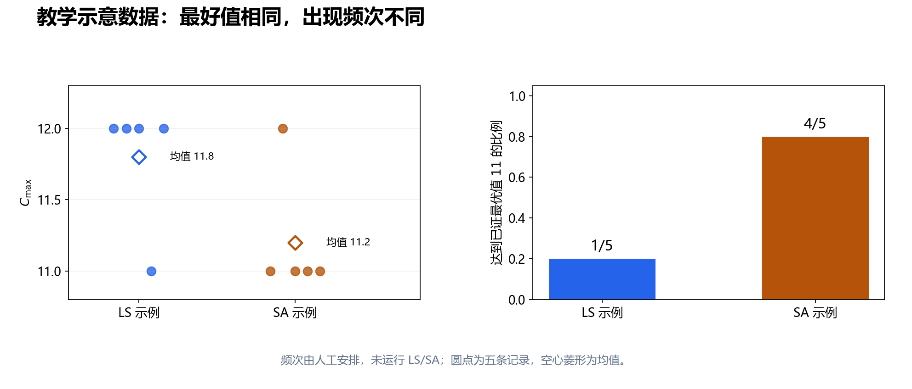

# 第 13 节：标准数据集与可复现实验

状态：本轮审校完成，待用户 review。<br>
本节目标：把“算法效果不错”变成可核对的证据：实例与参考值匹配、排程通过独立校验、预算统一、随机重复完整、统计可从原始记录重建。

前置：[第 11 节：下界与精确求解](11_下界与精确求解_BB_MILP_CP.md)、[第 12 节：优秀解集合与混合搜索](12_优秀解集合_Big_Valley与Path_Relinking.md)。本节仍以标准、静态、确定性、不可抢占、最小化 $C_{\max}$ 的 JSSP 为对象；迁移到 FJSP 时须另外核对机器选项和对应加工时间。

## 13.1 一次运行达到 11，究竟说明了什么？

第 11 节已证明贯穿实例的最优值为 11。若程序输出一张合法的值 11 排程，可以说这次运行达到最优。但以下问题仍没有答案：

- 换一个随机种子，是否还能达到 11？
- 同样时间内，一个更简单的多起点 LS 能否同样达到？
- 换成更大、未参与调参的实例，是否仍有收益？
- 是否花了额外的初始化、重连或修复时间，却没有计入预算？

实验要同时回答 **正确性、质量、成本与稳定性**。一张最好成绩表只能覆盖其中一部分；算法停在某个值，也不能代替第 11 节的最优性证据。

本节给出一份学习项目可直接采用的协议。种子数、实例划分和预算是本项目建议的起步设置，不是整个调度领域的统一标准。

## 13.2 常见 JSSP 实例从哪里取得？

先分清实例作者、数据托管者和参考结果维护者，它们可能不是同一个人。

| 家族 | 本节建议的入口与用途 | 需要注意什么 |
|---|---|---|
| FT | OR-Library 中的 `ft06`、`ft10`、`ft20`，用于从微型例子过渡到公开实例 | 原文件注明别名 `mt06` 等，别名不能当作新增实例 |
| LA | OR-Library 的 `la01`–`la40`，逐步扩展不同规模 | 不要只挑算法最有利的几个实例 |
| ABZ、ORB、SWV、YN | 同一 `jobshop1` 文件内的其他经典家族 | 先核对名称、规模、工艺路线与格式 |
| Taillard | 作者主页和 OR-Library 的 `jobshop2` 生成材料 | 涵盖不同调度问题，必须明确选的是 job shop |

[OR-Library 的 JSSP 说明](https://people.brunel.ac.uk/~mastjjb/jeb/orlib/jobshopinfo.html)区分两个文件：`jobshop1` 包含 82 个文献测试实例，`jobshop2` 提供 Taillard JSSP 的生成代码与数据。`jobshop2` 不是另一个可以照 `jobshop1` 直接逐行读入的实例清单。

[`jobshop1.txt` 的原始说明](https://people.brunel.ac.uk/~mastjjb/jeb/orlib/files/jobshop1.txt)列出上述经典家族及出处，并说明数据行记录每道工序的机器编号和加工时间，机器从 0 编号。文件还包含标题、分隔线和多个实例，parser 不能把整份文件当作一个裸矩阵。

Taillard 原论文提出的测试集包括 permutation flow shop、job shop 和 open shop，目标为 makespan；数据可从 [作者的调度实例页](https://mistic.iict-heig-vd.ch/taillard/problemes.dir/ordonnancement.dir/ordonnancement.html)按问题类别取得。OR-Library 的 [`jobshop2` 说明与源码](https://people.brunel.ac.uk/~mastjjb/jeb/orlib/files/jobshop2.txt)给出 80 个 JSSP 实例的生成材料；其中 C 版可选择机器从 0 或 1 编号。因此即使实例名字相同，编号约定也要读清。

第一轮可先做 toy、`ft06`、少量 LA，跑通全过程后再增加完整家族或 Taillard 的一个规模组。不要为了“看起来标准”一次接入大量格式，牺牲输入核对与结果校验。

## 13.3 同名实例怎样证明是同一个问题？

建立 `manifest.csv`，至少记录：

| 字段 | 作用 |
|---|---|
| `instance_id, family` | 本地唯一标识与家族 |
| `source_url, retrieved_at, source_revision` | 下载入口、日期、可取得的版本或提交 |
| `raw_sha256` | 原始文件字节的 SHA-256 |
| `format, machine_index_base` | 所采用的格式和机器编号起点 |
| `jobs, machines, operations` | 解析后的规模统计 |
| `normalized_sha256` | 按约定规范化后的实例内容哈希 |

原始哈希不同，可能只是换行、空格或注释不同；原始哈希相同，说明文件字节相同，但不说明 parser 解释正确。规范化哈希用于比较实际语义，前提是规范化规则明确。

一个可用规则是：按 job 与工艺次序保存每道工序，机器统一为 0-based，时长保存整数，序列化采用固定键顺序与固定分隔符；FJSP 的每道工序机器选项另按机器编号排序。保留工艺链顺序，不能把所有工序按机器排序后丢失 job 关系。

若两个来源只有机器标签的整体重命名不同，先记录并应用一一对应映射，再比较规范化内容。本节的普通规范化哈希不会自动判定所有标签同构；哈希不同需要定位差异，不能立刻断定调度问题不同。

开始跑算法前，至少手查首尾几个 job，核对总加工量、各 job 长度、机器负载和工序总数。要比较公开参考值，还需确认目标与假设相同：加入运输、换型或释放时间后，即使基础加工表相同，也已经是不同的实验问题。

## 13.4 参考值必须带证据类型和快照

对每个实例建立 `reference.csv`，保留 `instance_id, reference_id, lower_bound, upper_bound, status, source_url, source_revision, retrieved_at`。这张表和原始结果一起归档。

| 参考信息 | 可以说明什么 | 不能直接说明什么 |
|---|---|---|
| 有效全局下界 LB | 最优值不小于 LB | 存在值恰好为 LB 的可行排程 |
| 已知可行上界 UB | 至少有一张该值的合法排程 | 该排程已经最优 |
| BKS 上界 | 所保存来源快照中的最好已知可行值 | 永远不变的最优值 |
| 已证明最优值 | 有有效证明，常见为 LB 与 UB 闭合 | 所有更改了假设的版本仍有相同最优值 |

例如 [JSPLib 维护仓库](https://github.com/ScheduleOpt/benchmarks/blob/main/jobshop/README.md)分别提供实例、求解器实验结果和最好上下界记录。使用时保存配套文件与版本，不能把网页今天的参考值和上个月的 CSV 混在同一张表中而不注明变化。

本节不列一张容易过时的实时 BKS 总表。教学核算只使用贯穿实例已经独立证明的 $\mathrm{LB}=\mathrm{UB}=11$；公开实例参考值在正式实验准备时按所选快照读取。

若结果小于旧 BKS，先核对实例、约束、时长与排程合法性，通过后才可能是改善旧上界。若结果小于有效全局 LB，至少有一处输入、实现、参考映射或下界证据出错，不能作为新纪录发布。

## 13.5 先做独立校验，再谈成绩

求解器声称“可行”还不够。输出每道工序的身份、机器、开始和结束时间，用独立 validator 重新检查：

1. 所有工序恰好出现一次，没有遗漏、重复或未知编号。
2. 机器合法；JSSP 与指定机器一致，FJSP 则属于对应可选集合。
3. $c_{j,k}-s_{j,k}$ 等于该机器上的加工时间，且 $s_{j,k}\geq0$。
4. 每个 job 满足 $c_{j,k}\leq s_{j,k+1}$。
5. 每台机器按开始时刻排序后，相邻区间不重叠。
6. 从工序结束时刻重新计算 $C_{\max}$，与求解器报告值一致。

区间统一使用 $[s,c)$，允许一道工序在另一道结束时开始。当前笔记采用整数时间，可直接精确比较；改用浮点数时需事先规定单位与容差，不能靠很宽的容差掩盖真正的重叠。

独立的含义是：validator 直接依据实例与输出区间检查约束，不只是再次调用同一个 decoder 的“可行”标志。调试阶段可频繁检查；正式实验的最终校验放在统一的计时边界之外，内部修复和算法本身必需的可行性检查仍计入搜索时间。

非法解、异常退出和无解输出必须保留一条失败记录。不能删除失败种子，再以剩余几次的均值代表完整实验。

## 13.6 预算怎样对齐？

先写清比较的问题。**固定墙钟时间** 关心用户等同样久能拿到什么；**固定候选评价次数** 更容易比较搜索轨迹，却可能忽略不同算法一次评价的成本。两种预算都有用，应分别报告。

本节建议正式比较时采用每实例、每种子 1 秒和 10 秒两档墙钟预算，并记录实际耗时与评价次数。这里的数字只是学习实验的起点。约定如下：

- 统一排除输入读取、结果写盘、最终独立校验与画图。
- 从初始化开始计时，初始构造、TS/SA 搜索、集合维护、PR、内部修复和混合求解器调用均计入。
- 同一硬件、操作系统、编译模式、线程数和运行环境；记录 CPU 型号、内存、编译器、库版本与程序版本标识。
- 按实例、种子组成运行块，交替或随机化算法执行顺序，保存执行顺序，减少系统负载和温度变化带来的顺序偏差。
- 候选评价前后检查截止时间，记录超时量；不可中断的长调用应设置剩余时间限制，并如实报告实际耗时。

若所有算法共享缓存的初始解，可统一排除这段公共准备，但结论应明确变成“给定同一起点后的搜索性能”。这与“从实例到结果的端到端性能”不是同一实验，不能混在一列中。

固定评价预算也要定义 `evaluation`：是一次完整 decoder、一个邻域的扫描，还是一次增量候选评分？本节建议数一次完整候选评价，并另外统计初始评价、非法候选与重连评价。只写“迭代一万轮”无法比较一轮扫描六个候选的 LS 与一轮只提议一个候选的 SA。

## 13.7 随机种子、重复次数与调参隔离

起步协议可设随机算法每实例使用种子 0–9，共 $R=10$ 次；完全确定性的 Greedy 每实例运行一次即可。确定性 Greedy 的重复耗时测量可以另外进行，但重复同一结果不能制造十个独立质量样本。

相同种子不自动意味着不同算法经历同样随机选择：它们调用随机数的数量与次序可能不同。若希望比较同一起点，单独生成并保存该实例/种子的起点，再传给各算法；种子本身只是可追踪的运行编号之一。

使用固定种子和固定评价预算时，还需固定随机数生成器、采样方法、tie-break、遍历次序与线程设置，才能尽量复现轨迹。按墙钟停止时，即使种子相同，机器负载变化也可能使最后完成的评价次数不同，应记录这种差异。

调参前划分开发集与保留集。例如用选定的几个 LA 实例调初温、tenure 或集合容量，冻结参数后再运行没有参与选择的 LA/其他家族实例。最终可以报告全部结果，但要标明哪些参与了开发。反复看保留集后改参数，就已把它变成开发集，应如实记录。

学习项目不要求立即做大规模统计检验；先保证重复、预算和数据完整。十个种子也不保证均值差异具有统计显著性。若要提出稳健的跨实例结论，应报告不确定性与实例覆盖范围，必要时再设计正式统计分析。

## 13.8 指标怎样计算与命名？

设某实例第 $r$ 次合法运行的值为 $z_r$，共有 $R$ 次，正的参考上界为 $U_{\mathrm{ref}}$、有效下界为 $L$。本节定义：

$$
\operatorname{RPD}_{\mathrm{BKS}}(z_r)
=100\frac{z_r-U_{\mathrm{ref}}}{U_{\mathrm{ref}}}.
$$

RPD 是相对所保存 BKS 上界的百分偏差，越小越好；若参考值已证最优，才能解释成相对最优值的偏差。参考上界未证最优时，RPD 为 0 仍不表示已最优，负值可能表示改进了旧上界。

$$
\operatorname{Gap}_{\mathrm{LB}}(z_r)=100\frac{z_r-L}{L},\qquad
\operatorname{Improve}_{\mathrm{Greedy}}(z_r)=100\frac{G-z_r}{G}.
$$

$G>0$ 是同一实例确定性 Greedy 的值。下界距离越小越好；相对 Greedy 的改善率越大越好。这里的下界距离以 LB 为分母，与第 11 节 CP-SAT 相对 gap 的分母不同，必须保留明确列名，不能都叫 `gap`。

重复运行的平均值与样本标准差为：

$$
\bar z=\frac1R\sum_{r=1}^R z_r,\qquad
s=\sqrt{\frac{\sum_{r=1}^R(z_r-\bar z)^2}{R-1}}\quad(R\geq2).
$$

还应给出最好值 $\min_rz_r$、中位数、最差值 $\max_rz_r$ 与可行率。最好值反映这批运行曾达到什么，均值和离散程度反映稳定性，不能只报其中一项。

若有失败运行，可行率仍以所有计划运行数为分母；质量均值只对合法结果计算，并注明有效样本数和失败原因。不要给失败解随意填 0 或伪造一个很大的 $C_{\max}$。若要设定失败惩罚，应提前定义另一个指标。

## 13.9 用五次教学记录手算一张结果表

下面是 **人工编排的教学数据**：用贯穿实例已核验的值 11、12，安排两组频次来练习统计。LS/SA 仅作示意标签，不能据此判断算法优劣。[教学 CSV](assets/13_example_runs.csv)标有 `data_kind=illustrative`，耗时和评价次数留空。

| 示意方法 | 种子 0 | 种子 1 | 种子 2 | 种子 3 | 种子 4 |
|---|---:|---:|---:|---:|---:|
| LS 示例 | 12 | 12 | 12 | 11 | 12 |
| SA 示例 | 11 | 12 | 11 | 11 | 11 |

本例已知 $U_{\mathrm{ref}}=L=11$，第 5 节 SPT 构造的值为 $G=15$。先计算 LS 示例：总和为 59，均值 $59/5=11.8$；平方离差和为 $4(12-11.8)^2+(11-11.8)^2=0.8$，所以样本标准差为 $\sqrt{0.8/4}\approx0.4472$。

| 指标 | LS 示例 | SA 示例 |
|---|---:|---:|
| 最好 / 中位数 / 最差 | 11 / 12 / 12 | 11 / 11 / 12 |
| 均值 | 11.8 | 11.2 |
| 样本标准差 | 0.4472 | 0.4472 |
| 平均 $\operatorname{RPD}_{\mathrm{BKS}}$ | 7.2727% | 1.8182% |
| 相对 Greedy 的平均改善率 | 21.3333% | 25.3333% |
| 达到已证最优值的比例 | 1/5 | 4/5 |

例如 LS 的平均 RPD 为 $100(11.8-11)/11\approx7.2727\%$。对同一实例，分母固定，所以“先求各次 RPD 再平均”与“对均值求 RPD”相同。此例 LB 与参考上界恰好相同，两个距离指标数值相同；一般实例并不如此。



图 13-1：只展示上表人工安排的数据。两组最好值和标准差相同，达到 11 的频次却不同；说明为什么最好值、均值和分布需要一起看，不能据此给 LS 与 SA 排名。

跨实例汇总时，建议先算每实例的平均 RPD，再对实例等权平均：

$$
\operatorname{MeanRPD}=\frac1N\sum_{i=1}^N
\left(\frac1R\sum_{r=1}^R\operatorname{RPD}_{i,r}\right).
$$

这里 $N$ 是实例数，公式假设每实例都有 $R$ 次合法结果；有失败时先报告缺失范围与处理规则。不能直接用不同规模实例的 $C_{\max}$ 总平均代表总体质量，也不要因某实例多跑了几个种子而暗中增加其权重。

## 13.10 收敛曲线与消融实验分别解释什么？

每次找到新最好值时记录 `(elapsed, best_makespan)`，并保留初始点和终止信息。`best` 是阶梯函数，两次改善之间保持原值；不能把线性插值的中间值当成算法真的取得过的成绩。

画多次运行的曲线时，在共同时间网格上取“该时刻之前最近的 best”，再计算中位数与分位区间。若算法尚未产生合法解，该段记为缺失并报告，不要填 0。首次达到目标的时间若有超时未达到的运行，要标记为未达到，不能只平均成功运行后声称所有运行都很快。

第 12 节的 hybrid 可采用同预算消融：多起点 TS、加集合重启、再加 PR、再加路径后改进。除所研究部件外，保持 decoder、总预算与起点协议一致。若“加 PR”同时改变了初始化、邻域和时间上限，就无法把差异单独归因于 PR。

汇报时先看可行率和异常，再看质量—时间曲线，最后看最终分布。某部件没有改善也是结果；需要结合调用次数、评价开销和实例表现解释，而不是删除该行。

## 13.11 原始日志与复现入口

逐次结果至少保存以下字段；求解器版本、硬件、计时边界、参数和数据快照放在可关联的元信息文件中：

```text
experiment_id, instance_id, instance_hash, algorithm, config_id,
seed, budget_kind, budget, elapsed, evaluations,
makespan, feasible, status, stop_reason, schedule_path
```

CP-SAT 另保留 `best_objective_bound`、线程数、gap 停止参数和求解器状态；随机算法保留 RNG 与起点信息。若目录没有 Git，可用源文件归档与哈希标识程序版本，不必为得到一个版本字符串而假装已有提交。

一个复现包应包含：所选数据或获取清单、reference 快照、冻结配置、编译与运行命令、逐次 CSV、输出排程、独立 validator、汇总与画图脚本。报告中的表从逐次 CSV 生成，不能只在 Markdown 手改一个最好值。

复现说明还要区分两件事：别人能按同一协议得到相近分布；别人能逐评价重放同一轨迹。前者适用于墙钟限时实验，后者需要更强的确定性约束。不要把“种子相同”写成两者的充分条件。

## 13.12 易错点

| 容易写错的地方 | 应采用的做法 |
|---|---|
| 两个文件都叫 `ta01` 就比较分数 | 核对问题类别、规范化内容与参考映射 |
| BKS 等于已证明最优值 | 保存 LB、UB、状态和来源证据 |
| SA 跑十次取最好，LS 只跑一次 | 对齐总预算与重复协议，完整报告分布 |
| 混合算法的修复时间不计入 | 计入内部修复与求解器调用 |
| 删掉非法结果后报 100% 可行 | 所有计划运行进入失败统计 |
| 使用一个 `gap` 列混装多个公式 | 用明确列名并写出分母 |
| 教学统计表写成实际实验成绩 | 显式标注数据生成方式与适用范围 |

## 13.13 自检题

1. `jobshop1` 与 `jobshop2` 的内容有什么不同？Taillard 生成文件为什么仍要检查机器编号起点？
2. 原始 SHA-256 不同，能否马上断定两个来源对应不同实例？
3. $L=100,U_{\mathrm{ref}}=110,z=115$ 时，本节 RPD 和下界距离分别是多少？
4. 两组示意数据的最好值都为 11，为什么仍需报告均值与命中频次？
5. 十次计划运行有两次非法，质量均值只用了八次，可行率应是多少？
6. 同样种子、墙钟限时 10 秒，能否承诺逐评价轨迹完全一致？
7. 在固定了部分机器顺序的 CP 修复里得到下界 120，能否填入原问题的全局 LB 列？

### 参考答案

1. 前者是多实例集合并附格式说明，后者是 Taillard JSSP 的生成代码与数据；C 生成器允许选择 0-based 或 1-based。
2. 不能，可能只有空格、换行或注释差异。需按已定义规则比较解析语义，标签重命名还需显式映射。
3. RPD 为 $100(115-110)/110\approx4.5455\%$；下界距离为 $100(115-100)/100=15\%$。
4. 同样最好值可能来自不同稳定性；本例均值分别为 11.8 与 11.2，达到 11 的次数分别为 1 与 4，但只是教学频次。
5. $8/10=80\%$。均值注明有效样本数 8，并保留两条非法记录与原因。
6. 不能。系统负载可能改变截止前完成的评价次数，随机数实现、多线程与遍历顺序也会影响轨迹。
7. 不能直接填写。它只约束被固定决策的受限子问题，其他机器顺序可能取得更小值。

## 13.14 复习速记卡

| 要立即想起的问题 | 本节要点 |
|---|---|
| 标准实例先查什么？ | 来源、格式、编号、规范化内容、目标与假设 |
| 参考值保存什么？ | 实例映射、LB、UB、状态、来源快照 |
| 公平预算包含什么？ | 明确计时边界，初始化、修复与混合部件按同一规则计入 |
| 随机算法报告什么？ | 完整种子、最好/均值/离散程度、失败与可行率 |
| RPD 是最优性 gap 吗？ | 只有参照值已证最优才能这样解释 |
| 表怎样重建？ | 原始逐次记录 → 脚本 → 汇总与图，保留输出排程 |

下一节：[发展脉络回顾与 FJSP 扩展](14_发展脉络回顾与FJSP扩展.md)。完成实验闭环后，再判断 JSSP 中哪些结构能迁移，以及增加机器选择后哪些定义必须改写。

审校与核算范围见 [全套审校记录](assets/01_14_review.md)。
