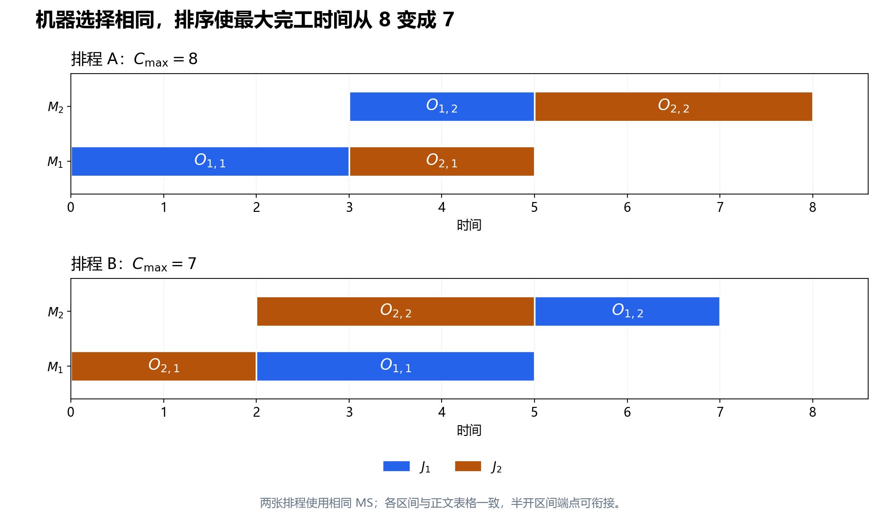

# 第 14 节：发展脉络回顾与 FJSP 扩展

状态：本轮审校完成，待用户 review。 
本节目标：把前十三节的方法放回各自解决的困难中，理解它们如何组合；再从固定机器 JSSP 过渡到 FJSP，分清机器选择、排序、解码、邻域与下界需要怎样变化。

前置：[第 13 节：标准数据集与可复现实验](13_标准数据集与可复现实验.md)。本节先回顾经典 JSSP，再讨论标准、静态、确定性、不可抢占、单目标 FJSP；没有增加运输、换型、工人、机器故障或动态到达。

## 14.1 学过的算法，分别在解决哪一个困难？

前面的学习顺序是“定义 → 图 → 解码 → 关键结构 → 搜索 → 分解与证明 → 多解协作 → 实验”。这便于理解，但不是算法史上的替代链。精确方法、分解方法和元启发式长期并行发展。

| 遇到的困难 | 前文采用的工具 | 它给出什么，仍留下什么 |
|---|---|---|
| 说不清什么是合法排程 | 问题定义、工艺约束、机器互斥 | 给出可行性标准，尚未决定机器顺序 |
| 时间变量太多，约束关系看不清 | 析取图、机器队列 | 把冲突转成方向选择，仍需避免环 |
| 已给定顺序，不知道如何评价 | 拓扑排序、最长路 decoder | 给出该顺序的最早排程，不负责寻找最好顺序 |
| 不知道该改哪一处 | 关键路径、head/tail、关键块、N5 | 提供有结构的候选，候选不保证改善 |
| 没有可用起点 | 派工规则与构造启发式 | 快速得到可行解，质量仍需改进 |
| 下降停在局部最优 | SA、TS、多起点、扰动 | 提供跨平台或离开局部区域的机制，不自动证明最优 |
| 全部机器一起搜索太难 | Shifting Bottleneck | 用单机子问题逐步定序并重优化，仍有子问题与固定决策的限制 |
| 需要说明离最优还有多远 | 下界、B&B、MILP、CP/CP-SAT | 有机会给出证明或全局界，限时可能仍有差距 |
| 多个好解的结构没有被利用 | 优秀解集合、PR、hybrid | 让好解协作，新增维护与评价成本 |
| 不知道收益是否可靠 | 独立校验、重复实验与消融 | 让结果可核对，结论受实例与预算范围限制 |

这里的职责可以组合。例如 TS 可以用构造解初始化、用 N5 产生候选、用最长路评分、从优秀解集合重启；CP 可以给小实例证明，也可以作为 hybrid 的受限修复器。算法名称不同，并不意味着底层表示、评价与可行性检查都要重写。

## 14.2 几篇代表性论文，怎样读才不会误解发展史？

下表年份指可核对的期刊发表年份，只帮助定位代表性工作，**不宣称思想或问题在该年首次出现**。各篇来源与可读范围见 [来源核验记录](assets/14_sources_verified.md)。

| 年份与工作 | 对本套笔记的意义 | 阅读时保留的边界 |
|---|---|---|
| Manne，1960，[On the Job-Shop Scheduling Problem](https://pubsonline.informs.org/doi/10.1287/opre.8.2.219) | 将 JSSP 的工艺限制和设备冲突写成离散线性规划的代表工作 | 摘要也提到更早的相关模型，不能称为整数规划的首次发明 |
| Adams、Balas、Zawack，1988，[Shifting Bottleneck](https://pubsonline.informs.org/doi/10.1287/mnsc.34.3.391) | 逐台识别瓶颈、单机定序，并重优化已排机器 | 分解与搜索可结合，不是“只按负载排机器” |
| Carlier、Pinson，1989，[An Algorithm for Solving the Job-Shop Problem](https://pubsonline.informs.org/doi/10.1287/mnsc.35.2.164) | B&B、单机问题与剪枝协作，说明证明也要利用结构 | 不将当时的计算时间直接与今天程序比较 |
| Brandimarte，1993，[Routing and scheduling in a flexible job shop by tabu search](https://link.springer.com/article/10.1007/BF02023073) | 把 FJSP 的机器分配与其产生的 job-shop 排序子问题联系起来 | 该文的两层策略允许信息交互，不等于一次分配后永不调整 |
| Nowicki、Smutnicki，1996，[A Fast Taboo Search Algorithm for the Job Shop Problem](https://pubsonline.informs.org/doi/10.1287/mnsc.42.6.797) | 利用关键路径与块结构设计快速 TS | 不是所有 TS 都等同于其邻域和记忆规则 |
| Nowicki、Smutnicki，2005，[An Advanced Tabu Search Algorithm for the Job Shop Problem](https://doi.org/10.1007/s10951-005-6364-5) | 在 JSSP 中结合 Big Valley 动机、PR 元素与邻域性质 | 不能由摘要补出全文的距离、参数和可行性细节 |

这些工作交叉覆盖“表示、结构、记忆、分解、证明和多解信息”。不要得出“有了 TS，精确方法就不需要了”或“CP-SAT 能建模，就不必研究 decoder”的结论。要看当前任务需要什么：短时高质量可行解、最优性证据、复杂约束扩展，还是一套可解释的学习实现。

## 14.3 FJSP 增加了什么决策？

JSSP 中每道工序的机器 $\mu_{j,k}$ 已给定，加工时间 $p_{j,k}$ 也固定。**柔性作业车间调度**（Flexible Job Shop Scheduling Problem, FJSP）允许一道工序在若干候选机器中选择一台。

令 $\mathcal M_{j,k}$ 为 $O_{j,k}$ 的非空可选机器集合，$a_{j,k}\in\mathcal M_{j,k}$ 为实际选择；$p_{j,k,r}>0$ 表示该工序选择 $M_r$ 时的加工时间。于是：

$$
c_{j,k}=s_{j,k}+p_{j,k,r}
\quad\text{当 }a_{j,k}=M_r.
$$

工艺链仍满足 $c_{j,k}\leq s_{j,k+1}$；实际选择同一机器的工序仍不能重叠。每道工序必须 **选且只选一台机器**，并在其上连续完成，不能把一个加工任务拆到几台机器上同时做。

现在需要共同决定：每道工序去哪里、同机工序如何排序，以及这些决策下何时开始。固定机器选择以后，只消去了第一层选择，仍没有自动得到合法或优质的排序。

若所有 $\mathcal M_{j,k}$ 都是单例，且其他假设与目标保持一致，FJSP 就退化为固定机器 JSSP。一般固定 MS 后得到的 JSSP 子问题可能让一个 job 多次访问同一机器；前文的 DAG 解码可以处理这种重入，但某些“每个 job 每台机器只访问一次”的数据格式与专门邻域性质需要重新核对。

## 14.4 用学习计划中的 2×2 例子分开观察两层决策

为了与下一阶段衔接，改用 [FJSP 学习路线计划书](https://github.com/fengmaker/my-website/blob/main/Heuristic/fjsp_learning/plans/FJSP学习路线计划书.md)中的小实例。此处两台机器，两个 job，每个 job 两道工序：

| Job | 工序 | 可选机器与加工时间 |
|---|---|---|
| $J_1$ | $O_{1,1}$ | $M_1:3$，$M_2:5$ |
| $J_1$ | $O_{1,2}$ | $M_2:2$ |
| $J_2$ | $O_{2,1}$ | $M_1:2$，$M_2:4$ |
| $J_2$ | $O_{2,2}$ | $M_1:4$，$M_2:3$ |

先固定选择：$O_{1,1},O_{2,1}$ 去 $M_1$，$O_{1,2},O_{2,2}$ 去 $M_2$。机器选择相同，排序不同，得到：

| 排程 | $M_1$ 区间 | $M_2$ 区间 | $C_{\max}$ |
|---|---|---|---:|
| A | $O_{1,1}:[0,3)$，$O_{2,1}:[3,5)$ | $O_{1,2}:[3,5)$，$O_{2,2}:[5,8)$ | 8 |
| B | $O_{2,1}:[0,2)$，$O_{1,1}:[2,5)$ | $O_{2,2}:[2,5)$，$O_{1,2}:[5,7)$ | 7 |

两张排程都满足工艺链和机器互斥；它们说明机器分配不能替代排序。若只说“每道工序都选最快机器”，这两张排程的选择完全相同，仍无法知道最后得到 7 还是 8。

图 14-1：这是上述两个可行排程的过程对照，不是算法成绩。颜色表示 job，标注表示工序；图中没有换型或运输时间。

本例还可以手工证明全局最优值为 7。假设存在 $C_{\max}<7$ 的排程：$O_{1,1}$ 不能选 $M_2$，否则它与后续 $O_{1,2}$ 的工艺链至少长 $5+2=7$；$O_{2,1}$ 也不能选 $M_2$，否则与后续工序的最短链长至少为 $4+3=7$。所以两道首工序都必须去 $M_1$。

若 $O_{1,1}$ 在前，$O_{2,1}$ 最早在 5 完成，后续至少再做 3，完工不早于 8；若 $O_{2,1}$ 在前，$O_{1,1}$ 最早在 5 完成，后续再做 2，完工不早于 7。两种顺序都与 $C_{\max}<7$ 矛盾。排程 B 达到 7，因此最优值为 7。

附带脚本还枚举全部机器分配与机器队列，交叉核对这个手算结果。

## 14.5 为什么“每道工序选最快机器”可能很差？

再用一个只研究机器选择的反例：三个 job 各只有一道工序，每道都可选 $M_1:2$ 或 $M_2:3$。

若全选最快的 $M_1$，三道工序串行，总时间为 $2+2+2=6$。若两道放 $M_1$、一道放 $M_2$，两台机器从 0 并行工作，完工时间为 $\max(4,3)=4$。

这里的取舍是 **单工序加工快** 与 **整体资源分担**。慢一点的机器可以分流拥堵，使最大完工时间缩短。一般 FJSP 还受工艺链影响：机器的当前空闲、前序完成时刻和后续等待共同决定一次选择的效果，不能只比较加工时长。

这不表示永远应该均衡负载。为均衡而把一道关键工序放到极慢机器上，也可能拉长工艺链；机器负载、工艺长度和实际可开始时刻都要一起评价。

## 14.6 OS/MS 编码怎样接上 decoder？

本轮先用两部分表达：

- **MS**（machine selection，机器选择）：按固定全局工序编号保存 $a_{j,k}$。它始终对应具体工序，不能随 OS 位置一起挪动。
- **OS**（operation sequence，工序优先序）：保存 job 符号。$J_j$ 有 $n_j$ 道工序就出现 $n_j$ 次，第 $k$ 次出现解释为 $O_{j,k}$。

对 14.4 的例子，固定工序编号顺序为 $O_{1,1},O_{1,2},O_{2,1},O_{2,2}$，选取 MS 对应 $M_1,M_2,M_1,M_2$。取：

$$
\mathrm{OS}=(J_2,J_1,J_2,J_1)
\quad\Longrightarrow\quad
(O_{2,1},O_{1,1},O_{2,2},O_{1,2}).
$$

OS 是 decoder 处理工序的优先次序，不是全车间按真实开始时间排序的时间表；不同机器可以并行。

尾部追加 decoder 维护 job 就绪时刻 $R_j$ 与机器尾部时刻 $A_r$，初值都为 0。处理当前工序 $O_{j,k}$ 时，若 MS 选 $M_r$，则：

$$
s_{j,k}=\max(R_j,A_r),\qquad
c_{j,k}=s_{j,k}+p_{j,k,r}.
$$

之后令 $R_j=c_{j,k}$、$A_r=c_{j,k}$。按上面的 OS 手算：

| 处理次序 | 工序与机器 | 开始时刻的计算 | 区间 |
|---|---|---|---|
| 1 | $O_{2,1}$，$M_1$ | $\max(0,0)=0$ | $[0,2)$ |
| 2 | $O_{1,1}$，$M_1$ | $\max(0,2)=2$ | $[2,5)$ |
| 3 | $O_{2,2}$，$M_2$ | $\max(2,0)=2$ | $[2,5)$ |
| 4 | $O_{1,2}$，$M_2$ | $\max(5,5)=5$ | $[5,7)$ |

这正好生成排程 B。OS 改为 $(J_1,J_2,J_1,J_2)$，同一 MS 则生成排程 A。一般实例还可实现空隙插入 decoder；它要检查整段加工能否放入空隙，插入后实际机器顺序也可能与 OS 的处理次序不同。

OS 计数正确、MS 选择合法时，尾部追加版在当前标准假设下可构造合法排程：每次等 job 前序完成，又追加在指定机器已有尾部之后。因此它适合先建立可靠基线。若增加日历、共享资源或换型约束，这个两数组递推就不足够。

## 14.7 固定 MS 与机器顺序后，哪些图结构仍然成立？

固定 MS 后，每个节点的实际机器与时长都确定了。再确定各机器队列，加工艺弧和相邻机器弧；在正加工时间、标准约束下，仍然需要无环，仍可用拓扑序最长路计算最早排程。

此时第 3、4 节的 head、tail、松弛量和关键路径计算可以沿用，但节点权重要改成实际选中机器的 $p_{j,k,r}$。这些结论是 **给定 MS 和机器顺序条件下** 的结构分析。

| JSSP 部件 | 迁移到 FJSP 时怎样处理 |
|---|---|
| Job 工艺弧 | 标准 FJSP 工艺链仍固定，可保留 |
| 节点加工时间 | 从固定 $p_{j,k}$ 改为所选机器上的 $p_{j,k,r}$ |
| 同机冲突集合 | 根据当前 MS 重新构造，换机后集合会变化 |
| DAG 最长路与关键路径 | 固定分配和队列后可沿用，换机或换序后重算 |
| 机器队列交换 | 仍需可行性与目标评价，原邻域定理核对适用条件 |
| 原 N5 | 只覆盖部分同机排序移动，不能表达全部换机选择 |
| 机器顺序距离 | 两个 MS 不同时，同机工序对集合改变，不能直接套第 12 节公式 |

对换机移动，不能只修改节点的机器标签：该工序要从旧机器队列移除，再插入新机器的某个位置，同时更新时长与相邻关系。只在新机器上“随便接一条边”可能造成环或漏掉资源冲突。

若用 OS/MS + decoder，则可以先修改编码，再完整解码，避免手工增量维护队列的复杂性。其代价是重解码较多，但第一版更容易核验。

## 14.8 FJSP 的邻域至少要覆盖两类决策

| 邻域 | 改动 | 必须保持什么 |
|---|---|---|
| MS-change | 为一条固定身份的工序换合法机器 | 仍选且只选一个选项，并更新加工时长 |
| OS-swap | 交换 OS 中两个不同 job 的位置 | 每个 job 的出现次数不变 |
| OS-insert | 移出一个 job 符号，再插入另一位置 | 每个 job 的出现次数不变，解释实际工序时重算出现次序 |

每次改动都重新解码，再按第 13 节的协议比较。OS 中两处相同 job 符号交换是空操作，应跳过。即使不同符号交换后，decoder 也可能得到同一机器顺序和目标值，不应把“编码变了”自动当成“排程结构改变了”。

最容易出错的是把 OS 某个位置永久当作具体工序。例如 $(J_2,J_1,J_2,J_1)$ 的第 3 位表示 $O_{2,2}$；改序后，第 3 位可能属于另一个 job。MS 要通过固定工序身份取值，不能通过当前 OS 位置直接取第 3 个 MS 元素。

关键路径可以用来增加选中某些工序的概率，但换机后关键路径可能改变，不能保证旧关键工序换机一定改善。SA、TS 的接受与记忆机制可以沿用，具体移动属性、delta 分布、温度尺度和 tenure 则应重新设计或调参。

## 14.9 下界迁移时，为什么固定分配负载最容易被误用？

固定 MS 为 $a$ 时，令：

$$
L_r(a)=\sum_{(j,k):a_{j,k}=M_r}p_{j,k,r}.
$$

则 $\max_rL_r(a)$ 是 **该固定分配子问题** 的下界。若允许换机器，它可能大于另一种分配的最优值；14.5 中全部选 $M_1$ 时负载为 6，而另一个合法分配的排程只要 4。因此 6 不是该 FJSP 的全局下界。

写成最优值更清楚。令 $C^*(a)$ 为固定分配 $a$ 后的最优值，则：

$$
\mathrm{OPT}_{\mathrm{FJSP}}=\min_a C^*(a),\qquad
\max_rL_r(a)\leq C^*(a).
$$

后一条只约束一个 $a$，不能推出 $\max_rL_r(a)\leq\mathrm{OPT}_{\mathrm{FJSP}}$。相反，固定任意合法分配得到的完整可行排程，仍是整个 FJSP 的可行解，因此其 $C_{\max}$ 给出全局上界。

入门时可用每道工序的最短可选时间：

$$
p_{j,k}^{\min}=\min_{M_r\in\mathcal M_{j,k}}p_{j,k,r}.
$$

由工艺链得到全局下界：

$$
\mathrm{LB}_{\mathrm{job}}=\max_j\sum_kp_{j,k}^{\min}.
$$

若有 $m$ 台机器、整数加工时间，再由总工作量与总容量得到：

$$
\mathrm{LB}_{\mathrm{work}}=
\left\lceil\frac{\sum_{j,k}p_{j,k}^{\min}}{m}\right\rceil.
$$

理由是任意合法选择的总加工量不小于分子，而长度为 $C_{\max}$ 的时间内，$m$ 台机器总共至多提供 $mC_{\max}$ 的加工容量。整数最优值允许向上取整；连续非整数时间模型保留未取整的下界。

两者取最大值仍是有效全局下界。它们忽略候选机器限制与工序之间的等待，可能很弱。对 14.4 的 2×2 例子，job 最短链都是 5，总最短加工量为 $3+2+2+3=10$，故两者均给 5，而最优值是 7。下界没有闭合，不代表算法错了。

## 14.10 CP-SAT 如何表达“选一台机器”？

第 11 节的 JSSP 区间长度固定、机器固定。FJSP 可为每个工序选项引入 presence 布尔变量 $x_{j,k,r}$：选该机器为 1，否则为 0，并要求：

$$
\sum_{M_r\in\mathcal M_{j,k}}x_{j,k,r}=1.
$$

每个选项建立固定长度 $p_{j,k,r}$ 的 **可选区间**（optional interval）。它仅在相应 $x_{j,k,r}=1$ 时占用资源；将各选项放入其候选机器的 NoOverlap 集合，同机已选区间就不能重叠。

工序还需一套代表真正被选加工的主开始/结束变量。被选选项的起止时间和时长要通过条件约束与主工序同步，job precedence 则连接主工序：

$$
c_{j,k}\leq s_{j,k+1}.
$$

只加“恰选一个”却忘记同步，会导致机器上加工的区间与 job 工艺约束中的时间不是同一段，模型可能错误地绕过约束。

[OR-Tools 官方 FJSP 示例](https://github.com/google/or-tools/blob/stable/examples/python/flexible_job_shop_sat.py)采用主工序变量、选项 presence、optional interval、选中时条件同步、机器 NoOverlap 和 makespan 目标的结构。官方示例的选项二元组顺序是 `(processing_time, machine_id)`，与学习项目内部建议的 `(machine, duration)` 不同，适配时显式转换。

后续先用 14.4 的已证最优值 7 核对模型，将导出排程交给独立 validator，再检查求解状态、bound 与停止条件。

## 14.11 接下来先实现什么？

完整五周安排见 [FJSP 学习路线计划书](https://github.com/fengmaker/my-website/blob/main/Heuristic/fjsp_learning/plans/FJSP学习路线计划书.md)。完成这套 JSSP 笔记以后，不需要先把所有 JSSP 高级算法实现一遍才能开始 FJSP。

建议按可验收结果推进：

1. 实现统一实例结构、明确格式的 parser、输出排程与独立 validator；先拒绝故意构造的坏排程。
2. 用 14.4 的例子实现 OS/MS 和尾部追加 decoder，逐行核对区间，再增加空隙插入与 Greedy。
3. 用 CP-SAT 对微型实例建立另一条建模核对路径，区分可行结果和最优性证明。
4. 实现 MS-change、OS-swap、OS-insert 与多起点 LS；确认每次输出合法。
5. 接入基本 SA，记录 current、best、种子、预算和收敛日志；先保证算法正确，再尝试关键工序偏置。
6. 按第 13 节的方法核对标准 FJSP 数据与参考快照，做重复、同预算实验并写报告。

第 12 节的集合和 PR、第 9 节的 TS、第 10 节的分解都可以在这个闭环之后选修。先找到日志里明确的瓶颈，再决定增加哪个部件；例如 decoder 占绝大多数时间时，先测量和优化评价路径，而不是直接叠加另一种元启发式。

## 14.12 易错点

| 容易混淆的地方 | 应采用的理解 |
|---|---|
| 学习目录就是算法史 | 它按理解顺序组织，历史是多条方法线并行 |
| 固定 MS 就完成排程 | 仍需同机排序与时间安排 |
| FJSP 允许一工序同时用多台机器 | 本节标准模型每道工序恰选一台、不可拆分 |
| MS 按 OS 当前位置索引 | MS 按固定工序身份索引，OS 出现次序重新解释 |
| 换机只改机器编号 | 还要改时长、机器成员与队列关系，重新解码 |
| JSSP 的 N5 已覆盖整个 FJSP | 它不覆盖机器选择，适用条件需重新核对 |
| 固定 MS 的负载是全局 LB | 它只给该分配子问题的下界 |
| CP 子问题最优就是 FJSP 最优 | 看被固定的决策及界的作用范围 |

## 14.13 自检题

1. 在哪些条件下，FJSP 退化为本套笔记的 JSSP？
2. 14.4 的 A、B 是否使用相同机器分配？为什么 $C_{\max}$ 不同？
3. 若假设该例 $C_{\max}<7$，为什么两道首工序都只能去 $M_1$？随后两种机器顺序分别导致什么下限？
4. 14.5 中全选最快机器得到多少？分流后可得到多少？它反驳了哪个全局下界的误用？
5. OS 第三位为什么不能永久指向同一工序？MS 应怎样关联工序？
6. 固定 MS 和机器队列后，最长路解码还需要哪些假设？
7. 14.4 的两个入门全局下界是多少？能否仅据此证明最优值为 7？
8. CP-SAT 只加入恰选一个和 NoOverlap，却没有同步选项时间与主工序时间，会有什么问题？

### 参考答案

1. 每道工序可选集为单例，工艺链、时长、不可抢占、机器独占和 makespan 目标等其余假设一致。
2. 相同。两台机器的工序先后关系不同，改变了前序等待与末尾完成时间，分别得到 8 和 7。
3. $O_{1,1}$ 若去 $M_2$，自身及后序总长至少 7；$O_{2,1}$ 若去 $M_2$，其最短 job 链也至少 7。都去 $M_1$ 后，$O_{1,1}$ 在前导致至少 8，$O_{2,1}$ 在前导致至少 7，均矛盾。
4. 全选 $M_1$ 得 6；两道去 $M_1$、一道去 $M_2$ 得 4。因此某一固定 MS 的最大机器负载 6 不是整个 FJSP 的全局下界。
5. OS 用某 job 的第几次出现解释工序，改序后位置含义可能改变。MS 通过固定的全局工序编号关联具体 $O_{j,k}$。
6. 所选时长固定且为正，标准工艺先后和同机互斥完整建入图，机器顺序图无环；没有未处理的额外资源、日历或换型限制。
7. job 下界 5，总工作量下界 $\lceil10/2\rceil=5$，合并仍为 5。不能仅据此证明 7；14.4 另有排除小于 7 的完整论证。
8. 机器上占用的加工区间可能与工艺链使用的时间变量脱节，得到对真实问题不合法的“解”。

## 14.14 复习速记卡

| 要立即想起的问题 | 本节要点 |
|---|---|
| 各类方法怎样组织？ | 表示、评价、结构、搜索控制、分解、证明、实验各有职责 |
| FJSP 多了什么？ | 每道工序选机器，加工时间可随机器变化 |
| 固定 MS 后剩下什么？ | 固定路线的 JSSP 排序子问题，可能有重入 |
| 第一版编码？ | MS 按工序身份，OS 按 job 出现次序解释 |
| 哪些图工具可迁移？ | 固定 MS 与队列后，判环、最长路、head/tail 和关键路径 |
| 哪些必须重新设计？ | 换机邻域、冲突集合、跨分配距离、全局下界与部分邻域性质 |
| 近期完成标准？ | 正确求解流程、独立校验、小实例对照与同预算重复实验 |

后续入口：[FJSP 学习路线计划书](https://github.com/fengmaker/my-website/blob/main/Heuristic/fjsp_learning/plans/FJSP学习路线计划书.md)。全套章节与各节 review 状态见 [专题目录](./index.md)。

审校与核算范围见 [全套审校记录](assets/01_14_review.md)。
