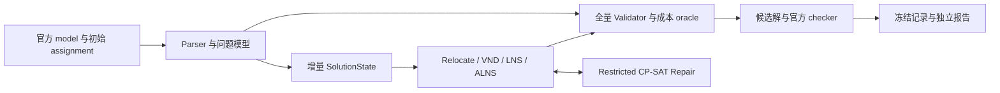
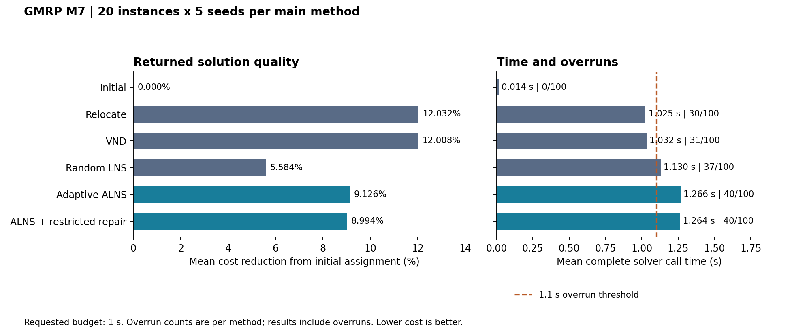

---
tags:
  - GMRP
  - ALNS
  - CP-SAT
  - 实验结果
  - 工程实现
search:
  boost: 2
---

# GMRP-ALNS：机器重分配与短预算实验

**已完成：v1.0.0 研究发布，M0～M8。** 面向 ROADEF/EURO Challenge 2012 的 Machine Reassignment Problem，完成解析器、独立全量校验、增量状态、局部搜索、ALNS 与受限 CP-SAT 修复，并建立冻结协议、原始记录与报告再生流程。

[GitHub 仓库](https://github.com/fengmaker/GMRP-ALNS) · [结果观察表](../../assets/projects/gmrp/m7-observations.csv) · [主方法汇总](../../assets/projects/gmrp/m7-methods.csv) · [来源与 SHA-256](../../assets/projects/provenance.json)

本页整理本人项目已经完成的归档实测，核查日期为 2026-10-11。本次建站核对记录和哈希、重新汇总并作图，没有重跑求解器。材料核查采用本人本地仓库快照 `0ce7fd206124`，源码现已公开。M7 实验源码冻结于 `ee29875c39c1`，与后续文档快照分别记录。

## 问题与实现

为每个进程选择最终机器，同时满足机器资源容量、同服务进程不得同机、服务的最小 location 覆盖、neighborhood 服务依赖，以及 transient resource 在迁出和迁入机器上的双端占用。

目标为 load、balance、process move、service move、machine move 五类加权成本之和。其中 service move 使用各服务搬迁进程数的最大值，不能替换成所有服务搬迁数的总和。



增量引擎维护移动的目标变化与状态回滚，全量 oracle 负责搜索输出的最终裁决。Restricted Repair 冻结大部分 assignment，只联合优化选中进程的有限机器域；M7 采用单 CP-SAT worker、最多 100 个分配变量和 0.05 秒局部求解上限，只有经验证的严格改进才写回。

附属 GAP 模块实现经典 Generalized Assignment Problem 的精确与启发式基线；`gap1` 五个参考最优值的复现属于 GAP 验证，不是 GMRP 竞赛实例的最优性证明。v1.0.0 发布审计记录 61 个测试通过、82% 行覆盖率，以及 Ruff、严格 mypy 检查通过。

## M7 冻结实验

| 项目 | 协议 |
| --- | --- |
| 数据 | 20 个 ROADEF A/B 实例；A1/A2 各 5 个，B 组 10 个 |
| 主矩阵 | 6 个方法 × 20 实例 × 5 种子 = 600 次 |
| 额外消融 | 3 个变体 × 4 个预声明实例 × 5 种子 = 60 次 |
| 随机种子 | `7, 42, 101, 202, 303` |
| 请求预算 | 每次完整 solver call 请求 1 秒；超过 1.1 秒记为超容差 |
| 环境 | Windows 11，Python 3.12.4，8 物理核 / 16 逻辑核，约 15.25 GiB RAM；串行实验 |
| 依赖与线程 | OR-Tools 9.15.6755；数值库线程、CP-SAT worker、同时运行的实验进程均为 1 |
| 输出验证 | 归档中的 660 条记录均为 `ok`，全量 Validator 与官方 checker 回执一致 |

改善率按每次观察计算后等权平均：

$$
\text{improvement}(\%)=100\frac{C_{\mathrm{initial}}-C_{\mathrm{returned}}}{C_{\mathrm{initial}}}.
$$

它衡量相对初始 assignment 的改善，不是相对竞赛最好已知值的 Gap。下表每个方法均为 100 次观察，包含超时后返回的结果。

| 主方法 | 平均改善率 | 平均 solver call / 秒 | 超 1.1 秒次数 |
| --- | ---: | ---: | ---: |
| Initial | 0.000% | 0.014 | 0 / 100 |
| Relocate | 12.032% | 1.025 | 30 / 100 |
| VND | 12.008% | 1.032 | 31 / 100 |
| Random LNS | 5.584% | 1.130 | 37 / 100 |
| Adaptive ALNS | 9.126% | 1.266 | 40 / 100 |
| ALNS + Restricted Repair | 8.994% | 1.264 | 40 / 100 |



数据：由[660 条观察投影](../../assets/projects/gmrp/m7-observations.csv)重算；[原归档逐实例汇总](../../assets/projects/gmrp/m7-summary.csv)保留实例、方法和预算。左图为平均成本改善，右图标签为平均时间及超容差次数；不是严格一秒内的排名。

## 结论与边界

**在这组一秒请求预算下，简单 Relocate / VND 的返回解优于更复杂的 ALNS。** Restricted Repair 相对 ALNS 的平均收益约为 -0.131 个百分点，未带来稳定提升。这个负面结果指出了初始化、算子选择与最终全量校验在短预算中的开销，不能外推到更长预算。

- 六方法主矩阵有 178 次超容差，额外消融有 30 次，合计 **208 / 660**。最大完整 solver call 为 2.376 秒；解析和官方校验另计，不属于这“一秒”请求预算。
- A 组改善明显大于 B 组；预声明的 held-out B3～B10 中，ALNS 与 Restricted 的 40 对运行都缺少同时准时的结果，不能称作严格一秒 held-out 比较。
- 禁用重启的消融不能证明重启无效：对应 20 次 ALNS 都没到配置的 200 次迭代触发点。小样本变体结果不作显著性宣称。
- 本轮核对了 660 条记录的签名、checker 回执及成本一致性。归档 JSONL 不包含 assignment 向量，因此没有在本轮独立重放每个解的约束验证；原始运行的官方 checker 通过记录与本轮核对范围分别说明。

## 复现入口

以下命令在对应快照的项目根目录执行，需 Python 3.11+。先安装项目依赖，再运行离线 toy 演示；演示会生成并验证候选解，也检查 GAP toy 的精确最优值。

```powershell
python -m pip install -e ".[dev,experiments]"
python scripts/demo.py
```

只重建已归档 M7 报告，不重跑求解器、不需要官方原始实例或 checker：

```powershell
python -m gmrp_alns.experiments report results/m7 results/report/m7-regen
```

完整重跑需要按原项目说明准备官方 model、初始 assignment 与未修改 checker，然后在新输出目录冻结协议并执行。正式比较应对齐 manifest 中的解释器、依赖、输入和源码哈希，而不是仅安装一个名称相同的包。

??? note "完整 M7 运行命令"

    在项目根目录、官方文件已就位的前提下：

    ```powershell
    python -m gmrp_alns.experiments freeze configs/m7_benchmark.json results/runs/m7-local --checker data/raw/roadef/checker/solution_checker.exe
    python -m gmrp_alns.experiments run results/runs/m7-local --instances a1_1
    python -m gmrp_alns.experiments run results/runs/m7-local
    python -m gmrp_alns.experiments report results/runs/m7-local results/report/m7-local
    ```

核查来源：[M7 协议与验证记录](https://github.com/fengmaker/GMRP-ALNS/blob/0ce7fd2061240144d9430d417070fe8951de7113/docs/m7_verification.md)、[发布审计](https://github.com/fengmaker/GMRP-ALNS/blob/0ce7fd2061240144d9430d417070fe8951de7113/docs/release_audit_v1.0.0.md)、[复现说明](https://github.com/fengmaker/GMRP-ALNS/blob/0ce7fd2061240144d9430d417070fe8951de7113/docs/reproducibility.md)。本站[来源清单](../../assets/projects/provenance.json)保留固定版本和原文件哈希。返回[个人作品集](index.md)，方法基础见[通用启发式搜索](../求解算法体系/通用启发式搜索.md)与 [CP-SAT 建模入门](../求解算法体系/CP-SAT建模入门.md)。
