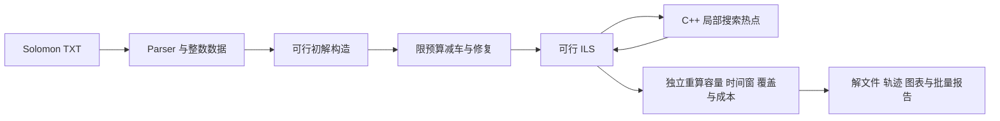
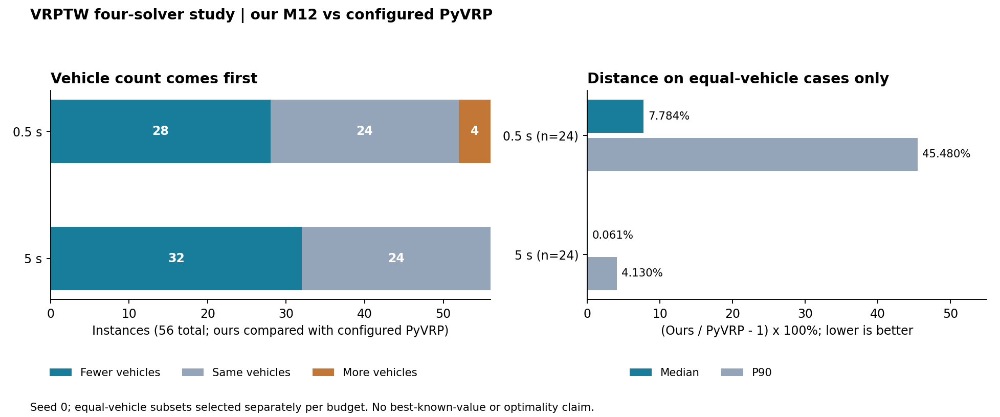
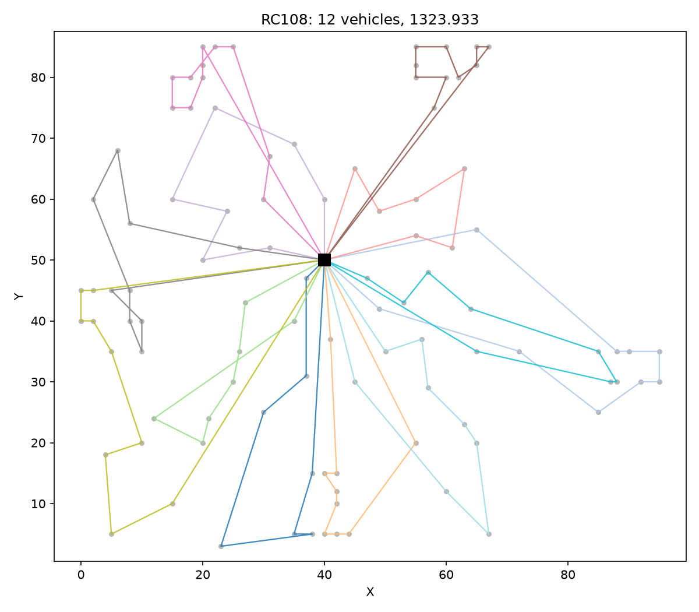
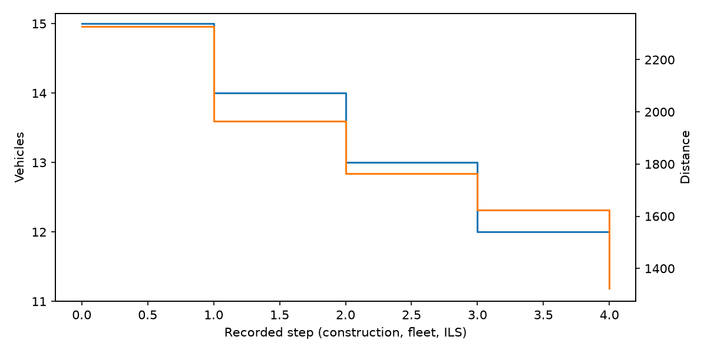

---
tags:
  - VRPTW
  - 启发式算法
  - 实验结果
  - 工程实现
search:
  boost: 2
---

# VRPTW Solver：从独立校验到原生局部搜索

**已完成：M0～M12。** 为标准 Solomon VRPTW 实现解析与独立验证、可行构造、限预算减车、局部搜索、ILS、批量报告、分阶段诊断和 C++17 / pybind11 热点后端。求解运行不依赖 PyVRP；PyVRP、OR-Tools 和 Gurobi 用作独立实验对照。

[GitHub 仓库](https://github.com/fengmaker/vrptw_slover) · [固定版本 README](https://github.com/fengmaker/vrptw_slover/blob/9fe59ad51b9533f00bb8efe097143ad0fa5ba8ef/README.md) · [四方汇总 CSV](../../assets/projects/vrptw/four-solver-summary.csv) · [逐次记录 CSV](../../assets/projects/vrptw/four-solver-runs.csv)

本页整理本人已完成项目的归档实测，固定版本为 `9fe59ad51b95`（2026-10-09），核查日期为 2026-10-11。本次建站重新汇总 448 条主实验记录并作图，没有重跑求解器。原[ALNS 开发方案](../路径规划/VRPTW/研究方案.md)保留为早期设计稿，当前实际实现以可行 ILS 与原生局部搜索为主。

## 模型与工程实现

每位客户访问一次，车辆从仓库出发并返回，满足容量、服务时间窗和仓库时间限制；允许早到等待。目标按 **车辆数优先、距离次优** 比较。四方实验共用 `round(1000 * hypot(dx, dy))` 整数距离矩阵，时间窗和服务时长也按千分位整数表达。



高层构造、减车和修复保留在 Python；原生扩展加速候选枚举、筛选与移动应用。四方实验使用默认 `relocate`、`swap`、`two_opt`、`two_opt_star` 四算子轮换，不是七算子全部开启。M11 的可选不可行搜索默认关闭；没有构建扩展时普通 CLI 可回退 Python，但复现下面的 M12 对照必须明确使用 native 后端。

M12 归档报告记录 348 项测试通过、912 条自研完整解独立重验、最终默认 CLI 批次 168/168 可行。这些是原项目迁移验收记录；本轮网站构建测试与它们分别统计。[M12 验收报告](https://github.com/fengmaker/vrptw_slover/blob/9fe59ad51b9533f00bb8efe097143ad0fa5ba8ef/benchmarks/M12_REPORT.md)

## 四求解器短预算实验

| 项目 | 协议 |
| --- | --- |
| 数据 | 56 个 Solomon 100 客户实例，覆盖 C / R / RC |
| 矩阵 | 56 实例 × 2 预算 × 4 求解器 × 1 种子 = 448 次主实验调用 |
| 预算与种子 | 0.5 秒、5 秒；`seed=0` |
| 启动与目标 | 每例独立冷启动，不传参考路线；使用原始车辆上限，车辆数后距离 |
| 时间边界 | 求解调用包含初解构造；外部建模单列，输入读取、导入、进程启动、写报告排除 |
| 环境 | Windows x64，Ryzen 7 6800H，8 核 / 16 线程；搜索单线程、轮换次序串行运行 |
| 解释器与版本 | 自研 / OR-Tools / Gurobi：CPython 3.12.4；PyVRP：CPython 3.13.5、本地 0.13.0a0；OR-Tools 9.15.6755；Gurobi 13.0.0 |

四个常驻 worker 避免反复导入开销，搜索仍为每例冷启动。PyVRP 使用支配距离的车辆固定成本，未调用独立的 `minimise_fleet()`；OR-Tools 使用插入构造 + GLS；Gurobi 使用项目自写的二下标弧 MILP。成绩反映这些实现、版本与参数，不代表各库的最佳可能水平。[完整协议](https://github.com/fengmaker/vrptw_slover/blob/9fe59ad51b9533f00bb8efe097143ad0fa5ba8ef/benchmarks/four_solver/README.md)

### 主表

| 预算 / 秒 | 求解器 | 返回完整可行解 | 总车辆 | 对 PyVRP 少 / 同 / 多车 | 同车样本 n | 距离 Gap 中位数 / P90 |
| --- | --- | ---: | ---: | --- | ---: | --- |
| 0.5 | 自研 M12 | 56 / 56 | 454 | 28 / 24 / 4 | 24 | 7.7841% / 45.4805% |
| 0.5 | PyVRP | 56 / 56 | 490 | 基准 | — | — |
| 0.5 | OR-Tools | 56 / 56 | 463 | 24 / 28 / 4 | 28 | 1.5331% / 9.3252% |
| 0.5 | Gurobi MILP | 27 / 56 | — | 1 / 1 / 25 | 1 | 0.0000% / 0.0000% |
| 5 | 自研 M12 | 56 / 56 | 443 | 32 / 24 / 0 | 24 | 0.0608% / 4.1299% |
| 5 | PyVRP | 56 / 56 | 490 | 基准 | — | — |
| 5 | OR-Tools | 56 / 56 | 447 | 33 / 23 / 0 | 23 | 0.0000% / 3.9338% |
| 5 | Gurobi MILP | 54 / 56 | — | 5 / 3 / 46 | 3 | 0.0000% / 6.0525% |

只在两方车数相同时计算：

$$
\text{distance gap}(\%)=100\left(\frac{D_{\mathrm{solver}}}{D_{\mathrm{PyVRP}}}-1\right).
$$

正值表示更长。不是相对 BKS 的差距，也不是已证明的最优性 Gap；不同车数不计算距离 Gap。总车辆只在 56 例全部可行时填写，Gurobi 的少 / 同 / 多车只比较共同可行集合，缺解不记作其他算法质量胜出。



同车数子集按每档预算分别选择，本次均为 24 例，但不因此视为相同实例集合。图表依据[四方原汇总](../../assets/projects/vrptw/four-solver-summary.csv)和[448 条记录投影](../../assets/projects/vrptw/four-solver-runs.csv)，与[固定版本实验报告](https://github.com/fengmaker/vrptw_slover/blob/9fe59ad51b9533f00bb8efe097143ad0fa5ba8ef/benchmarks/FOUR_SOLVER_REPORT.md)的舍入结果一致。

### 有效改进与限制

- 自研从 0.5 秒增加到 5 秒后，11 例减车、39 例同车距离改善、6 例打平，没有观察到退步。这是单种子、同机这一轮结果，不是随机稳定性结论。
- 5 秒自研相对 OR-Tools 为 8 例少车、43 例同车、5 例多车；同车距离 Gap 中位数约 1.413%。因此不能只凭总车数宣称逐实例全面胜出。
- 主表 PyVRP 在 5 秒时有 55 例与 0.5 秒完全相同，需结合其严格车辆固定成本配置解读；不能将其停滞泛化为 PyVRP 库能力。
- 补充的“固定自研车辆上限、固定成本为 0”的 PyVRP 距离诊断是另一任务，5 秒同车 47 例，Gap 中位数约 7.602%，C103 仍有 46.495% 长尾。它不能替换主表的 24 例同车统计；M12 迁移报告的三种子指标也另属协议。
- Gurobi 5 秒只有 54/56 例返回完整可行解；基本 MTZ 模型的松弛较弱。未找到可行解不等于证明实例不可行，其 bound / MIP Gap 对应含车辆固定成本的标量目标，不是距离 Gap。

实际 5 秒档端到端中位数约为自研 5.0021 秒、PyVRP 5.0072 秒、OR-Tools 5.0062 秒、Gurobi 5.7977 秒；这里包含外部建模和独立验证，仍排除读入、导入与写报告。名义预算与实际返回时间分别记录，不作毫秒级速度排名。

## 输出示例：RC108

以下两图来自 **M12 最终交付、RC108、seed 0、0.5 秒** 的历史归档，结果为 12 车、距离 1323.933；它们不是上述四方主表的 5 秒运行。[原路线图](https://github.com/fengmaker/vrptw_slover/blob/9fe59ad51b9533f00bb8efe097143ad0fa5ba8ef/benchmarks/m12/delivery/RC108/seed-0/routes.png)

{ loading=lazy }

{ loading=lazy }

收敛图横轴是构造、减车和 ILS 的**记录步骤**，不是秒数，也不是统一的 ILS 迭代计数；双纵轴分别为车辆数与距离。

## 运行与复现

项目目录名与 Python 包名不同：命令入口是 `vrptw`。以下从固定快照的仓库根目录执行，未安装包时设置 `PYTHONPATH`。先求解一例，再从原始输入独立验证输出：

```powershell
$env:PYTHONPATH = (Resolve-Path .\src).Path
python -m vrptw solve .\data\C101.txt --seed 0 --time-limit 0.5 --out .\runs\website-C101
python -m vrptw validate .\data\C101.txt .\runs\website-C101\solution.json
```

固定快照的根目录包含 `src/`、`data/`、`benchmarks/`；若本地外层还套有文件夹，先进入这一层。单例命令用于接口验证，不等同于重跑四方实验。

完整四方重跑使用新输出目录：

```powershell
.\benchmarks\four_solver\run.ps1 -Out runs/four_solver_repeat
```

需按[运行说明](https://github.com/fengmaker/vrptw_slover/blob/9fe59ad51b9533f00bb8efe097143ad0fa5ba8ef/benchmarks/four_solver/README.md)准备 native 扩展、本地 PyVRP 构建、对应解释器和 Gurobi 许可证，并显式调整机器上的路径。只重算已保存 CSV 的汇总无需重跑搜索，标准库脚本入口与参数见同一说明；不要以一次新的运行覆盖原始档案。

返回[个人作品集](index.md)，问题模型见 [VRPTW 专题](../路径规划/VRPTW/总笔记.md)，结果来源与文件哈希见[来源清单](../../assets/projects/provenance.json)。
